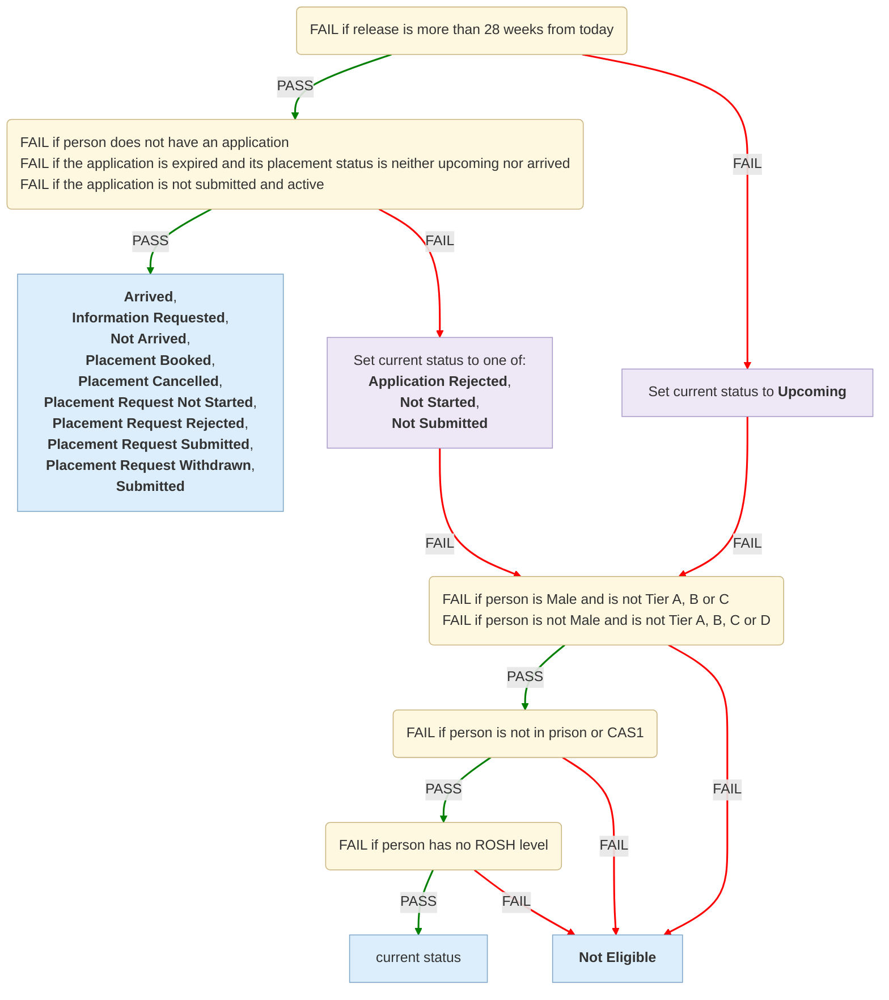
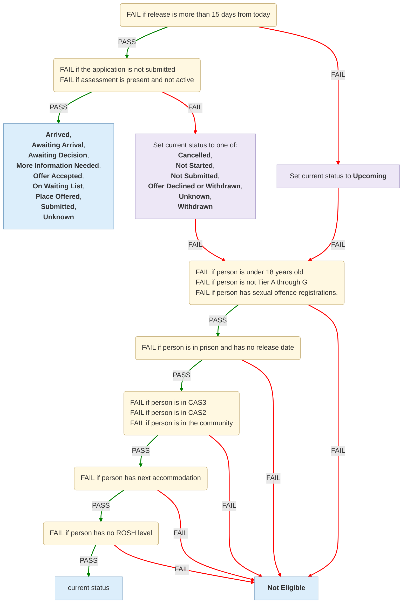
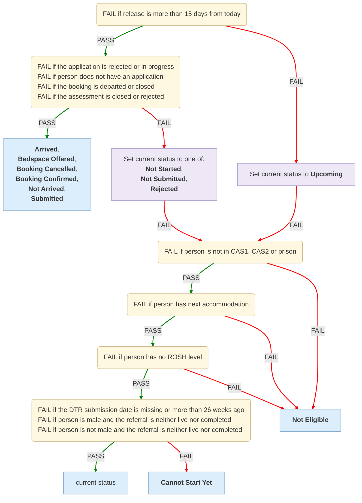
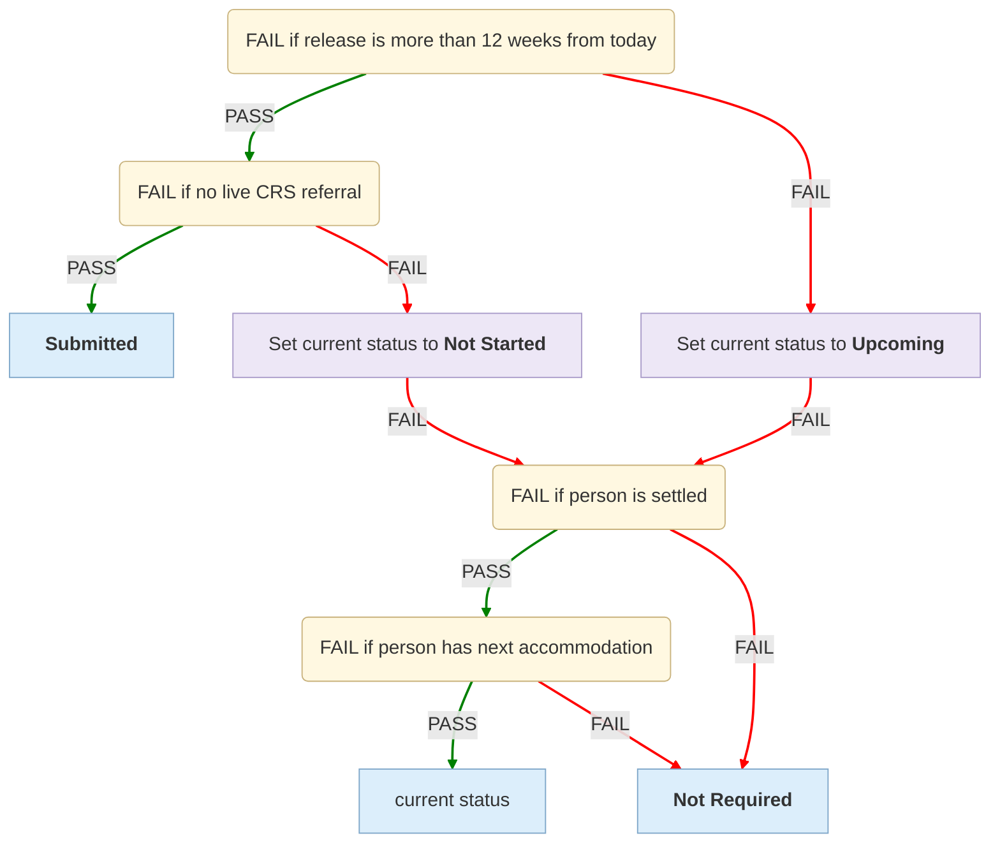
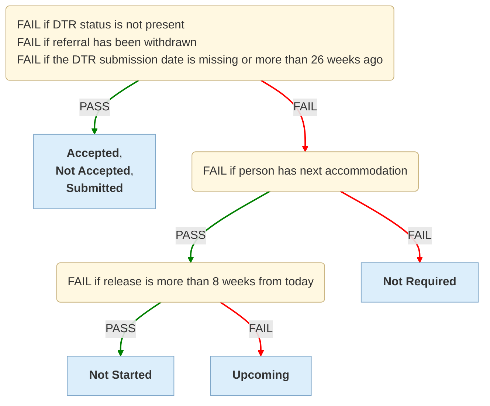
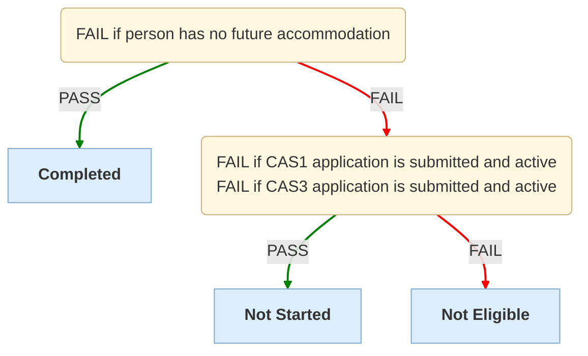

# Eligibility rules graph

Generated by `./gradlew :query:generateEligibilityRulesGraph`. Do not edit by hand.

Diamond RuleSet nodes have a FAIL context updater.

## CAS1

### Nodes

**Upcoming** (RuleSet) `ReleaseWithinTwentyEightWeeksRuleSet`
- [`ReleaseOutsideTwentyEightWeeksRule`](../query/src/main/kotlin/uk/gov/justice/digital/hmpps/singleaccommodationserviceapi/query/eligibility/domain/cas1/upcoming/rules/ReleaseOutsideTwentyEightWeeksRule.kt): FAIL if release is more than 28 weeks from today
- FAIL: [`Cas1UpcomingContextUpdater`](../query/src/main/kotlin/uk/gov/justice/digital/hmpps/singleaccommodationserviceapi/query/eligibility/domain/cas1/upcoming/Cas1UpcomingContextUpdater.kt) - Set current status to Upcoming

| Status | Action | Link type |
| --- | --- | --- |
| CAS1_UPCOMING | START_APPROVED_PREMISE_APPLICATION (CAS1) | - |

**Suitability** (RuleSet) `Cas1RuleSet`
- [`Cas1NotPresentRule`](../query/src/main/kotlin/uk/gov/justice/digital/hmpps/singleaccommodationserviceapi/query/eligibility/domain/cas1/referral/rules/Cas1NotPresentRule.kt): FAIL if person does not have an application
- [`Cas1ExpiredRule`](../query/src/main/kotlin/uk/gov/justice/digital/hmpps/singleaccommodationserviceapi/query/eligibility/domain/cas1/referral/rules/Cas1ExpiredRule.kt): FAIL if the application is expired and its placement status is neither upcoming nor arrived
- [`Cas1NotActiveRule`](../query/src/main/kotlin/uk/gov/justice/digital/hmpps/singleaccommodationserviceapi/query/eligibility/domain/cas1/referral/rules/Cas1NotActiveRule.kt): FAIL if the application is not submitted and active
- PASS: [`Cas1ActiveContextUpdater`](../query/src/main/kotlin/uk/gov/justice/digital/hmpps/singleaccommodationserviceapi/query/eligibility/domain/cas1/referral/Cas1ActiveContextUpdater.kt) - Arrived,
 Information Requested,
 Not Arrived,
 Placement Booked,
 Placement Cancelled,
 Placement Request Not Started,
 Placement Request Rejected,
 Placement Request Submitted,
 Placement Request Withdrawn,
 Submitted

| Status | Action | Link type |
| --- | --- | --- |
| CAS1_ARRIVED | - | CAS1_VIEW_APPLICATION |
| CAS1_NOT_ARRIVED | CREATE_PLACEMENT (CAS1) | CAS1_VIEW_APPLICATION |
| CAS1_PLACEMENT_BOOKED | - | CAS1_VIEW_APPLICATION |
| CAS1_PLACEMENT_CANCELLED | CREATE_PLACEMENT (CAS1) | CAS1_VIEW_APPLICATION |
| CAS1_PLACEMENT_REQUEST_NOT_STARTED | CREATE_PLACEMENT (CAS1) | CAS1_VIEW_APPLICATION |
| CAS1_PLACEMENT_REQUEST_WITHDRAWN | CREATE_PLACEMENT (CAS1) | CAS1_VIEW_APPLICATION |
| CAS1_PLACEMENT_REQUEST_NOT_SUBMITTED | CREATE_PLACEMENT (CAS1) | CAS1_VIEW_APPLICATION |
| CAS1_PLACEMENT_REQUEST_REJECTED | CREATE_PLACEMENT (CAS1) | CAS1_VIEW_APPLICATION |
| CAS1_PLACEMENT_REQUEST_SUBMITTED | - | CAS1_VIEW_APPLICATION |
| CAS1_INFO_REQUESTED | PROVIDE_INFORMATION (CAS1) | CAS1_VIEW_APPLICATION |
| CAS1_SUBMITTED | - | CAS1_VIEW_APPLICATION |
- FAIL: [`Cas1StartContextUpdater`](../query/src/main/kotlin/uk/gov/justice/digital/hmpps/singleaccommodationserviceapi/query/eligibility/domain/cas1/referral/Cas1StartContextUpdater.kt) - Set current status to one of:
Application Rejected,
 Not Started,
 Not Submitted

| Status | Action | Link type |
| --- | --- | --- |
| CAS1_NOT_SUBMITTED | CONTINUE_APPROVED_PREMISE_APPLICATION (CAS1) | CAS1_VIEW_APPLICATION |
| CAS1_APPLICATION_REJECTED | START_APPROVED_PREMISE_APPLICATION (CAS1) | CAS1_START_APPLICATION |
| CAS1_NOT_STARTED | START_APPROVED_PREMISE_APPLICATION (CAS1) | CAS1_START_APPLICATION |

**Arrived, Information Requested, Not Arrived, Placement Booked, Placement Cancelled, Placement Request Not Started, Placement Request Rejected, Placement Request Submitted, Placement Request Withdrawn, Submitted** (Outcome)

**Eligibility Tier** (RuleSet) `TierEligibleForCas1RuleSet`
- [`MaleRiskEligibilityRule`](../query/src/main/kotlin/uk/gov/justice/digital/hmpps/singleaccommodationserviceapi/query/eligibility/domain/cas1/eligible/rules/MaleRiskEligibilityRule.kt): FAIL if person is Male and is not Tier A, B or C
- [`NonMaleRiskEligibilityRule`](../query/src/main/kotlin/uk/gov/justice/digital/hmpps/singleaccommodationserviceapi/query/eligibility/domain/cas1/eligible/rules/NonMaleRiskEligibilityRule.kt): FAIL if person is not Male and is not Tier A, B, C or D

**Eligibility Current Accommodation** (RuleSet) `CurrentAccommodationEligibleForCas1RuleSet`
- [`CurrentAccommodationIsPrisonOrCas1Rule`](../query/src/main/kotlin/uk/gov/justice/digital/hmpps/singleaccommodationserviceapi/query/eligibility/domain/cas1/eligible/rules/CurrentAccommodationIsPrisonOrCas1Rule.kt): FAIL if person is not in prison or CAS1

**Eligibility Rosh** (RuleSet) `RoshEligibleRuleSet`
- [`NoRoshLevelRule`](../query/src/main/kotlin/uk/gov/justice/digital/hmpps/singleaccommodationserviceapi/query/eligibility/domain/common/rules/NoRoshLevelRule.kt): FAIL if person has no ROSH level

**current status** (Outcome)

**Not Eligible** (Outcome)

## CAS2

### Nodes

**Upcoming** (RuleSet) `ReleaseWithin15DaysRuleSet`
- [`ReleaseOutside15DaysRule`](../query/src/main/kotlin/uk/gov/justice/digital/hmpps/singleaccommodationserviceapi/query/eligibility/domain/common/rules/ReleaseOutside15DaysRule.kt): FAIL if release is more than 15 days from today
- FAIL: [`Cas2UpcomingContextUpdater`](../query/src/main/kotlin/uk/gov/justice/digital/hmpps/singleaccommodationserviceapi/query/eligibility/domain/cas2/upcoming/Cas2UpcomingContextUpdater.kt) - Set current status to Upcoming

| Status | Action | Link type |
| --- | --- | --- |
| CAS2_UPCOMING | START_CAS2_REFERRAL (CAS2) | - |

**Suitability** (RuleSet) `Cas2RuleSet`
- [`Cas2NotSubmittedRule`](../query/src/main/kotlin/uk/gov/justice/digital/hmpps/singleaccommodationserviceapi/query/eligibility/domain/cas2/referral/rules/Cas2NotSubmittedRule.kt): FAIL if the application is not submitted
- [`Cas2NotActiveRule`](../query/src/main/kotlin/uk/gov/justice/digital/hmpps/singleaccommodationserviceapi/query/eligibility/domain/cas2/referral/rules/Cas2NotActiveRule.kt): FAIL if assessment is present and not active
- PASS: [`Cas2ActiveContextUpdater`](../query/src/main/kotlin/uk/gov/justice/digital/hmpps/singleaccommodationserviceapi/query/eligibility/domain/cas2/referral/Cas2ActiveContextUpdater.kt) - Arrived,
 Awaiting Arrival,
 Awaiting Decision,
 More Information Needed,
 Offer Accepted,
 On Waiting List,
 Place Offered,
 Submitted,
 Unknown

| Status | Action | Link type |
| --- | --- | --- |
| CAS2_SUBMITTED | - | CAS2_VIEW_APPLICATION |
| CAS2_MORE_INFORMATION_NEEDED | PROVIDE_MORE_INFORMATION_FOR_CAS2_REFERRAL (CAS2) | CAS2_VIEW_APPLICATION |
| CAS2_AWAITING_DECISION | - | CAS2_VIEW_APPLICATION |
| CAS2_ON_WAITING_LIST | - | CAS2_VIEW_APPLICATION |
| CAS2_PLACE_OFFERED | REPLY_TO_CAS2_PLACE_OFFER (CAS2) | CAS2_VIEW_APPLICATION |
| CAS2_OFFER_ACCEPTED | - | CAS2_VIEW_APPLICATION |
| CAS2_UNKNOWN | - | - |
| CAS2_ARRIVED | - | CAS2_VIEW_APPLICATION |
| CAS2_AWAITING_ARRIVAL | - | CAS2_VIEW_APPLICATION |
- FAIL: [`Cas2StartContextUpdater`](../query/src/main/kotlin/uk/gov/justice/digital/hmpps/singleaccommodationserviceapi/query/eligibility/domain/cas2/referral/Cas2StartContextUpdater.kt) - Set current status to one of:
Cancelled,
 Not Started,
 Not Submitted,
 Offer Declined or Withdrawn,
 Unknown,
 Withdrawn

| Status | Action | Link type |
| --- | --- | --- |
| CAS2_NOT_STARTED | START_CAS2_REFERRAL (CAS2) | CAS2_START_APPLICATION |
| CAS2_NOT_SUBMITTED | CONTINUE_A_CAS2_REFERRAL (CAS2) | CAS2_VIEW_APPLICATION |
| CAS2_OFFER_DECLINED_OR_WITHDRAWN | - | CAS2_START_APPLICATION |
| CAS2_CANCELLED | - | CAS2_START_APPLICATION |
| CAS2_WITHDRAWN | - | CAS2_START_APPLICATION |
| CAS2_UNKNOWN | - | - |

**Arrived, Awaiting Arrival, Awaiting Decision, More Information Needed, Offer Accepted, On Waiting List, Place Offered, Submitted, Unknown** (Outcome)

**Eligibility Person** (RuleSet) `PersonEligibleRuleSet`
- [`Under18Rule`](../query/src/main/kotlin/uk/gov/justice/digital/hmpps/singleaccommodationserviceapi/query/eligibility/domain/cas2/eligible/rules/Under18Rule.kt): FAIL if person is under 18 years old
- [`WrongTierRule`](../query/src/main/kotlin/uk/gov/justice/digital/hmpps/singleaccommodationserviceapi/query/eligibility/domain/cas2/eligible/rules/WrongTierRule.kt): FAIL if person is not Tier A through G
- [`HasSexualOffenceRegistrationsRule`](../query/src/main/kotlin/uk/gov/justice/digital/hmpps/singleaccommodationserviceapi/query/eligibility/domain/cas2/eligible/rules/HasSexualOffenceRegistrationsRule.kt): FAIL if person has sexual offence registrations.

**Eligibility Release Date** (RuleSet) `ReleaseDateEligibleRuleSet`
- [`InPrisonNoReleaseRule`](../query/src/main/kotlin/uk/gov/justice/digital/hmpps/singleaccommodationserviceapi/query/eligibility/domain/cas2/eligible/rules/InPrisonNoReleaseRule.kt): FAIL if person is in prison and has no release date

**Eligibility Current Accommodation** (RuleSet) `CurrentAccommodationEligibleForCas2RuleSet`
- [`CurrentAccommodationTypeIsCas3Rule`](../query/src/main/kotlin/uk/gov/justice/digital/hmpps/singleaccommodationserviceapi/query/eligibility/domain/cas2/eligible/rules/CurrentAccommodationTypeIsCas3Rule.kt): FAIL if person is in CAS3
- [`CurrentAccommodationTypeIsCas2Rule`](../query/src/main/kotlin/uk/gov/justice/digital/hmpps/singleaccommodationserviceapi/query/eligibility/domain/cas2/eligible/rules/CurrentAccommodationTypeIsCas2Rule.kt): FAIL if person is in CAS2
- [`CurrentAccommodationTypeIsCommunityRule`](../query/src/main/kotlin/uk/gov/justice/digital/hmpps/singleaccommodationserviceapi/query/eligibility/domain/cas2/eligible/rules/CurrentAccommodationTypeIsCommunityRule.kt): FAIL if person is in the community

**Eligibility Next Accommodation** (RuleSet) `NoNextAccommodationRuleSet`
- [`HasNextAccommodationRule`](../query/src/main/kotlin/uk/gov/justice/digital/hmpps/singleaccommodationserviceapi/query/eligibility/domain/common/rules/HasNextAccommodationRule.kt): FAIL if person has next accommodation

**Eligibility Rosh** (RuleSet) `RoshEligibleRuleSet`
- [`NoRoshLevelRule`](../query/src/main/kotlin/uk/gov/justice/digital/hmpps/singleaccommodationserviceapi/query/eligibility/domain/common/rules/NoRoshLevelRule.kt): FAIL if person has no ROSH level

**current status** (Outcome)

**Not Eligible** (Outcome)

## CAS3

### Nodes

**Upcoming** (RuleSet) `ReleaseWithin15DaysRuleSet`
- [`ReleaseOutside15DaysRule`](../query/src/main/kotlin/uk/gov/justice/digital/hmpps/singleaccommodationserviceapi/query/eligibility/domain/common/rules/ReleaseOutside15DaysRule.kt): FAIL if release is more than 15 days from today
- FAIL: [`Cas3UpcomingContextUpdater`](../query/src/main/kotlin/uk/gov/justice/digital/hmpps/singleaccommodationserviceapi/query/eligibility/domain/cas3/upcoming/Cas3UpcomingContextUpdater.kt) - Set current status to Upcoming

| Status | Action | Link type |
| --- | --- | --- |
| CAS3_UPCOMING | START_CAS3_REFERRAL (CAS3) | - |

**Suitability** (RuleSet) `Cas3RuleSet`
- [`Cas3ReferralNotActiveRule`](../query/src/main/kotlin/uk/gov/justice/digital/hmpps/singleaccommodationserviceapi/query/eligibility/domain/cas3/referral/rules/Cas3ReferralNotActiveRule.kt): FAIL if the application is rejected or in progress
- [`Cas3NotPresentRule`](../query/src/main/kotlin/uk/gov/justice/digital/hmpps/singleaccommodationserviceapi/query/eligibility/domain/cas3/referral/rules/Cas3NotPresentRule.kt): FAIL if person does not have an application
- [`Cas3BookingNotActiveRule`](../query/src/main/kotlin/uk/gov/justice/digital/hmpps/singleaccommodationserviceapi/query/eligibility/domain/cas3/referral/rules/Cas3BookingNotActiveRule.kt): FAIL if the booking is departed or closed
- [`Cas3AssessmentNotActiveRule`](../query/src/main/kotlin/uk/gov/justice/digital/hmpps/singleaccommodationserviceapi/query/eligibility/domain/cas3/referral/rules/Cas3AssessmentNotActiveRule.kt): FAIL if the assessment is closed or rejected
- PASS: [`Cas3ActiveContextUpdater`](../query/src/main/kotlin/uk/gov/justice/digital/hmpps/singleaccommodationserviceapi/query/eligibility/domain/cas3/referral/Cas3ActiveContextUpdater.kt) - Arrived,
 Bedspace Offered,
 Booking Cancelled,
 Booking Confirmed,
 Not Arrived,
 Submitted

| Status | Action | Link type |
| --- | --- | --- |
| CAS3_BEDSPACE_OFFERED | REPLY_TO_CAS3_BEDSPACE_OFFER (CAS3) | CAS3_VIEW_REFERRAL |
| CAS3_BOOKING_CONFIRMED | - | CAS3_VIEW_REFERRAL |
| CAS3_NOT_ARRIVED | - | CAS3_VIEW_REFERRAL |
| CAS3_BOOKING_CANCELLED | - | CAS3_VIEW_REFERRAL |
| CAS3_SUBMITTED | - | CAS3_VIEW_REFERRAL |
| CAS3_ARRIVED | - | CAS3_VIEW_REFERRAL |
- FAIL: [`Cas3StartContextUpdater`](../query/src/main/kotlin/uk/gov/justice/digital/hmpps/singleaccommodationserviceapi/query/eligibility/domain/cas3/referral/Cas3StartContextUpdater.kt) - Set current status to one of:
Not Started,
 Not Submitted,
 Rejected

| Status | Action | Link type |
| --- | --- | --- |
| CAS3_NOT_STARTED_NEW | START_CAS3_REFERRAL (CAS3) | CAS3_START_REFERRAL |
| CAS3_REJECTED | START_CAS3_REFERRAL (CAS3) | CAS3_START_REFERRAL |
| CAS3_NOT_SUBMITTED | CONTINUE_CAS3_REFERRAL (CAS3) | CAS3_VIEW_REFERRAL |
| CAS3_NOT_STARTED | START_CAS3_REFERRAL (CAS3) | CAS3_START_REFERRAL |

**Arrived, Bedspace Offered, Booking Cancelled, Booking Confirmed, Not Arrived, Submitted** (Outcome)

**Eligibility Current Accommodation** (RuleSet) `CurrentAccommodationEligibleForCas3RuleSet`
- [`WrongCurrentAccommodationForCas3TypeRule`](../query/src/main/kotlin/uk/gov/justice/digital/hmpps/singleaccommodationserviceapi/query/eligibility/domain/cas3/eligible/rules/WrongCurrentAccommodationForCas3TypeRule.kt): FAIL if person is not in CAS1, CAS2 or prison

**Eligibility Next Accommodation** (RuleSet) `NoNextAccommodationRuleSet`
- [`HasNextAccommodationRule`](../query/src/main/kotlin/uk/gov/justice/digital/hmpps/singleaccommodationserviceapi/query/eligibility/domain/common/rules/HasNextAccommodationRule.kt): FAIL if person has next accommodation

**Eligibility Rosh** (RuleSet) `RoshEligibleRuleSet`
- [`NoRoshLevelRule`](../query/src/main/kotlin/uk/gov/justice/digital/hmpps/singleaccommodationserviceapi/query/eligibility/domain/common/rules/NoRoshLevelRule.kt): FAIL if person has no ROSH level

**Prerequisite** (RuleSet) `Cas3PrerequisiteRuleSet`
- [`DtrExpiredRule`](../query/src/main/kotlin/uk/gov/justice/digital/hmpps/singleaccommodationserviceapi/query/eligibility/domain/common/rules/DtrExpiredRule.kt): FAIL if the DTR submission date is missing or more than 26 weeks ago
- [`CrsSubmittedRuleMale`](../query/src/main/kotlin/uk/gov/justice/digital/hmpps/singleaccommodationserviceapi/query/eligibility/domain/cas3/prerequisite/rules/CrsSubmittedRuleMale.kt): FAIL if person is male and the referral is neither live nor completed
- [`CrsSubmittedRuleNonMale`](../query/src/main/kotlin/uk/gov/justice/digital/hmpps/singleaccommodationserviceapi/query/eligibility/domain/cas3/prerequisite/rules/CrsSubmittedRuleNonMale.kt): FAIL if person is not male and the referral is neither live nor completed
- FAIL: [`Cas3CannotStartContextUpdater`](../query/src/main/kotlin/uk/gov/justice/digital/hmpps/singleaccommodationserviceapi/query/eligibility/domain/cas3/prerequisite/Cas3CannotStartContextUpdater.kt) - Cannot Start Yet

| Status | Action | Link type | Blocking reason |
| --- | --- | --- | --- |
| CAS3_CANNOT_START_YET_SUBMIT_DTR_CRS_ACCOMMODATION | - | - | SUBMIT_DTR_AND_CRS_ACCOMMODATION_BEFORE_CAS3 |
| CAS3_CANNOT_START_YET_SUBMIT_DTR_CRS | - | - | SUBMIT_DTR_AND_CRS_BEFORE_CAS3 |
| CAS3_CANNOT_START_YET_SUBMIT_CRS_ACCOMMODATION | - | - | SUBMIT_CRS_ACCOMMODATION_BEFORE_CAS3 |
| CAS3_CANNOT_START_YET_SUBMIT_CRS | - | - | SUBMIT_CRS_BEFORE_CAS3 |
| CAS3_CANNOT_START_YET_SUBMIT_DTR | - | - | SUBMIT_DTR_BEFORE_CAS3 |

**current status** (Outcome)

**Cannot Start Yet** (Outcome)

**Not Eligible** (Outcome)

## CRS

### Nodes

**Upcoming** (RuleSet) `ReleaseWithin12WeeksRuleSet`
- [`ReleaseOutside12WeeksRule`](../query/src/main/kotlin/uk/gov/justice/digital/hmpps/singleaccommodationserviceapi/query/eligibility/domain/crs/upcoming/rules/ReleaseOutside12WeeksRule.kt): FAIL if release is more than 12 weeks from today
- FAIL: [`CrsUpcomingContextUpdater`](../query/src/main/kotlin/uk/gov/justice/digital/hmpps/singleaccommodationserviceapi/query/eligibility/domain/crs/upcoming/CrsUpcomingContextUpdater.kt) - Set current status to Upcoming

| Status | Action | Link type |
| --- | --- | --- |
| CRS_UPCOMING_ACCOMMODATION_REFERRAL | SUBMIT_CRS_ACCOMMODATION_REFERRAL (CRS) | - |
| CRS_UPCOMING_REFERRAL | SUBMIT_CRS_REFERRAL (CRS) | - |

**Completion** (RuleSet) `LiveCrsRuleSet`
- [`NoLiveCrsRule`](../query/src/main/kotlin/uk/gov/justice/digital/hmpps/singleaccommodationserviceapi/query/eligibility/domain/crs/referral/rules/NoLiveCrsRule.kt): FAIL if no live CRS referral
- FAIL: [`CrsStartContextUpdater`](../query/src/main/kotlin/uk/gov/justice/digital/hmpps/singleaccommodationserviceapi/query/eligibility/domain/crs/referral/CrsStartContextUpdater.kt) - Set current status to Not Started

| Status | Action | Link type |
| --- | --- | --- |
| CRS_NOT_STARTED_ACCOMMODATION_REFERRAL | SUBMIT_CRS_ACCOMMODATION_REFERRAL (CRS) | - |
| CRS_NOT_STARTED_REFERRAL | SUBMIT_CRS_REFERRAL (CRS) | - |

**Submitted** (Outcome)

**Eligibility Settled** (RuleSet) `NotSettledRuleSet`
- [`IsSettledRule`](../query/src/main/kotlin/uk/gov/justice/digital/hmpps/singleaccommodationserviceapi/query/eligibility/domain/crs/eligible/rules/IsSettledRule.kt): FAIL if person is settled

**Eligibility Next Accommodation** (RuleSet) `NoNextAccommodationRuleSet`
- [`HasNextAccommodationRule`](../query/src/main/kotlin/uk/gov/justice/digital/hmpps/singleaccommodationserviceapi/query/eligibility/domain/common/rules/HasNextAccommodationRule.kt): FAIL if person has next accommodation

**current status** (Outcome)

**Not Required** (Outcome)

## DTR

### Nodes

**Suitability** (RuleSet) `DtrRuleSet`
- [`DtrNotPresentRule`](../query/src/main/kotlin/uk/gov/justice/digital/hmpps/singleaccommodationserviceapi/query/eligibility/domain/dtr/referral/rules/DtrNotPresentRule.kt): FAIL if DTR status is not present
- [`DtrWithdrawnRule`](../query/src/main/kotlin/uk/gov/justice/digital/hmpps/singleaccommodationserviceapi/query/eligibility/domain/dtr/referral/rules/DtrWithdrawnRule.kt): FAIL if referral has been withdrawn
- [`DtrExpiredRule`](../query/src/main/kotlin/uk/gov/justice/digital/hmpps/singleaccommodationserviceapi/query/eligibility/domain/common/rules/DtrExpiredRule.kt): FAIL if the DTR submission date is missing or more than 26 weeks ago
- PASS: [`DtrActiveContextUpdater`](../query/src/main/kotlin/uk/gov/justice/digital/hmpps/singleaccommodationserviceapi/query/eligibility/domain/dtr/referral/DtrActiveContextUpdater.kt) - Accepted,
 Not Accepted,
 Submitted

| Status | Action | Link type |
| --- | --- | --- |
| DTR_ACCEPTED | - | - |
| DTR_NOT_ACCEPTED | - | - |
| DTR_SUBMITTED | ADD_DTR_OUTCOME (DTR) | - |

**Accepted, Not Accepted, Submitted** (Outcome)

**Eligibility Next Accommodation** (RuleSet) `NoNextAccommodationRuleSet`
- [`HasNextAccommodationRule`](../query/src/main/kotlin/uk/gov/justice/digital/hmpps/singleaccommodationserviceapi/query/eligibility/domain/common/rules/HasNextAccommodationRule.kt): FAIL if person has next accommodation

**Upcoming** (RuleSet) `ReleaseWithinEightWeeksRuleSet`
- [`ReleaseOutsideEightWeeksRule`](../query/src/main/kotlin/uk/gov/justice/digital/hmpps/singleaccommodationserviceapi/query/eligibility/domain/dtr/upcoming/rules/ReleaseOutsideEightWeeksRule.kt): FAIL if release is more than 8 weeks from today
- FAIL: [`DtrUpcomingContextUpdater`](../query/src/main/kotlin/uk/gov/justice/digital/hmpps/singleaccommodationserviceapi/query/eligibility/domain/dtr/upcoming/DtrUpcomingContextUpdater.kt) - Upcoming

| Status | Action | Link type |
| --- | --- | --- |
| DTR_UPCOMING | SUBMIT_DTR_REFERRAL (DTR) | - |

**Not Started** (Outcome)

**Upcoming** (Outcome)

**Not Required** (Outcome)

## PA

### Nodes

**Completion** (RuleSet) `HasNextAccommodationRuleSet`
- [`NoNextAccommodationRule`](../query/src/main/kotlin/uk/gov/justice/digital/hmpps/singleaccommodationserviceapi/query/eligibility/domain/pa/referral/rules/NoNextAccommodationRule.kt): FAIL if person has no future accommodation

**Completed** (Outcome)

**Eligibility** (RuleSet) `NoActiveCas1OrCas3ReferralsRuleSet`
- [`Cas1ActiveRule`](../query/src/main/kotlin/uk/gov/justice/digital/hmpps/singleaccommodationserviceapi/query/eligibility/domain/pa/eligible/rules/Cas1ActiveRule.kt): FAIL if CAS1 application is submitted and active
- [`Cas3ActiveRule`](../query/src/main/kotlin/uk/gov/justice/digital/hmpps/singleaccommodationserviceapi/query/eligibility/domain/pa/eligible/rules/Cas3ActiveRule.kt): FAIL if CAS3 application is submitted and active

**Not Started** (Outcome)

**Not Eligible** (Outcome)

## Rule catalogue

| Rule | Description | RuleSets | Trees |
| --- | --- | --- | --- |
| Cas1ActiveRule | FAIL if CAS1 application is submitted and active | Eligibility | PA |
| Cas1ExpiredRule | FAIL if the application is expired and its placement status is neither upcoming nor arrived | Suitability | CAS1 |
| Cas1NotActiveRule | FAIL if the application is not submitted and active | Suitability | CAS1 |
| Cas1NotPresentRule | FAIL if person does not have an application | Suitability | CAS1 |
| Cas2NotActiveRule | FAIL if assessment is present and not active | Suitability | CAS2 |
| Cas2NotSubmittedRule | FAIL if the application is not submitted | Suitability | CAS2 |
| Cas3ActiveRule | FAIL if CAS3 application is submitted and active | Eligibility | PA |
| Cas3AssessmentNotActiveRule | FAIL if the assessment is closed or rejected | Suitability | CAS3 |
| Cas3BookingNotActiveRule | FAIL if the booking is departed or closed | Suitability | CAS3 |
| Cas3NotPresentRule | FAIL if person does not have an application | Suitability | CAS3 |
| Cas3ReferralNotActiveRule | FAIL if the application is rejected or in progress | Suitability | CAS3 |
| CrsSubmittedRuleMale | FAIL if person is male and the referral is neither live nor completed | Prerequisite | CAS3 |
| CrsSubmittedRuleNonMale | FAIL if person is not male and the referral is neither live nor completed | Prerequisite | CAS3 |
| CurrentAccommodationIsPrisonOrCas1Rule | FAIL if person is not in prison or CAS1 | Eligibility Current Accommodation | CAS1 |
| CurrentAccommodationTypeIsCas2Rule | FAIL if person is in CAS2 | Eligibility Current Accommodation | CAS2 |
| CurrentAccommodationTypeIsCas3Rule | FAIL if person is in CAS3 | Eligibility Current Accommodation | CAS2 |
| CurrentAccommodationTypeIsCommunityRule | FAIL if person is in the community | Eligibility Current Accommodation | CAS2 |
| DtrExpiredRule | FAIL if the DTR submission date is missing or more than 26 weeks ago | Prerequisite, Suitability | CAS3, DTR |
| DtrNotPresentRule | FAIL if DTR status is not present | Suitability | DTR |
| DtrWithdrawnRule | FAIL if referral has been withdrawn | Suitability | DTR |
| HasNextAccommodationRule | FAIL if person has next accommodation | Eligibility Next Accommodation | CAS2, CAS3, CRS, DTR |
| HasSexualOffenceRegistrationsRule | FAIL if person has sexual offence registrations. | Eligibility Person | CAS2 |
| InPrisonNoReleaseRule | FAIL if person is in prison and has no release date | Eligibility Release Date | CAS2 |
| IsSettledRule | FAIL if person is settled | Eligibility Settled | CRS |
| MaleRiskEligibilityRule | FAIL if person is Male and is not Tier A, B or C | Eligibility Tier | CAS1 |
| NoLiveCrsRule | FAIL if no live CRS referral | Completion | CRS |
| NoNextAccommodationRule | FAIL if person has no future accommodation | Completion | PA |
| NoRoshLevelRule | FAIL if person has no ROSH level | Eligibility Rosh | CAS1, CAS2, CAS3 |
| NonMaleRiskEligibilityRule | FAIL if person is not Male and is not Tier A, B, C or D | Eligibility Tier | CAS1 |
| ReleaseOutside12WeeksRule | FAIL if release is more than 12 weeks from today | Upcoming | CRS |
| ReleaseOutside15DaysRule | FAIL if release is more than 15 days from today | Upcoming | CAS2, CAS3 |
| ReleaseOutsideEightWeeksRule | FAIL if release is more than 8 weeks from today | Upcoming | DTR |
| ReleaseOutsideTwentyEightWeeksRule | FAIL if release is more than 28 weeks from today | Upcoming | CAS1 |
| Under18Rule | FAIL if person is under 18 years old | Eligibility Person | CAS2 |
| WrongCurrentAccommodationForCas3TypeRule | FAIL if person is not in CAS1, CAS2 or prison | Eligibility Current Accommodation | CAS3 |
| WrongTierRule | FAIL if person is not Tier A through G | Eligibility Person | CAS2 |

## Context updater catalogue

Arrived,
 Information Requested,
 Not Arrived,
 Placement Booked,
 Placement Cancelled,
 Placement Request Not Started,
 Placement Request Rejected,
 Placement Request Submitted,
 Placement Request Withdrawn,
 Submitted

Used by: Suitability (CAS1) on pass

| Status | Action | Link type |
| --- | --- | --- |
| CAS1_ARRIVED | - | CAS1_VIEW_APPLICATION |
| CAS1_NOT_ARRIVED | CREATE_PLACEMENT (CAS1) | CAS1_VIEW_APPLICATION |
| CAS1_PLACEMENT_BOOKED | - | CAS1_VIEW_APPLICATION |
| CAS1_PLACEMENT_CANCELLED | CREATE_PLACEMENT (CAS1) | CAS1_VIEW_APPLICATION |
| CAS1_PLACEMENT_REQUEST_NOT_STARTED | CREATE_PLACEMENT (CAS1) | CAS1_VIEW_APPLICATION |
| CAS1_PLACEMENT_REQUEST_WITHDRAWN | CREATE_PLACEMENT (CAS1) | CAS1_VIEW_APPLICATION |
| CAS1_PLACEMENT_REQUEST_NOT_SUBMITTED | CREATE_PLACEMENT (CAS1) | CAS1_VIEW_APPLICATION |
| CAS1_PLACEMENT_REQUEST_REJECTED | CREATE_PLACEMENT (CAS1) | CAS1_VIEW_APPLICATION |
| CAS1_PLACEMENT_REQUEST_SUBMITTED | - | CAS1_VIEW_APPLICATION |
| CAS1_INFO_REQUESTED | PROVIDE_INFORMATION (CAS1) | CAS1_VIEW_APPLICATION |
| CAS1_SUBMITTED | - | CAS1_VIEW_APPLICATION |

Set current status to one of:
Application Rejected,
 Not Started,
 Not Submitted

Used by: Suitability (CAS1) on fail

| Status | Action | Link type |
| --- | --- | --- |
| CAS1_NOT_SUBMITTED | CONTINUE_APPROVED_PREMISE_APPLICATION (CAS1) | CAS1_VIEW_APPLICATION |
| CAS1_APPLICATION_REJECTED | START_APPROVED_PREMISE_APPLICATION (CAS1) | CAS1_START_APPLICATION |
| CAS1_NOT_STARTED | START_APPROVED_PREMISE_APPLICATION (CAS1) | CAS1_START_APPLICATION |

Set current status to Upcoming

Used by: Upcoming (CAS1) on fail

| Status | Action | Link type |
| --- | --- | --- |
| CAS1_UPCOMING | START_APPROVED_PREMISE_APPLICATION (CAS1) | - |

Arrived,
 Awaiting Arrival,
 Awaiting Decision,
 More Information Needed,
 Offer Accepted,
 On Waiting List,
 Place Offered,
 Submitted,
 Unknown

Used by: Suitability (CAS2) on pass

| Status | Action | Link type |
| --- | --- | --- |
| CAS2_SUBMITTED | - | CAS2_VIEW_APPLICATION |
| CAS2_MORE_INFORMATION_NEEDED | PROVIDE_MORE_INFORMATION_FOR_CAS2_REFERRAL (CAS2) | CAS2_VIEW_APPLICATION |
| CAS2_AWAITING_DECISION | - | CAS2_VIEW_APPLICATION |
| CAS2_ON_WAITING_LIST | - | CAS2_VIEW_APPLICATION |
| CAS2_PLACE_OFFERED | REPLY_TO_CAS2_PLACE_OFFER (CAS2) | CAS2_VIEW_APPLICATION |
| CAS2_OFFER_ACCEPTED | - | CAS2_VIEW_APPLICATION |
| CAS2_UNKNOWN | - | - |
| CAS2_ARRIVED | - | CAS2_VIEW_APPLICATION |
| CAS2_AWAITING_ARRIVAL | - | CAS2_VIEW_APPLICATION |

Set current status to one of:
Cancelled,
 Not Started,
 Not Submitted,
 Offer Declined or Withdrawn,
 Unknown,
 Withdrawn

Used by: Suitability (CAS2) on fail

| Status | Action | Link type |
| --- | --- | --- |
| CAS2_NOT_STARTED | START_CAS2_REFERRAL (CAS2) | CAS2_START_APPLICATION |
| CAS2_NOT_SUBMITTED | CONTINUE_A_CAS2_REFERRAL (CAS2) | CAS2_VIEW_APPLICATION |
| CAS2_OFFER_DECLINED_OR_WITHDRAWN | - | CAS2_START_APPLICATION |
| CAS2_CANCELLED | - | CAS2_START_APPLICATION |
| CAS2_WITHDRAWN | - | CAS2_START_APPLICATION |
| CAS2_UNKNOWN | - | - |

Set current status to Upcoming

Used by: Upcoming (CAS2) on fail

| Status | Action | Link type |
| --- | --- | --- |
| CAS2_UPCOMING | START_CAS2_REFERRAL (CAS2) | - |

Arrived,
 Bedspace Offered,
 Booking Cancelled,
 Booking Confirmed,
 Not Arrived,
 Submitted

Used by: Suitability (CAS3) on pass

| Status | Action | Link type |
| --- | --- | --- |
| CAS3_BEDSPACE_OFFERED | REPLY_TO_CAS3_BEDSPACE_OFFER (CAS3) | CAS3_VIEW_REFERRAL |
| CAS3_BOOKING_CONFIRMED | - | CAS3_VIEW_REFERRAL |
| CAS3_NOT_ARRIVED | - | CAS3_VIEW_REFERRAL |
| CAS3_BOOKING_CANCELLED | - | CAS3_VIEW_REFERRAL |
| CAS3_SUBMITTED | - | CAS3_VIEW_REFERRAL |
| CAS3_ARRIVED | - | CAS3_VIEW_REFERRAL |

Cannot Start Yet

Used by: Prerequisite (CAS3) on fail

| Status | Action | Link type | Blocking reason |
| --- | --- | --- | --- |
| CAS3_CANNOT_START_YET_SUBMIT_DTR_CRS_ACCOMMODATION | - | - | SUBMIT_DTR_AND_CRS_ACCOMMODATION_BEFORE_CAS3 |
| CAS3_CANNOT_START_YET_SUBMIT_DTR_CRS | - | - | SUBMIT_DTR_AND_CRS_BEFORE_CAS3 |
| CAS3_CANNOT_START_YET_SUBMIT_CRS_ACCOMMODATION | - | - | SUBMIT_CRS_ACCOMMODATION_BEFORE_CAS3 |
| CAS3_CANNOT_START_YET_SUBMIT_CRS | - | - | SUBMIT_CRS_BEFORE_CAS3 |
| CAS3_CANNOT_START_YET_SUBMIT_DTR | - | - | SUBMIT_DTR_BEFORE_CAS3 |

Set current status to one of:
Not Started,
 Not Submitted,
 Rejected

Used by: Suitability (CAS3) on fail

| Status | Action | Link type |
| --- | --- | --- |
| CAS3_NOT_STARTED_NEW | START_CAS3_REFERRAL (CAS3) | CAS3_START_REFERRAL |
| CAS3_REJECTED | START_CAS3_REFERRAL (CAS3) | CAS3_START_REFERRAL |
| CAS3_NOT_SUBMITTED | CONTINUE_CAS3_REFERRAL (CAS3) | CAS3_VIEW_REFERRAL |
| CAS3_NOT_STARTED | START_CAS3_REFERRAL (CAS3) | CAS3_START_REFERRAL |

Set current status to Upcoming

Used by: Upcoming (CAS3) on fail

| Status | Action | Link type |
| --- | --- | --- |
| CAS3_UPCOMING | START_CAS3_REFERRAL (CAS3) | - |

Set current status to Not Started

Used by: Completion (CRS) on fail

| Status | Action | Link type |
| --- | --- | --- |
| CRS_NOT_STARTED_ACCOMMODATION_REFERRAL | SUBMIT_CRS_ACCOMMODATION_REFERRAL (CRS) | - |
| CRS_NOT_STARTED_REFERRAL | SUBMIT_CRS_REFERRAL (CRS) | - |

Set current status to Upcoming

Used by: Upcoming (CRS) on fail

| Status | Action | Link type |
| --- | --- | --- |
| CRS_UPCOMING_ACCOMMODATION_REFERRAL | SUBMIT_CRS_ACCOMMODATION_REFERRAL (CRS) | - |
| CRS_UPCOMING_REFERRAL | SUBMIT_CRS_REFERRAL (CRS) | - |

Accepted,
 Not Accepted,
 Submitted

Used by: Suitability (DTR) on pass

| Status | Action | Link type |
| --- | --- | --- |
| DTR_ACCEPTED | - | - |
| DTR_NOT_ACCEPTED | - | - |
| DTR_SUBMITTED | ADD_DTR_OUTCOME (DTR) | - |

Upcoming

Used by: Upcoming (DTR) on fail

| Status | Action | Link type |
| --- | --- | --- |
| DTR_UPCOMING | SUBMIT_DTR_REFERRAL (DTR) | - |

