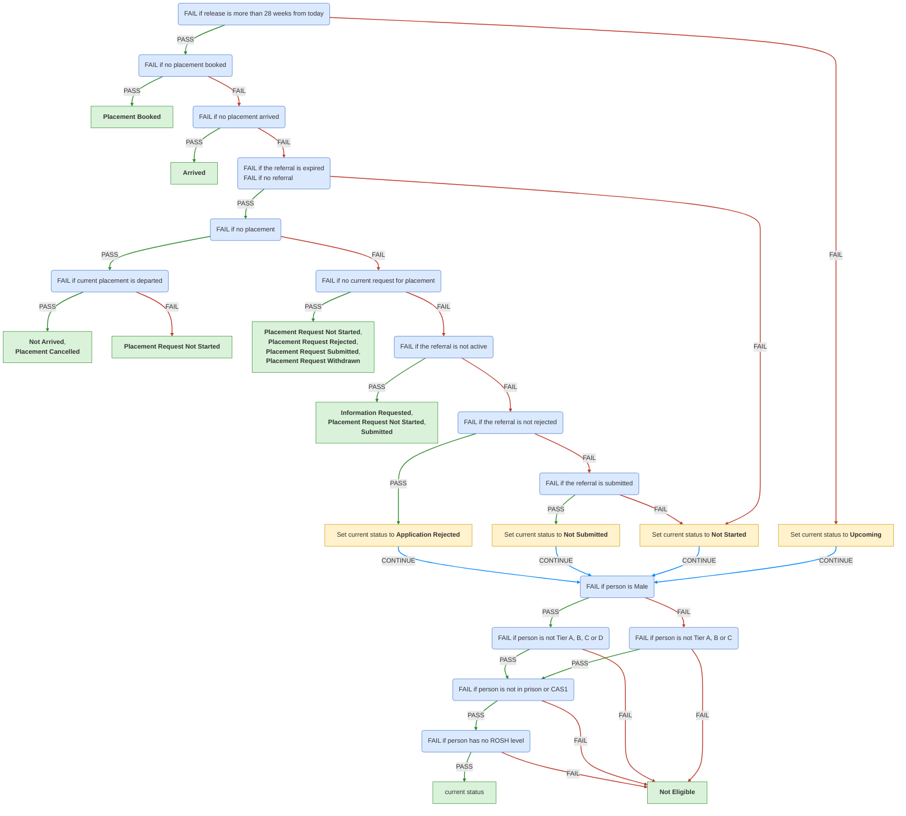
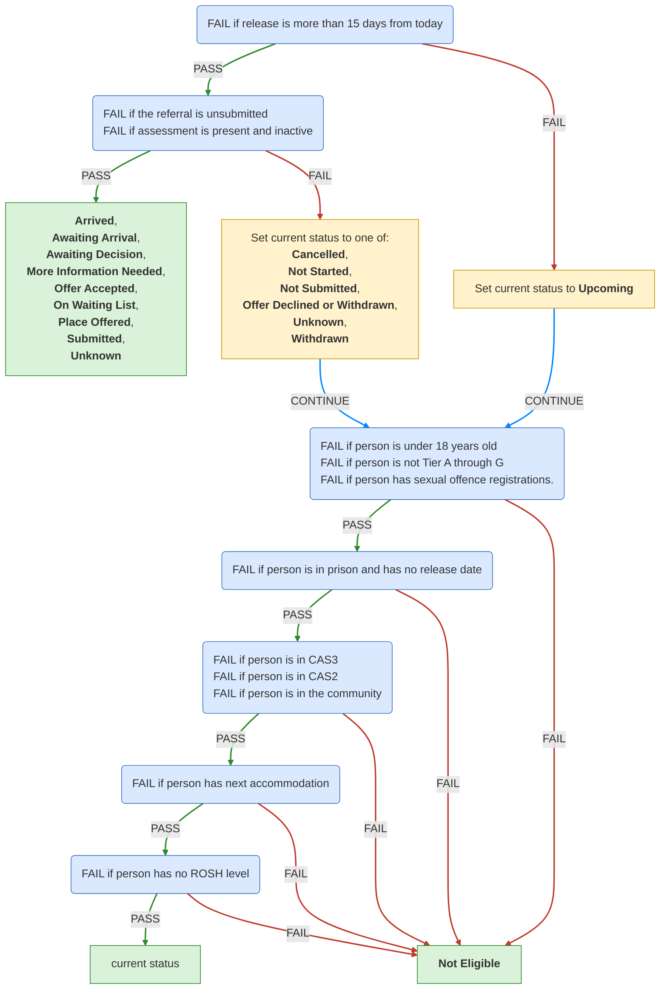
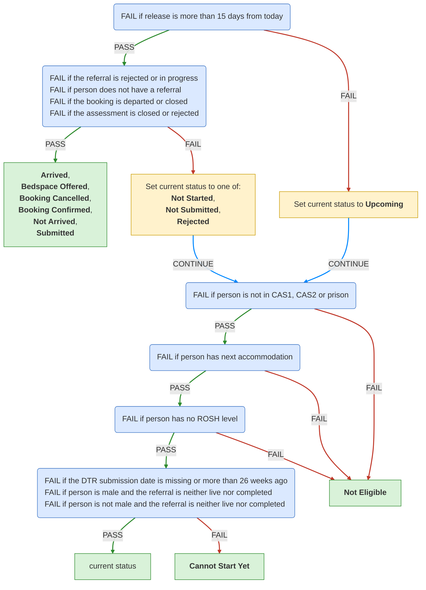
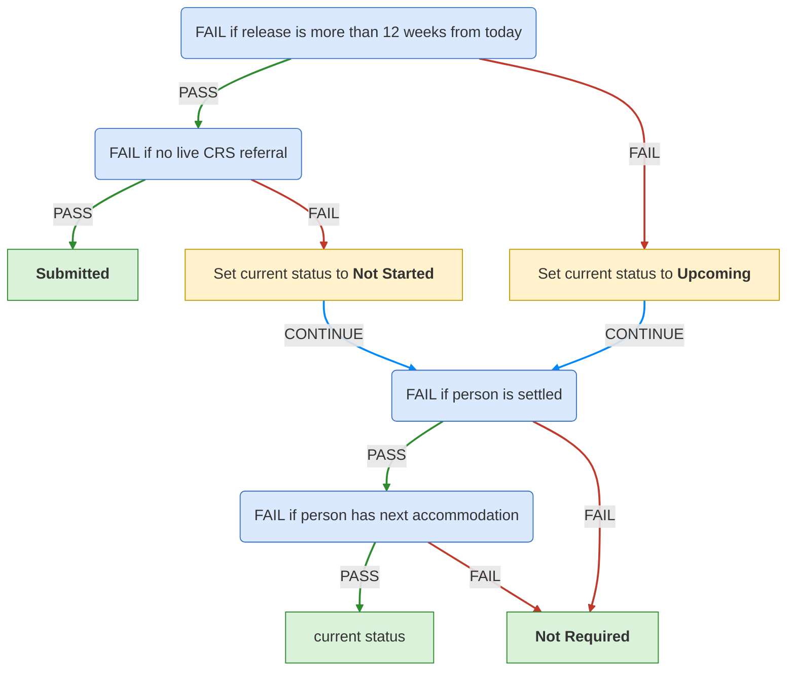
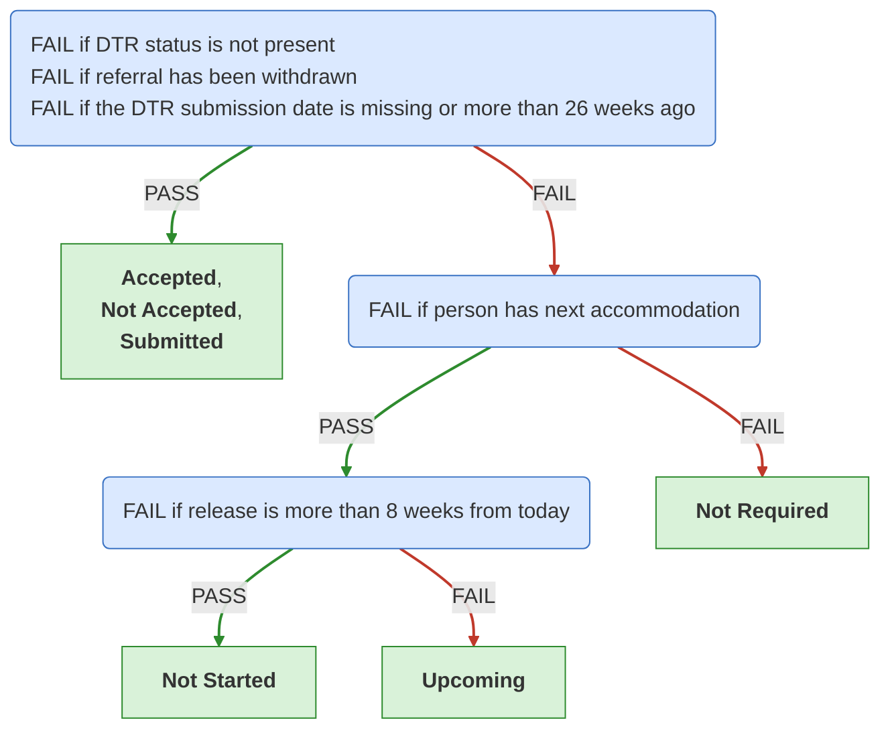
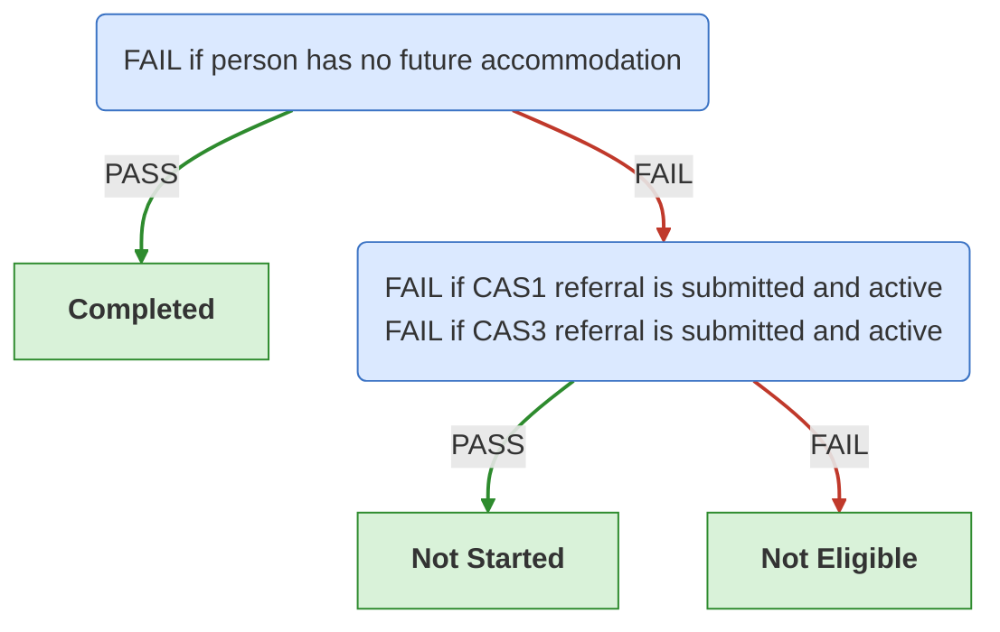

# Eligibility rules graph

Generated by `./gradlew :query:generateEligibilityRulesGraph`. Do not edit by hand.

Diagram colours are shared with the HTML graph in [`RulesGraphColours`](../query/src/main/kotlin/uk/gov/justice/digital/hmpps/singleaccommodationserviceapi/query/eligibility/graph/RulesGraphColours.kt). Regenerate both graphs after changing the palette.

Diamond RuleSet nodes have a FAIL context updater.

## CAS1

### Nodes

**PASS if person can start referral** (RuleSet) `ReleaseWithin28WeeksRuleSet`
- [`ReleaseOutside28WeeksRule`](../query/src/main/kotlin/uk/gov/justice/digital/hmpps/singleaccommodationserviceapi/query/eligibility/domain/rules/ReleaseOutside28WeeksRule.kt): FAIL if release is more than 28 weeks from today
- FAIL: [`Cas1UpcomingContextUpdater`](../query/src/main/kotlin/uk/gov/justice/digital/hmpps/singleaccommodationserviceapi/query/eligibility/domain/contextupdaters/Cas1UpcomingContextUpdater.kt) - Set current status to Upcoming

**PASS if person has a placement booked** (RuleSet) `UpcomingPlacementRuleSet`
- [`NoUpcomingPlacementRule`](../query/src/main/kotlin/uk/gov/justice/digital/hmpps/singleaccommodationserviceapi/query/eligibility/domain/rules/NoUpcomingPlacementRule.kt): FAIL if no placement booked

**Placement Booked** (Outcome)

**PASS if person has arrived at their placement** (RuleSet) `ArrivedPlacementRuleSet`
- [`NoArrivedPlacementRule`](../query/src/main/kotlin/uk/gov/justice/digital/hmpps/singleaccommodationserviceapi/query/eligibility/domain/rules/NoArrivedPlacementRule.kt): FAIL if no placement arrived

**Arrived** (Outcome)

**PASS if referral has not expired** (RuleSet) `Cas1NotExpiredRuleSet`
- [`Cas1ExpiredRule`](../query/src/main/kotlin/uk/gov/justice/digital/hmpps/singleaccommodationserviceapi/query/eligibility/domain/rules/Cas1ExpiredRule.kt): FAIL if the referral is expired
- [`Cas1NotPresentRule`](../query/src/main/kotlin/uk/gov/justice/digital/hmpps/singleaccommodationserviceapi/query/eligibility/domain/rules/Cas1NotPresentRule.kt): FAIL if no referral
- FAIL: [`Cas1StartContextUpdater`](../query/src/main/kotlin/uk/gov/justice/digital/hmpps/singleaccommodationserviceapi/query/eligibility/domain/contextupdaters/Cas1StartContextUpdater.kt) - Set current status to Not Started

**PASS if person has a placement** (RuleSet) `PlacementRuleSet`
- [`NoPlacementRule`](../query/src/main/kotlin/uk/gov/justice/digital/hmpps/singleaccommodationserviceapi/query/eligibility/domain/rules/NoPlacementRule.kt): FAIL if no placement

**PASS if person has an active placement** (RuleSet) `ActivePlacementRuleSet`
- [`DepartedPlacementRule`](../query/src/main/kotlin/uk/gov/justice/digital/hmpps/singleaccommodationserviceapi/query/eligibility/domain/rules/DepartedPlacementRule.kt): FAIL if current placement is departed
- PASS: [`ActivePlacementContextUpdater`](../query/src/main/kotlin/uk/gov/justice/digital/hmpps/singleaccommodationserviceapi/query/eligibility/domain/contextupdaters/ActivePlacementContextUpdater.kt) - Not Arrived,
 Placement Cancelled

**Not Arrived, Placement Cancelled** (Outcome)

**Placement Request Not Started** (Outcome)

**PASS if person has a request for placement** (RuleSet) `RequestForPlacementRuleSet`
- [`NoRequestForPlacementRule`](../query/src/main/kotlin/uk/gov/justice/digital/hmpps/singleaccommodationserviceapi/query/eligibility/domain/rules/NoRequestForPlacementRule.kt): FAIL if no current request for placement
- PASS: [`NoPlacementContextUpdater`](../query/src/main/kotlin/uk/gov/justice/digital/hmpps/singleaccommodationserviceapi/query/eligibility/domain/contextupdaters/NoPlacementContextUpdater.kt) - Placement Request Not Started,
 Placement Request Rejected,
 Placement Request Submitted,
 Placement Request Withdrawn

**Placement Request Not Started, Placement Request Rejected, Placement Request Submitted, Placement Request Withdrawn** (Outcome)

**PASS if person has an active referral** (RuleSet) `Cas1ActiveRuleSet`
- [`Cas1NotActiveRule`](../query/src/main/kotlin/uk/gov/justice/digital/hmpps/singleaccommodationserviceapi/query/eligibility/domain/rules/Cas1NotActiveRule.kt): FAIL if the referral is not active
- PASS: [`NoRequestForPlacementContextUpdater`](../query/src/main/kotlin/uk/gov/justice/digital/hmpps/singleaccommodationserviceapi/query/eligibility/domain/contextupdaters/NoRequestForPlacementContextUpdater.kt) - Information Requested,
 Placement Request Not Started,
 Submitted

**Information Requested, Placement Request Not Started, Submitted** (Outcome)

**PASS if person has a rejected referral** (RuleSet) `Cas1RejectedRuleSet`
- [`Cas1NotRejectedRule`](../query/src/main/kotlin/uk/gov/justice/digital/hmpps/singleaccommodationserviceapi/query/eligibility/domain/rules/Cas1NotRejectedRule.kt): FAIL if the referral is not rejected
- PASS: [`Cas1RejectedContextUpdater`](../query/src/main/kotlin/uk/gov/justice/digital/hmpps/singleaccommodationserviceapi/query/eligibility/domain/contextupdaters/Cas1RejectedContextUpdater.kt) - Set current status to Application Rejected

**PASS if person is not male** (RuleSet) `NotMaleRuleSet`
- [`MaleRule`](../query/src/main/kotlin/uk/gov/justice/digital/hmpps/singleaccommodationserviceapi/query/eligibility/domain/rules/MaleRule.kt): FAIL if person is Male

**PASS if person is Tier A, B, C or D** (RuleSet) `NotMaleTierEligibleForCas1RuleSet`
- [`NonMaleRiskEligibilityRule`](../query/src/main/kotlin/uk/gov/justice/digital/hmpps/singleaccommodationserviceapi/query/eligibility/domain/rules/NonMaleRiskEligibilityRule.kt): FAIL if person is not Tier A, B, C or D

**PASS if person is in prison or CAS1** (RuleSet) `CurrentAccommodationEligibleForCas1RuleSet`
- [`CurrentAccommodationIsPrisonOrCas1Rule`](../query/src/main/kotlin/uk/gov/justice/digital/hmpps/singleaccommodationserviceapi/query/eligibility/domain/rules/CurrentAccommodationIsPrisonOrCas1Rule.kt): FAIL if person is not in prison or CAS1

**PASS if person has a ROSH level** (RuleSet) `RoshEligibleRuleSet`
- [`NoRoshLevelRule`](../query/src/main/kotlin/uk/gov/justice/digital/hmpps/singleaccommodationserviceapi/query/eligibility/domain/rules/NoRoshLevelRule.kt): FAIL if person has no ROSH level

**current status** (Outcome)

**Not Eligible** (Outcome)

**PASS if person is Tier A, B or C** (RuleSet) `MaleTierEligibleForCas1RuleSet`
- [`MaleRiskEligibilityRule`](../query/src/main/kotlin/uk/gov/justice/digital/hmpps/singleaccommodationserviceapi/query/eligibility/domain/rules/MaleRiskEligibilityRule.kt): FAIL if person is not Tier A, B or C

**PASS if person has a draft referral** (RuleSet) `Cas1NotSubmittedRuleSet`
- [`Cas1SubmittedRule`](../query/src/main/kotlin/uk/gov/justice/digital/hmpps/singleaccommodationserviceapi/query/eligibility/domain/rules/Cas1SubmittedRule.kt): FAIL if the referral is submitted
- PASS: [`Cas1NotSubmittedContextUpdater`](../query/src/main/kotlin/uk/gov/justice/digital/hmpps/singleaccommodationserviceapi/query/eligibility/domain/contextupdaters/Cas1NotSubmittedContextUpdater.kt) - Set current status to Not Submitted
- FAIL: [`Cas1StartContextUpdater`](../query/src/main/kotlin/uk/gov/justice/digital/hmpps/singleaccommodationserviceapi/query/eligibility/domain/contextupdaters/Cas1StartContextUpdater.kt) - Set current status to Not Started

## CAS2

### Nodes

**PASS if person can start referral** (RuleSet) `ReleaseWithin15DaysRuleSet`
- [`ReleaseOutside15DaysRule`](../query/src/main/kotlin/uk/gov/justice/digital/hmpps/singleaccommodationserviceapi/query/eligibility/domain/rules/ReleaseOutside15DaysRule.kt): FAIL if release is more than 15 days from today
- FAIL: [`Cas2UpcomingContextUpdater`](../query/src/main/kotlin/uk/gov/justice/digital/hmpps/singleaccommodationserviceapi/query/eligibility/domain/contextupdaters/Cas2UpcomingContextUpdater.kt) - Set current status to Upcoming

**PASS if person has an active referral** (RuleSet) `Cas2RuleSet`
- [`Cas2NotSubmittedRule`](../query/src/main/kotlin/uk/gov/justice/digital/hmpps/singleaccommodationserviceapi/query/eligibility/domain/rules/Cas2NotSubmittedRule.kt): FAIL if the referral is unsubmitted
- [`Cas2NotActiveRule`](../query/src/main/kotlin/uk/gov/justice/digital/hmpps/singleaccommodationserviceapi/query/eligibility/domain/rules/Cas2NotActiveRule.kt): FAIL if assessment is present and inactive
- PASS: [`Cas2ActiveContextUpdater`](../query/src/main/kotlin/uk/gov/justice/digital/hmpps/singleaccommodationserviceapi/query/eligibility/domain/contextupdaters/Cas2ActiveContextUpdater.kt) - Arrived,
 Awaiting Arrival,
 Awaiting Decision,
 More Information Needed,
 Offer Accepted,
 On Waiting List,
 Place Offered,
 Submitted,
 Unknown
- FAIL: [`Cas2StartContextUpdater`](../query/src/main/kotlin/uk/gov/justice/digital/hmpps/singleaccommodationserviceapi/query/eligibility/domain/contextupdaters/Cas2StartContextUpdater.kt) - Set current status to one of:
Cancelled,
 Not Started,
 Not Submitted,
 Offer Declined or Withdrawn,
 Unknown,
 Withdrawn

**Arrived, Awaiting Arrival, Awaiting Decision, More Information Needed, Offer Accepted, On Waiting List, Place Offered, Submitted, Unknown** (Outcome)

**PASS if person is aged 18 or over, Tier A - G and has no sexual offence registrations** (RuleSet) `PersonEligibleRuleSet`
- [`Under18Rule`](../query/src/main/kotlin/uk/gov/justice/digital/hmpps/singleaccommodationserviceapi/query/eligibility/domain/rules/Under18Rule.kt): FAIL if person is under 18 years old
- [`WrongTierRule`](../query/src/main/kotlin/uk/gov/justice/digital/hmpps/singleaccommodationserviceapi/query/eligibility/domain/rules/WrongTierRule.kt): FAIL if person is not Tier A through G
- [`HasSexualOffenceRegistrationsRule`](../query/src/main/kotlin/uk/gov/justice/digital/hmpps/singleaccommodationserviceapi/query/eligibility/domain/rules/HasSexualOffenceRegistrationsRule.kt): FAIL if person has sexual offence registrations.

**PASS if person is in prison and has a release date or is in other accommodation** (RuleSet) `ReleaseDateEligibleRuleSet`
- [`InPrisonNoReleaseRule`](../query/src/main/kotlin/uk/gov/justice/digital/hmpps/singleaccommodationserviceapi/query/eligibility/domain/rules/InPrisonNoReleaseRule.kt): FAIL if person is in prison and has no release date

**PASS if person is in prison or CAS1** (RuleSet) `CurrentAccommodationEligibleForCas2RuleSet`
- [`CurrentAccommodationTypeIsCas3Rule`](../query/src/main/kotlin/uk/gov/justice/digital/hmpps/singleaccommodationserviceapi/query/eligibility/domain/rules/CurrentAccommodationTypeIsCas3Rule.kt): FAIL if person is in CAS3
- [`CurrentAccommodationTypeIsCas2Rule`](../query/src/main/kotlin/uk/gov/justice/digital/hmpps/singleaccommodationserviceapi/query/eligibility/domain/rules/CurrentAccommodationTypeIsCas2Rule.kt): FAIL if person is in CAS2
- [`CurrentAccommodationTypeIsCommunityRule`](../query/src/main/kotlin/uk/gov/justice/digital/hmpps/singleaccommodationserviceapi/query/eligibility/domain/rules/CurrentAccommodationTypeIsCommunityRule.kt): FAIL if person is in the community

**PASS if person does not have a next accommodation** (RuleSet) `NoNextAccommodationRuleSet`
- [`HasNextAccommodationRule`](../query/src/main/kotlin/uk/gov/justice/digital/hmpps/singleaccommodationserviceapi/query/eligibility/domain/rules/HasNextAccommodationRule.kt): FAIL if person has next accommodation

**PASS if person has a ROSH level** (RuleSet) `RoshEligibleRuleSet`
- [`NoRoshLevelRule`](../query/src/main/kotlin/uk/gov/justice/digital/hmpps/singleaccommodationserviceapi/query/eligibility/domain/rules/NoRoshLevelRule.kt): FAIL if person has no ROSH level

**current status** (Outcome)

**Not Eligible** (Outcome)

## CAS3

### Nodes

**PASS if person can start referral** (RuleSet) `ReleaseWithin15DaysRuleSet`
- [`ReleaseOutside15DaysRule`](../query/src/main/kotlin/uk/gov/justice/digital/hmpps/singleaccommodationserviceapi/query/eligibility/domain/rules/ReleaseOutside15DaysRule.kt): FAIL if release is more than 15 days from today
- FAIL: [`Cas3UpcomingContextUpdater`](../query/src/main/kotlin/uk/gov/justice/digital/hmpps/singleaccommodationserviceapi/query/eligibility/domain/contextupdaters/Cas3UpcomingContextUpdater.kt) - Set current status to Upcoming

**PASS if person has an active referral** (RuleSet) `Cas3RuleSet`
- [`Cas3ReferralNotActiveRule`](../query/src/main/kotlin/uk/gov/justice/digital/hmpps/singleaccommodationserviceapi/query/eligibility/domain/rules/Cas3ReferralNotActiveRule.kt): FAIL if the referral is rejected or in progress
- [`Cas3NotPresentRule`](../query/src/main/kotlin/uk/gov/justice/digital/hmpps/singleaccommodationserviceapi/query/eligibility/domain/rules/Cas3NotPresentRule.kt): FAIL if person does not have a referral
- [`Cas3BookingNotActiveRule`](../query/src/main/kotlin/uk/gov/justice/digital/hmpps/singleaccommodationserviceapi/query/eligibility/domain/rules/Cas3BookingNotActiveRule.kt): FAIL if the booking is departed or closed
- [`Cas3AssessmentNotActiveRule`](../query/src/main/kotlin/uk/gov/justice/digital/hmpps/singleaccommodationserviceapi/query/eligibility/domain/rules/Cas3AssessmentNotActiveRule.kt): FAIL if the assessment is closed or rejected
- PASS: [`Cas3ActiveContextUpdater`](../query/src/main/kotlin/uk/gov/justice/digital/hmpps/singleaccommodationserviceapi/query/eligibility/domain/contextupdaters/Cas3ActiveContextUpdater.kt) - Arrived,
 Bedspace Offered,
 Booking Cancelled,
 Booking Confirmed,
 Not Arrived,
 Submitted
- FAIL: [`Cas3StartContextUpdater`](../query/src/main/kotlin/uk/gov/justice/digital/hmpps/singleaccommodationserviceapi/query/eligibility/domain/contextupdaters/Cas3StartContextUpdater.kt) - Set current status to one of:
Not Started,
 Not Submitted,
 Rejected

**Arrived, Bedspace Offered, Booking Cancelled, Booking Confirmed, Not Arrived, Submitted** (Outcome)

**PASS if person is in prison, CAS1 or CAS2** (RuleSet) `CurrentAccommodationEligibleForCas3RuleSet`
- [`WrongCurrentAccommodationForCas3TypeRule`](../query/src/main/kotlin/uk/gov/justice/digital/hmpps/singleaccommodationserviceapi/query/eligibility/domain/rules/WrongCurrentAccommodationForCas3TypeRule.kt): FAIL if person is not in CAS1, CAS2 or prison

**PASS if person does not have a next accommodation** (RuleSet) `NoNextAccommodationRuleSet`
- [`HasNextAccommodationRule`](../query/src/main/kotlin/uk/gov/justice/digital/hmpps/singleaccommodationserviceapi/query/eligibility/domain/rules/HasNextAccommodationRule.kt): FAIL if person has next accommodation

**PASS if person has a ROSH level** (RuleSet) `RoshEligibleRuleSet`
- [`NoRoshLevelRule`](../query/src/main/kotlin/uk/gov/justice/digital/hmpps/singleaccommodationserviceapi/query/eligibility/domain/rules/NoRoshLevelRule.kt): FAIL if person has no ROSH level

**PASS if person has a valid DTR and CRS** (RuleSet) `Cas3PrerequisiteRuleSet`
- [`DtrExpiredRule`](../query/src/main/kotlin/uk/gov/justice/digital/hmpps/singleaccommodationserviceapi/query/eligibility/domain/rules/DtrExpiredRule.kt): FAIL if the DTR submission date is missing or more than 26 weeks ago
- [`CrsSubmittedRuleMale`](../query/src/main/kotlin/uk/gov/justice/digital/hmpps/singleaccommodationserviceapi/query/eligibility/domain/rules/CrsSubmittedRuleMale.kt): FAIL if person is male and the referral is neither live nor completed
- [`CrsSubmittedRuleNonMale`](../query/src/main/kotlin/uk/gov/justice/digital/hmpps/singleaccommodationserviceapi/query/eligibility/domain/rules/CrsSubmittedRuleNonMale.kt): FAIL if person is not male and the referral is neither live nor completed
- FAIL: [`Cas3CannotStartContextUpdater`](../query/src/main/kotlin/uk/gov/justice/digital/hmpps/singleaccommodationserviceapi/query/eligibility/domain/contextupdaters/Cas3CannotStartContextUpdater.kt) - Cannot Start Yet

**current status** (Outcome)

**Cannot Start Yet** (Outcome)

**Not Eligible** (Outcome)

## CRS

### Nodes

**PASS if person can start referral** (RuleSet) `ReleaseWithin12WeeksRuleSet`
- [`ReleaseOutside12WeeksRule`](../query/src/main/kotlin/uk/gov/justice/digital/hmpps/singleaccommodationserviceapi/query/eligibility/domain/rules/ReleaseOutside12WeeksRule.kt): FAIL if release is more than 12 weeks from today
- FAIL: [`CrsUpcomingContextUpdater`](../query/src/main/kotlin/uk/gov/justice/digital/hmpps/singleaccommodationserviceapi/query/eligibility/domain/contextupdaters/CrsUpcomingContextUpdater.kt) - Set current status to Upcoming

**PASS if person has a live CRS** (RuleSet) `LiveCrsRuleSet`
- [`NoLiveCrsRule`](../query/src/main/kotlin/uk/gov/justice/digital/hmpps/singleaccommodationserviceapi/query/eligibility/domain/rules/NoLiveCrsRule.kt): FAIL if no live CRS referral
- FAIL: [`CrsStartContextUpdater`](../query/src/main/kotlin/uk/gov/justice/digital/hmpps/singleaccommodationserviceapi/query/eligibility/domain/contextupdaters/CrsStartContextUpdater.kt) - Set current status to Not Started

**Submitted** (Outcome)

**PASS if person is not in settled accommodation** (RuleSet) `NotSettledRuleSet`
- [`IsSettledRule`](../query/src/main/kotlin/uk/gov/justice/digital/hmpps/singleaccommodationserviceapi/query/eligibility/domain/rules/IsSettledRule.kt): FAIL if person is settled

**PASS if person does not have a next accommodation** (RuleSet) `NoNextAccommodationRuleSet`
- [`HasNextAccommodationRule`](../query/src/main/kotlin/uk/gov/justice/digital/hmpps/singleaccommodationserviceapi/query/eligibility/domain/rules/HasNextAccommodationRule.kt): FAIL if person has next accommodation

**current status** (Outcome)

**Not Required** (Outcome)

## DTR

### Nodes

**PASS if person has a valid DTR** (RuleSet) `DtrRuleSet`
- [`DtrNotPresentRule`](../query/src/main/kotlin/uk/gov/justice/digital/hmpps/singleaccommodationserviceapi/query/eligibility/domain/rules/DtrNotPresentRule.kt): FAIL if DTR status is not present
- [`DtrWithdrawnRule`](../query/src/main/kotlin/uk/gov/justice/digital/hmpps/singleaccommodationserviceapi/query/eligibility/domain/rules/DtrWithdrawnRule.kt): FAIL if referral has been withdrawn
- [`DtrExpiredRule`](../query/src/main/kotlin/uk/gov/justice/digital/hmpps/singleaccommodationserviceapi/query/eligibility/domain/rules/DtrExpiredRule.kt): FAIL if the DTR submission date is missing or more than 26 weeks ago
- PASS: [`DtrActiveContextUpdater`](../query/src/main/kotlin/uk/gov/justice/digital/hmpps/singleaccommodationserviceapi/query/eligibility/domain/contextupdaters/DtrActiveContextUpdater.kt) - Accepted,
 Not Accepted,
 Submitted

**Accepted, Not Accepted, Submitted** (Outcome)

**PASS if person does not have a next accommodation** (RuleSet) `NoNextAccommodationRuleSet`
- [`HasNextAccommodationRule`](../query/src/main/kotlin/uk/gov/justice/digital/hmpps/singleaccommodationserviceapi/query/eligibility/domain/rules/HasNextAccommodationRule.kt): FAIL if person has next accommodation

**PASS if person can start referral** (RuleSet) `ReleaseWithin8WeeksRuleSet`
- [`ReleaseOutside8WeeksRule`](../query/src/main/kotlin/uk/gov/justice/digital/hmpps/singleaccommodationserviceapi/query/eligibility/domain/rules/ReleaseOutside8WeeksRule.kt): FAIL if release is more than 8 weeks from today
- FAIL: [`DtrUpcomingContextUpdater`](../query/src/main/kotlin/uk/gov/justice/digital/hmpps/singleaccommodationserviceapi/query/eligibility/domain/contextupdaters/DtrUpcomingContextUpdater.kt) - Upcoming

**Not Started** (Outcome)

**Upcoming** (Outcome)

**Not Required** (Outcome)

## PA

### Nodes

**PASS if person has a next accommodation** (RuleSet) `HasNextAccommodationRuleSet`
- [`NoNextAccommodationRule`](../query/src/main/kotlin/uk/gov/justice/digital/hmpps/singleaccommodationserviceapi/query/eligibility/domain/rules/NoNextAccommodationRule.kt): FAIL if person has no future accommodation

**Completed** (Outcome)

**PASS if person does not have an active CAS1 or CAS3 referral** (RuleSet) `NoActiveCas1OrCas3ReferralsRuleSet`
- [`Cas1ActiveRule`](../query/src/main/kotlin/uk/gov/justice/digital/hmpps/singleaccommodationserviceapi/query/eligibility/domain/rules/Cas1ActiveRule.kt): FAIL if CAS1 referral is submitted and active
- [`Cas3ActiveRule`](../query/src/main/kotlin/uk/gov/justice/digital/hmpps/singleaccommodationserviceapi/query/eligibility/domain/rules/Cas3ActiveRule.kt): FAIL if CAS3 referral is submitted and active

**Not Started** (Outcome)

**Not Eligible** (Outcome)

## Rule catalogue

| Rule | Description | RuleSets | Trees |
| --- | --- | --- | --- |
| Cas1ActiveRule | FAIL if CAS1 referral is submitted and active | PASS if person does not have an active CAS1 or CAS3 referral | PA |
| Cas1ExpiredRule | FAIL if the referral is expired | PASS if referral has not expired | CAS1 |
| Cas1NotActiveRule | FAIL if the referral is not active | PASS if person has an active referral | CAS1 |
| Cas1NotPresentRule | FAIL if no referral | PASS if referral has not expired | CAS1 |
| Cas1NotRejectedRule | FAIL if the referral is not rejected | PASS if person has a rejected referral | CAS1 |
| Cas1SubmittedRule | FAIL if the referral is submitted | PASS if person has a draft referral | CAS1 |
| Cas2NotActiveRule | FAIL if assessment is present and inactive | PASS if person has an active referral | CAS2 |
| Cas2NotSubmittedRule | FAIL if the referral is unsubmitted | PASS if person has an active referral | CAS2 |
| Cas3ActiveRule | FAIL if CAS3 referral is submitted and active | PASS if person does not have an active CAS1 or CAS3 referral | PA |
| Cas3AssessmentNotActiveRule | FAIL if the assessment is closed or rejected | PASS if person has an active referral | CAS3 |
| Cas3BookingNotActiveRule | FAIL if the booking is departed or closed | PASS if person has an active referral | CAS3 |
| Cas3NotPresentRule | FAIL if person does not have a referral | PASS if person has an active referral | CAS3 |
| Cas3ReferralNotActiveRule | FAIL if the referral is rejected or in progress | PASS if person has an active referral | CAS3 |
| CrsSubmittedRuleMale | FAIL if person is male and the referral is neither live nor completed | PASS if person has a valid DTR and CRS | CAS3 |
| CrsSubmittedRuleNonMale | FAIL if person is not male and the referral is neither live nor completed | PASS if person has a valid DTR and CRS | CAS3 |
| CurrentAccommodationIsPrisonOrCas1Rule | FAIL if person is not in prison or CAS1 | PASS if person is in prison or CAS1 | CAS1 |
| CurrentAccommodationTypeIsCas2Rule | FAIL if person is in CAS2 | PASS if person is in prison or CAS1 | CAS2 |
| CurrentAccommodationTypeIsCas3Rule | FAIL if person is in CAS3 | PASS if person is in prison or CAS1 | CAS2 |
| CurrentAccommodationTypeIsCommunityRule | FAIL if person is in the community | PASS if person is in prison or CAS1 | CAS2 |
| DepartedPlacementRule | FAIL if current placement is departed | PASS if person has an active placement | CAS1 |
| DtrExpiredRule | FAIL if the DTR submission date is missing or more than 26 weeks ago | PASS if person has a valid DTR, PASS if person has a valid DTR and CRS | CAS3, DTR |
| DtrNotPresentRule | FAIL if DTR status is not present | PASS if person has a valid DTR | DTR |
| DtrWithdrawnRule | FAIL if referral has been withdrawn | PASS if person has a valid DTR | DTR |
| HasNextAccommodationRule | FAIL if person has next accommodation | PASS if person does not have a next accommodation | CAS2, CAS3, CRS, DTR |
| HasSexualOffenceRegistrationsRule | FAIL if person has sexual offence registrations. | PASS if person is aged 18 or over, Tier A - G and has no sexual offence registrations | CAS2 |
| InPrisonNoReleaseRule | FAIL if person is in prison and has no release date | PASS if person is in prison and has a release date or is in other accommodation | CAS2 |
| IsSettledRule | FAIL if person is settled | PASS if person is not in settled accommodation | CRS |
| MaleRiskEligibilityRule | FAIL if person is not Tier A, B or C | PASS if person is Tier A, B or C | CAS1 |
| MaleRule | FAIL if person is Male | PASS if person is not male | CAS1 |
| NoArrivedPlacementRule | FAIL if no placement arrived | PASS if person has arrived at their placement | CAS1 |
| NoLiveCrsRule | FAIL if no live CRS referral | PASS if person has a live CRS | CRS |
| NoNextAccommodationRule | FAIL if person has no future accommodation | PASS if person has a next accommodation | PA |
| NoPlacementRule | FAIL if no placement | PASS if person has a placement | CAS1 |
| NoRequestForPlacementRule | FAIL if no current request for placement | PASS if person has a request for placement | CAS1 |
| NoRoshLevelRule | FAIL if person has no ROSH level | PASS if person has a ROSH level | CAS1, CAS2, CAS3 |
| NoUpcomingPlacementRule | FAIL if no placement booked | PASS if person has a placement booked | CAS1 |
| NonMaleRiskEligibilityRule | FAIL if person is not Tier A, B, C or D | PASS if person is Tier A, B, C or D | CAS1 |
| ReleaseOutside12WeeksRule | FAIL if release is more than 12 weeks from today | PASS if person can start referral | CRS |
| ReleaseOutside15DaysRule | FAIL if release is more than 15 days from today | PASS if person can start referral | CAS2, CAS3 |
| ReleaseOutside28WeeksRule | FAIL if release is more than 28 weeks from today | PASS if person can start referral | CAS1 |
| ReleaseOutside8WeeksRule | FAIL if release is more than 8 weeks from today | PASS if person can start referral | DTR |
| Under18Rule | FAIL if person is under 18 years old | PASS if person is aged 18 or over, Tier A - G and has no sexual offence registrations | CAS2 |
| WrongCurrentAccommodationForCas3TypeRule | FAIL if person is not in CAS1, CAS2 or prison | PASS if person is in prison, CAS1 or CAS2 | CAS3 |
| WrongTierRule | FAIL if person is not Tier A through G | PASS if person is aged 18 or over, Tier A - G and has no sexual offence registrations | CAS2 |

## Context updater catalogue

Not Arrived,
 Placement Cancelled

Used by: PASS if person has an active placement (CAS1) on pass

Set current status to Not Submitted

Used by: PASS if person has a draft referral (CAS1) on pass

Set current status to Application Rejected

Used by: PASS if person has a rejected referral (CAS1) on pass

Set current status to Not Started

Used by: PASS if person has a draft referral (CAS1), PASS if referral has not expired (CAS1) on fail

Set current status to Upcoming

Used by: PASS if person can start referral (CAS1) on fail

Arrived,
 Awaiting Arrival,
 Awaiting Decision,
 More Information Needed,
 Offer Accepted,
 On Waiting List,
 Place Offered,
 Submitted,
 Unknown

Used by: PASS if person has an active referral (CAS2) on pass

Set current status to one of:
Cancelled,
 Not Started,
 Not Submitted,
 Offer Declined or Withdrawn,
 Unknown,
 Withdrawn

Used by: PASS if person has an active referral (CAS2) on fail

Set current status to Upcoming

Used by: PASS if person can start referral (CAS2) on fail

Arrived,
 Bedspace Offered,
 Booking Cancelled,
 Booking Confirmed,
 Not Arrived,
 Submitted

Used by: PASS if person has an active referral (CAS3) on pass

Cannot Start Yet

Used by: PASS if person has a valid DTR and CRS (CAS3) on fail

Set current status to one of:
Not Started,
 Not Submitted,
 Rejected

Used by: PASS if person has an active referral (CAS3) on fail

Set current status to Upcoming

Used by: PASS if person can start referral (CAS3) on fail

Set current status to Not Started

Used by: PASS if person has a live CRS (CRS) on fail

Set current status to Upcoming

Used by: PASS if person can start referral (CRS) on fail

Accepted,
 Not Accepted,
 Submitted

Used by: PASS if person has a valid DTR (DTR) on pass

Upcoming

Used by: PASS if person can start referral (DTR) on fail

Placement Request Not Started,
 Placement Request Rejected,
 Placement Request Submitted,
 Placement Request Withdrawn

Used by: PASS if person has a request for placement (CAS1) on pass

Information Requested,
 Placement Request Not Started,
 Submitted

Used by: PASS if person has an active referral (CAS1) on pass
