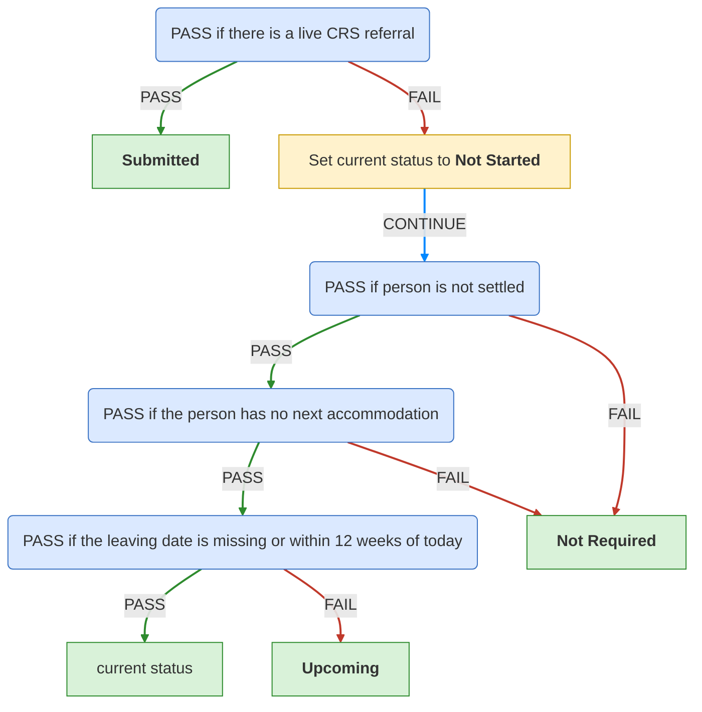
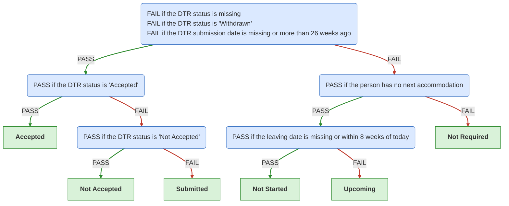
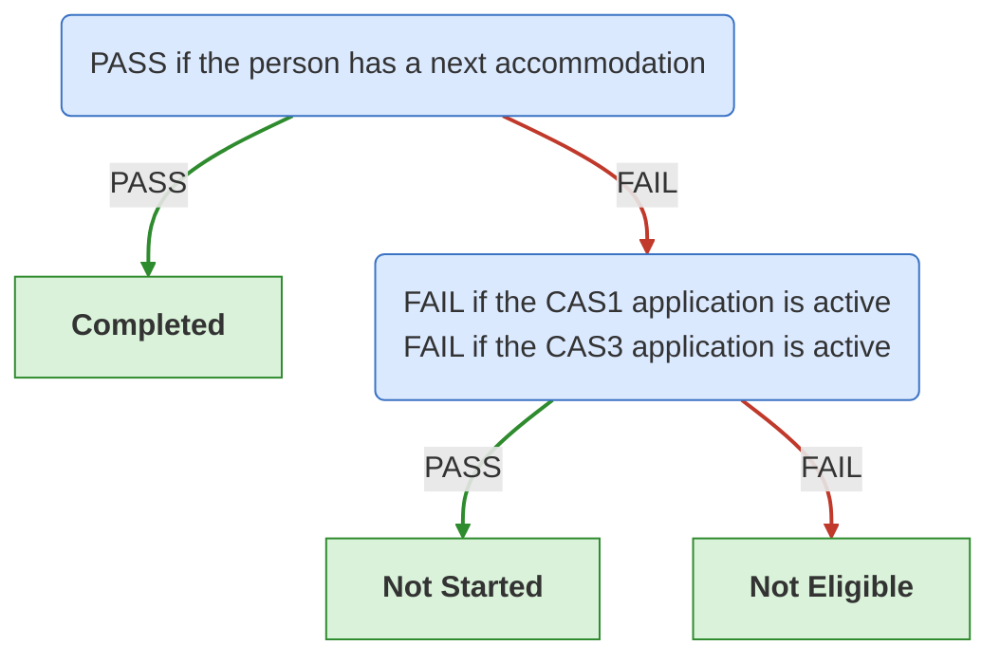
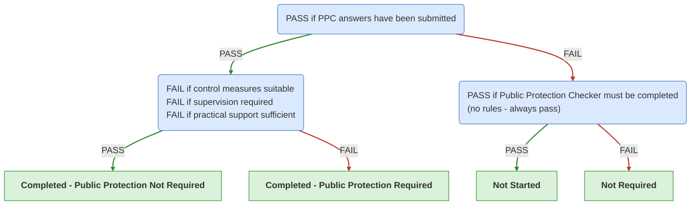

# Eligibility rules graph

Generated by `./gradlew :query:generateEligibilityRulesGraph`. Do not edit by hand.

Diagram colours are shared with the HTML graph in [`RulesGraphColours`](../query/src/main/kotlin/uk/gov/justice/digital/hmpps/singleaccommodationserviceapi/query/eligibility/graph/RulesGraphColours.kt). Regenerate both graphs after changing the palette.

Diamond RuleSet nodes have a FAIL context updater.

## CAS1

```mermaid
%%{init: {"flowchart": {"wrappingWidth": 800}}}%%
flowchart TD
  PASS_if_the_CAS1_placement_status_is__Arrived__or__Upcoming_("<div style='text-align:left'>PASS if the CAS1 placement status is 'Arrived' or 'Upcoming'</div>")
  PASS_if_the_CAS1_placement_status_is_not__Arrived_("<div style='text-align:left'>PASS if the CAS1 placement status is not 'Arrived'</div>")
  CAS1_PLACEMENT_BOOKED["<b>Placement Booked</b>"]
  CAS1_ARRIVED["<b>Arrived</b>"]
  PASS_if_there_is_an_unexpired_CAS1_application("<div style='text-align:left'>FAIL if there is no CAS1 application
FAIL if the CAS1 application status is 'Expired'</div>")
  PASS_if_there_is_a_CAS1_placement("<div style='text-align:left'>PASS if there is a CAS1 placement</div>")
  PASS_if_the_CAS1_placement_status_is_not__Departed_("<div style='text-align:left'>PASS if the CAS1 placement status is not 'Departed'</div>")
  PASS_if_the_CAS1_placement_status_is_not__Cancelled_("<div style='text-align:left'>PASS if the CAS1 placement status is not 'Cancelled'</div>")
  CAS1_NOT_ARRIVED["<b>Not Arrived</b>"]
  CAS1_PLACEMENT_CANCELLED["<b>Placement Cancelled</b>"]
  CAS1_PLACEMENT_REQUEST_NOT_STARTED["<b>Placement Request Not Started</b>"]
  PASS_if_there_is_a_CAS1_request_for_placement_status("<div style='text-align:left'>PASS if there is a CAS1 request for placement status</div>")
  PASS_if_the_CAS1_request_for_placement_status_is_not__Rejected_("<div style='text-align:left'>PASS if the CAS1 request for placement status is not 'Rejected'</div>")
  PASS_if_the_CAS1_request_for_placement_status_is_not__Withdrawn_("<div style='text-align:left'>PASS if the CAS1 request for placement status is not 'Withdrawn'</div>")
  PASS_if_the_CAS1_request_for_placement_status_is_not__Unsubmitted_("<div style='text-align:left'>PASS if the CAS1 request for placement status is not 'Unsubmitted'</div>")
  CAS1_PLACEMENT_REQUEST_SUBMITTED["<b>Placement Request Submitted</b>"]
  CAS1_PLACEMENT_REQUEST_NOT_SUBMITTED["<b>Placement Request Not Started</b>"]
  CAS1_PLACEMENT_REQUEST_WITHDRAWN["<b>Placement Request Withdrawn</b>"]
  CAS1_PLACEMENT_REQUEST_REJECTED["<b>Placement Request Rejected</b>"]
  PASS_if_the_CAS1_application_is_active("<div style='text-align:left'>PASS if the CAS1 application is active</div>")
  PASS_if_the_CAS1_application_status_is_not__Pending_Placement_Request_("<div style='text-align:left'>PASS if the CAS1 application status is not 'Pending Placement Request'</div>")
  PASS_if_the_CAS1_application_status_is_not__Requested_Further_Information_("<div style='text-align:left'>PASS if the CAS1 application status is not 'Requested Further Information'</div>")
  CAS1_SUBMITTED["<b>Submitted</b>"]
  CAS1_INFO_REQUESTED["<b>Information Requested</b>"]
  PASS_if_the_CAS1_application_status_is__Rejected_("<div style='text-align:left'>PASS if the CAS1 application status is 'Rejected'</div>")
  PASS_if_the_person_is_not_Male("<div style='text-align:left'>PASS if the person is not Male</div>")
  PASS_if_the_person_s_tier_is_A__B__C_or_D("<div style='text-align:left'>PASS if the person's tier is A, B, C or D</div>")
  PASS_if_the_person_is_in_prison_or_CAS1("<div style='text-align:left'>PASS if the person is in prison or CAS1</div>")
  PASS_if_the_person_has_a_ROSH_level("<div style='text-align:left'>PASS if the person has a ROSH level</div>")
  PASS_if_the_leaving_date_is_missing_or_within_28_weeks_of_today("<div style='text-align:left'>PASS if the leaving date is missing or within 28 weeks of today</div>")
  confirmed["current status"]
  outcome_Cas1UpcomingContextUpdater["<b>Upcoming</b>"]
  CAS1_NOT_ELIGIBLE["<b>Not Eligible</b>"]
  PASS_if_the_person_s_tier_is_A__B_or_C("<div style='text-align:left'>PASS if the person's tier is A, B or C</div>")
  updater_Cas1RejectedContextUpdater_PASS_if_the_person_is_not_Male["Set current status to <b>Application Rejected</b>"]
  PASS_if_the_CAS1_application_has_not_been_submitted("<div style='text-align:left'>PASS if the CAS1 application has not been submitted</div>")
  updater_Cas1NotSubmittedContextUpdater_PASS_if_the_person_is_not_Male["Set current status to <b>Not Submitted</b>"]
  updater_Cas1StartContextUpdater_PASS_if_the_person_is_not_Male["Set current status to <b>Not Started</b>"]
  PASS_if_the_CAS1_placement_status_is_not__Arrived_ -->|PASS| CAS1_PLACEMENT_BOOKED
  PASS_if_the_CAS1_placement_status_is_not__Arrived_ -->|FAIL| CAS1_ARRIVED
  PASS_if_the_CAS1_placement_status_is__Arrived__or__Upcoming_ -->|PASS| PASS_if_the_CAS1_placement_status_is_not__Arrived_
  PASS_if_the_CAS1_placement_status_is_not__Cancelled_ -->|PASS| CAS1_NOT_ARRIVED
  PASS_if_the_CAS1_placement_status_is_not__Cancelled_ -->|FAIL| CAS1_PLACEMENT_CANCELLED
  PASS_if_the_CAS1_placement_status_is_not__Departed_ -->|PASS| PASS_if_the_CAS1_placement_status_is_not__Cancelled_
  PASS_if_the_CAS1_placement_status_is_not__Departed_ -->|FAIL| CAS1_PLACEMENT_REQUEST_NOT_STARTED
  PASS_if_there_is_a_CAS1_placement -->|PASS| PASS_if_the_CAS1_placement_status_is_not__Departed_
  PASS_if_the_CAS1_request_for_placement_status_is_not__Unsubmitted_ -->|PASS| CAS1_PLACEMENT_REQUEST_SUBMITTED
  PASS_if_the_CAS1_request_for_placement_status_is_not__Unsubmitted_ -->|FAIL| CAS1_PLACEMENT_REQUEST_NOT_SUBMITTED
  PASS_if_the_CAS1_request_for_placement_status_is_not__Withdrawn_ -->|PASS| PASS_if_the_CAS1_request_for_placement_status_is_not__Unsubmitted_
  PASS_if_the_CAS1_request_for_placement_status_is_not__Withdrawn_ -->|FAIL| CAS1_PLACEMENT_REQUEST_WITHDRAWN
  PASS_if_the_CAS1_request_for_placement_status_is_not__Rejected_ -->|PASS| PASS_if_the_CAS1_request_for_placement_status_is_not__Withdrawn_
  PASS_if_the_CAS1_request_for_placement_status_is_not__Rejected_ -->|FAIL| CAS1_PLACEMENT_REQUEST_REJECTED
  PASS_if_there_is_a_CAS1_request_for_placement_status -->|PASS| PASS_if_the_CAS1_request_for_placement_status_is_not__Rejected_
  PASS_if_the_CAS1_application_status_is_not__Requested_Further_Information_ -->|PASS| CAS1_SUBMITTED
  PASS_if_the_CAS1_application_status_is_not__Requested_Further_Information_ -->|FAIL| CAS1_INFO_REQUESTED
  PASS_if_the_CAS1_application_status_is_not__Pending_Placement_Request_ -->|PASS| PASS_if_the_CAS1_application_status_is_not__Requested_Further_Information_
  PASS_if_the_CAS1_application_status_is_not__Pending_Placement_Request_ -->|FAIL| CAS1_PLACEMENT_REQUEST_NOT_SUBMITTED
  PASS_if_the_CAS1_application_is_active -->|PASS| PASS_if_the_CAS1_application_status_is_not__Pending_Placement_Request_
  PASS_if_the_leaving_date_is_missing_or_within_28_weeks_of_today -->|PASS| confirmed
  PASS_if_the_leaving_date_is_missing_or_within_28_weeks_of_today -->|FAIL| outcome_Cas1UpcomingContextUpdater
  PASS_if_the_person_has_a_ROSH_level -->|PASS| PASS_if_the_leaving_date_is_missing_or_within_28_weeks_of_today
  PASS_if_the_person_has_a_ROSH_level -->|FAIL| CAS1_NOT_ELIGIBLE
  PASS_if_the_person_is_in_prison_or_CAS1 -->|PASS| PASS_if_the_person_has_a_ROSH_level
  PASS_if_the_person_is_in_prison_or_CAS1 -->|FAIL| CAS1_NOT_ELIGIBLE
  PASS_if_the_person_s_tier_is_A__B__C_or_D -->|PASS| PASS_if_the_person_is_in_prison_or_CAS1
  PASS_if_the_person_s_tier_is_A__B__C_or_D -->|FAIL| CAS1_NOT_ELIGIBLE
  PASS_if_the_person_is_not_Male -->|PASS| PASS_if_the_person_s_tier_is_A__B__C_or_D
  PASS_if_the_person_s_tier_is_A__B_or_C -->|PASS| PASS_if_the_person_is_in_prison_or_CAS1
  PASS_if_the_person_s_tier_is_A__B_or_C -->|FAIL| CAS1_NOT_ELIGIBLE
  PASS_if_the_person_is_not_Male -->|FAIL| PASS_if_the_person_s_tier_is_A__B_or_C
  PASS_if_the_CAS1_application_status_is__Rejected_ -->|PASS| updater_Cas1RejectedContextUpdater_PASS_if_the_person_is_not_Male
  updater_Cas1RejectedContextUpdater_PASS_if_the_person_is_not_Male -->|CONTINUE| PASS_if_the_person_is_not_Male
  PASS_if_the_CAS1_application_has_not_been_submitted -->|PASS| updater_Cas1NotSubmittedContextUpdater_PASS_if_the_person_is_not_Male
  updater_Cas1NotSubmittedContextUpdater_PASS_if_the_person_is_not_Male -->|CONTINUE| PASS_if_the_person_is_not_Male
  PASS_if_the_CAS1_application_has_not_been_submitted -->|FAIL| updater_Cas1StartContextUpdater_PASS_if_the_person_is_not_Male
  updater_Cas1StartContextUpdater_PASS_if_the_person_is_not_Male -->|CONTINUE| PASS_if_the_person_is_not_Male
  PASS_if_the_CAS1_application_status_is__Rejected_ -->|FAIL| PASS_if_the_CAS1_application_has_not_been_submitted
  PASS_if_the_CAS1_application_is_active -->|FAIL| PASS_if_the_CAS1_application_status_is__Rejected_
  PASS_if_there_is_a_CAS1_request_for_placement_status -->|FAIL| PASS_if_the_CAS1_application_is_active
  PASS_if_there_is_a_CAS1_placement -->|FAIL| PASS_if_there_is_a_CAS1_request_for_placement_status
  PASS_if_there_is_an_unexpired_CAS1_application -->|PASS| PASS_if_there_is_a_CAS1_placement
  PASS_if_there_is_an_unexpired_CAS1_application -->|FAIL| updater_Cas1StartContextUpdater_PASS_if_the_person_is_not_Male
  PASS_if_the_CAS1_placement_status_is__Arrived__or__Upcoming_ -->|FAIL| PASS_if_there_is_an_unexpired_CAS1_application
  linkStyle 0,2,3,5,7,8,10,12,14,15,17,19,20,22,24,26,28,29,32,34,42 stroke:#2e8b2e,stroke-width:2px
  linkStyle 1,4,6,9,11,13,16,18,21,23,25,27,30,31,36,38,39,40,41,43,44 stroke:#c0392b,stroke-width:2px
  linkStyle 33,35,37 stroke:#0088ff,stroke-width:2px
  classDef ruleSetNode fill:#dbe9ff,stroke:#3b73c4,color:#333
  classDef outcomeNode fill:#d9f2d9,stroke:#2e8b2e,color:#333
  classDef updaterNode fill:#fff2cc,stroke:#c99a00,color:#333
  class PASS_if_the_CAS1_placement_status_is__Arrived__or__Upcoming_,PASS_if_the_CAS1_placement_status_is_not__Arrived_,PASS_if_there_is_an_unexpired_CAS1_application,PASS_if_there_is_a_CAS1_placement,PASS_if_the_CAS1_placement_status_is_not__Departed_,PASS_if_the_CAS1_placement_status_is_not__Cancelled_,PASS_if_there_is_a_CAS1_request_for_placement_status,PASS_if_the_CAS1_request_for_placement_status_is_not__Rejected_,PASS_if_the_CAS1_request_for_placement_status_is_not__Withdrawn_,PASS_if_the_CAS1_request_for_placement_status_is_not__Unsubmitted_,PASS_if_the_CAS1_application_is_active,PASS_if_the_CAS1_application_status_is_not__Pending_Placement_Request_,PASS_if_the_CAS1_application_status_is_not__Requested_Further_Information_,PASS_if_the_CAS1_application_status_is__Rejected_,PASS_if_the_person_is_not_Male,PASS_if_the_person_s_tier_is_A__B__C_or_D,PASS_if_the_person_is_in_prison_or_CAS1,PASS_if_the_person_has_a_ROSH_level,PASS_if_the_leaving_date_is_missing_or_within_28_weeks_of_today,PASS_if_the_person_s_tier_is_A__B_or_C,PASS_if_the_CAS1_application_has_not_been_submitted ruleSetNode
  class CAS1_PLACEMENT_BOOKED,CAS1_ARRIVED,CAS1_NOT_ARRIVED,CAS1_PLACEMENT_CANCELLED,CAS1_PLACEMENT_REQUEST_NOT_STARTED,CAS1_PLACEMENT_REQUEST_SUBMITTED,CAS1_PLACEMENT_REQUEST_NOT_SUBMITTED,CAS1_PLACEMENT_REQUEST_WITHDRAWN,CAS1_PLACEMENT_REQUEST_REJECTED,CAS1_SUBMITTED,CAS1_INFO_REQUESTED,confirmed,outcome_Cas1UpcomingContextUpdater,CAS1_NOT_ELIGIBLE outcomeNode
  class updater_Cas1RejectedContextUpdater_PASS_if_the_person_is_not_Male,updater_Cas1NotSubmittedContextUpdater_PASS_if_the_person_is_not_Male,updater_Cas1StartContextUpdater_PASS_if_the_person_is_not_Male updaterNode
```

### Nodes

**PASS if the CAS1 placement status is 'Arrived' or 'Upcoming'** (RuleSet) `Cas1ActivePlacementRuleSet`
- [`Cas1PlacementNotActiveRule`](../query/src/main/kotlin/uk/gov/justice/digital/hmpps/singleaccommodationserviceapi/query/eligibility/domain/rules/Cas1PlacementNotActiveRule.kt): FAIL if the CAS1 placement status is not 'Arrived' or 'Upcoming'

**PASS if the CAS1 placement status is not 'Arrived'** (RuleSet) `Cas1NotArrivedPlacementRuleSet`
- [`Cas1ArrivedPlacementRule`](../query/src/main/kotlin/uk/gov/justice/digital/hmpps/singleaccommodationserviceapi/query/eligibility/domain/rules/Cas1ArrivedPlacementRule.kt): FAIL if the CAS1 placement status is 'Arrived'

**Placement Booked** (Outcome)

**Arrived** (Outcome)

**PASS if there is an unexpired CAS1 application** (RuleSet) `Cas1ApplicationPresentAndNotExpiredRuleSet`
- [`Cas1NoApplicationRule`](../query/src/main/kotlin/uk/gov/justice/digital/hmpps/singleaccommodationserviceapi/query/eligibility/domain/rules/Cas1NoApplicationRule.kt): FAIL if there is no CAS1 application
- [`Cas1ApplicationExpiredRule`](../query/src/main/kotlin/uk/gov/justice/digital/hmpps/singleaccommodationserviceapi/query/eligibility/domain/rules/Cas1ApplicationExpiredRule.kt): FAIL if the CAS1 application status is 'Expired'
- FAIL: [`Cas1StartContextUpdater`](../query/src/main/kotlin/uk/gov/justice/digital/hmpps/singleaccommodationserviceapi/query/eligibility/domain/contextupdaters/Cas1StartContextUpdater.kt) - Set current status to Not Started

**PASS if there is a CAS1 placement** (RuleSet) `Cas1PlacementRuleSet`
- [`Cas1NoPlacementRule`](../query/src/main/kotlin/uk/gov/justice/digital/hmpps/singleaccommodationserviceapi/query/eligibility/domain/rules/Cas1NoPlacementRule.kt): FAIL if there is no CAS1 placement

**PASS if the CAS1 placement status is not 'Departed'** (RuleSet) `Cas1NotDepartedPlacementRuleSet`
- [`Cas1DepartedPlacementRule`](../query/src/main/kotlin/uk/gov/justice/digital/hmpps/singleaccommodationserviceapi/query/eligibility/domain/rules/Cas1DepartedPlacementRule.kt): FAIL if the CAS1 placement status is 'Departed'

**PASS if the CAS1 placement status is not 'Cancelled'** (RuleSet) `Cas1NotCancelledPlacementRuleSet`
- [`Cas1CancelledPlacementRule`](../query/src/main/kotlin/uk/gov/justice/digital/hmpps/singleaccommodationserviceapi/query/eligibility/domain/rules/Cas1CancelledPlacementRule.kt): FAIL if the CAS1 placement status is 'Cancelled'

**Not Arrived** (Outcome)

**Placement Cancelled** (Outcome)

**Placement Request Not Started** (Outcome)

**PASS if there is a CAS1 request for placement status** (RuleSet) `Cas1RequestForPlacementRuleSet`
- [`Cas1NoRequestForPlacementRule`](../query/src/main/kotlin/uk/gov/justice/digital/hmpps/singleaccommodationserviceapi/query/eligibility/domain/rules/Cas1NoRequestForPlacementRule.kt): FAIL if there is no CAS1 request for placement

**PASS if the CAS1 request for placement status is not 'Rejected'** (RuleSet) `Cas1NotRejectedRequestRuleSet`
- [`Cas1RejectedRequestRule`](../query/src/main/kotlin/uk/gov/justice/digital/hmpps/singleaccommodationserviceapi/query/eligibility/domain/rules/Cas1RejectedRequestRule.kt): FAIL if the CAS1 request for placement status is 'Rejected'

**PASS if the CAS1 request for placement status is not 'Withdrawn'** (RuleSet) `Cas1NotWithdrawnRequestRuleSet`
- [`Cas1WithdrawnRequestRule`](../query/src/main/kotlin/uk/gov/justice/digital/hmpps/singleaccommodationserviceapi/query/eligibility/domain/rules/Cas1WithdrawnRequestRule.kt): FAIL if the CAS1 request for placement status is 'Withdrawn'

**PASS if the CAS1 request for placement status is not 'Unsubmitted'** (RuleSet) `Cas1SubmittedRequestRuleSet`
- [`Cas1UnsubmittedRequestRule`](../query/src/main/kotlin/uk/gov/justice/digital/hmpps/singleaccommodationserviceapi/query/eligibility/domain/rules/Cas1UnsubmittedRequestRule.kt): FAIL if the CAS1 request for placement status is 'Unsubmitted'

**Placement Request Submitted** (Outcome)

**Placement Request Not Started** (Outcome)

**Placement Request Withdrawn** (Outcome)

**Placement Request Rejected** (Outcome)

**PASS if the CAS1 application is active** (RuleSet) `Cas1ApplicationActiveRuleSet`
- [`Cas1ApplicationNotActiveRule`](../query/src/main/kotlin/uk/gov/justice/digital/hmpps/singleaccommodationserviceapi/query/eligibility/domain/rules/Cas1ApplicationNotActiveRule.kt): FAIL if the CAS1 application is not active

**PASS if the CAS1 application status is not 'Pending Placement Request'** (RuleSet) `Cas1NotPendingPlacementRequestRuleSet`
- [`Cas1PendingPlacementRequestRule`](../query/src/main/kotlin/uk/gov/justice/digital/hmpps/singleaccommodationserviceapi/query/eligibility/domain/rules/Cas1PendingPlacementRequestRule.kt): FAIL if the CAS1 application status is 'Pending Placement Request'

**PASS if the CAS1 application status is not 'Requested Further Information'** (RuleSet) `Cas1MoreInfoNotRequestedRuleSet`
- [`Cas1MoreInfoRequestedRule`](../query/src/main/kotlin/uk/gov/justice/digital/hmpps/singleaccommodationserviceapi/query/eligibility/domain/rules/Cas1MoreInfoRequestedRule.kt): FAIL if the CAS1 application status is 'Requested Further Information'

**Submitted** (Outcome)

**Information Requested** (Outcome)

**PASS if the CAS1 application status is 'Rejected'** (RuleSet) `Cas1ApplicationRejectedRuleSet`
- [`Cas1ApplicationNotRejectedRule`](../query/src/main/kotlin/uk/gov/justice/digital/hmpps/singleaccommodationserviceapi/query/eligibility/domain/rules/Cas1ApplicationNotRejectedRule.kt): FAIL if the CAS1 application status is not 'Rejected'
- PASS: [`Cas1RejectedContextUpdater`](../query/src/main/kotlin/uk/gov/justice/digital/hmpps/singleaccommodationserviceapi/query/eligibility/domain/contextupdaters/Cas1RejectedContextUpdater.kt) - Set current status to Application Rejected

**PASS if the person is not Male** (RuleSet) `NotMaleRuleSet`
- [`MaleRule`](../query/src/main/kotlin/uk/gov/justice/digital/hmpps/singleaccommodationserviceapi/query/eligibility/domain/rules/MaleRule.kt): FAIL if the person is Male

**PASS if the person's tier is A, B, C or D** (RuleSet) `TierAToDRuleSet`
- [`TierNotAToDRule`](../query/src/main/kotlin/uk/gov/justice/digital/hmpps/singleaccommodationserviceapi/query/eligibility/domain/rules/TierNotAToDRule.kt): FAIL if the person's tier is not A, B, C or D

**PASS if the person is in prison or CAS1** (RuleSet) `CurrentAccommodationPrisonOrCas1RuleSet`
- [`CurrentAccommodationNotPrisonOrCas1Rule`](../query/src/main/kotlin/uk/gov/justice/digital/hmpps/singleaccommodationserviceapi/query/eligibility/domain/rules/CurrentAccommodationNotPrisonOrCas1Rule.kt): FAIL if the person is not in prison or CAS1

**PASS if the person has a ROSH level** (RuleSet) `HasRoshLevelRuleSet`
- [`NoRoshLevelRule`](../query/src/main/kotlin/uk/gov/justice/digital/hmpps/singleaccommodationserviceapi/query/eligibility/domain/rules/NoRoshLevelRule.kt): FAIL if the person has no ROSH level

**PASS if the leaving date is missing or within 28 weeks of today** (RuleSet) `LeavingWithin28WeeksRuleSet`
- [`LeavingOutside28WeeksRule`](../query/src/main/kotlin/uk/gov/justice/digital/hmpps/singleaccommodationserviceapi/query/eligibility/domain/rules/LeavingOutside28WeeksRule.kt): FAIL if the leaving date is more than 28 weeks from today
- FAIL: [`Cas1UpcomingContextUpdater`](../query/src/main/kotlin/uk/gov/justice/digital/hmpps/singleaccommodationserviceapi/query/eligibility/domain/contextupdaters/Cas1UpcomingContextUpdater.kt) - Upcoming

**current status** (Outcome)

**Upcoming** (Outcome)

**Not Eligible** (Outcome)

**PASS if the person's tier is A, B or C** (RuleSet) `TierAToCRuleSet`
- [`TierNotAToCRule`](../query/src/main/kotlin/uk/gov/justice/digital/hmpps/singleaccommodationserviceapi/query/eligibility/domain/rules/TierNotAToCRule.kt): FAIL if the person's tier is not A, B or C

**PASS if the CAS1 application has not been submitted** (RuleSet) `Cas1ApplicationNotSubmittedRuleSet`
- [`Cas1ApplicationSubmittedRule`](../query/src/main/kotlin/uk/gov/justice/digital/hmpps/singleaccommodationserviceapi/query/eligibility/domain/rules/Cas1ApplicationSubmittedRule.kt): FAIL if the CAS1 application has been submitted
- PASS: [`Cas1NotSubmittedContextUpdater`](../query/src/main/kotlin/uk/gov/justice/digital/hmpps/singleaccommodationserviceapi/query/eligibility/domain/contextupdaters/Cas1NotSubmittedContextUpdater.kt) - Set current status to Not Submitted
- FAIL: [`Cas1StartContextUpdater`](../query/src/main/kotlin/uk/gov/justice/digital/hmpps/singleaccommodationserviceapi/query/eligibility/domain/contextupdaters/Cas1StartContextUpdater.kt) - Set current status to Not Started

## CAS2

```mermaid
%%{init: {"flowchart": {"wrappingWidth": 800}}}%%
flowchart TD
  PASS_if_a_CAS2_application_exists("<div style='text-align:left'>PASS if a CAS2 application exists</div>")
  PASS_if_the_CAS2_application_is_submitted("<div style='text-align:left'>PASS if the CAS2 application is submitted</div>")
  PASS_if_the_CAS2_assessment_status_is_present("<div style='text-align:left'>PASS if the CAS2 assessment status is present</div>")
  PASS_if_the_CAS2_assessment_status_is_active("<div style='text-align:left'>PASS if the CAS2 assessment status is active</div>")
  PASS_if_the_CAS2_arrival_timestamp_is_present("<div style='text-align:left'>PASS if the CAS2 arrival timestamp is present</div>")
  CAS2_ARRIVED["<b>Arrived</b>"]
  PASS_if_the_CAS2_assessment_status_is__Awaiting_Arrival_("<div style='text-align:left'>PASS if the CAS2 assessment status is 'Awaiting Arrival'</div>")
  CAS2_AWAITING_ARRIVAL["<b>Awaiting Arrival</b>"]
  PASS_if_the_CAS2_assessment_status_is__Offer_Accepted_("<div style='text-align:left'>PASS if the CAS2 assessment status is 'Offer Accepted'</div>")
  CAS2_OFFER_ACCEPTED["<b>Offer Accepted</b>"]
  PASS_if_the_CAS2_assessment_status_is__Place_Offered_("<div style='text-align:left'>PASS if the CAS2 assessment status is 'Place Offered'</div>")
  CAS2_PLACE_OFFERED["<b>Place Offered</b>"]
  PASS_if_the_CAS2_assessment_status_is__On_Waiting_List_("<div style='text-align:left'>PASS if the CAS2 assessment status is 'On Waiting List'</div>")
  CAS2_ON_WAITING_LIST["<b>On Waiting List</b>"]
  PASS_if_the_CAS2_assessment_status_is__More_Information_Requested_("<div style='text-align:left'>PASS if the CAS2 assessment status is 'More Information Requested'</div>")
  CAS2_MORE_INFORMATION_NEEDED["<b>More Information Needed</b>"]
  CAS2_AWAITING_DECISION["<b>Awaiting Decision</b>"]
  PASS_if_the_CAS2_assessment_status_is__Offer_Declined_("<div style='text-align:left'>PASS if the CAS2 assessment status is 'Offer Declined'</div>")
  PASS_if_the_person_is_eligible("<div style='text-align:left'>FAIL if the person is under 18 years old
FAIL if the person's tier is not A, B, C, D, E, F or G
FAIL if the person has sexual offence registrations</div>")
  PASS_if_the_person_is_not_in_prison__or_is_in_prison_with_no_release_date("<div style='text-align:left'>PASS if the person is not in prison, or is in prison with no release date</div>")
  PASS_if_the_person_is_not_in_CAS2__CAS3_or_the_community("<div style='text-align:left'>FAIL if the person is in CAS3
FAIL if the person is in CAS2
FAIL if the person is in the community</div>")
  PASS_if_the_person_has_no_next_accommodation("<div style='text-align:left'>PASS if the person has no next accommodation</div>")
  PASS_if_the_person_has_a_ROSH_level("<div style='text-align:left'>PASS if the person has a ROSH level</div>")
  PASS_if_the_leaving_date_is_missing_or_within_15_days_of_today("<div style='text-align:left'>PASS if the leaving date is missing or within 15 days of today</div>")
  confirmed["current status"]
  outcome_Cas2UpcomingContextUpdater["<b>Upcoming</b>"]
  CAS2_NOT_ELIGIBLE["<b>Not Eligible</b>"]
  updater_Cas2OfferDeclinedContextUpdater_PASS_if_the_person_is_eligible["Set current status to <b>Offer Declined or Withdrawn</b>"]
  PASS_if_the_CAS2_assessment_status_is__Cancelled_("<div style='text-align:left'>PASS if the CAS2 assessment status is 'Cancelled'</div>")
  updater_Cas2CancelledContextUpdater_PASS_if_the_person_is_eligible["Set current status to <b>Cancelled</b>"]
  updater_Cas2WithdrawnContextUpdater_PASS_if_the_person_is_eligible["Set current status to <b>Withdrawn</b>"]
  CAS2_SUBMITTED["<b>Submitted</b>"]
  updater_Cas2NotSubmittedContextUpdater_PASS_if_the_person_is_eligible["Set current status to <b>Not Submitted</b>"]
  updater_Cas2NotStartedContextUpdater_PASS_if_the_person_is_eligible["Set current status to <b>Not Started</b>"]
  PASS_if_the_CAS2_arrival_timestamp_is_present -->|PASS| CAS2_ARRIVED
  PASS_if_the_CAS2_assessment_status_is__Awaiting_Arrival_ -->|PASS| CAS2_AWAITING_ARRIVAL
  PASS_if_the_CAS2_assessment_status_is__Offer_Accepted_ -->|PASS| CAS2_OFFER_ACCEPTED
  PASS_if_the_CAS2_assessment_status_is__Place_Offered_ -->|PASS| CAS2_PLACE_OFFERED
  PASS_if_the_CAS2_assessment_status_is__On_Waiting_List_ -->|PASS| CAS2_ON_WAITING_LIST
  PASS_if_the_CAS2_assessment_status_is__More_Information_Requested_ -->|PASS| CAS2_MORE_INFORMATION_NEEDED
  PASS_if_the_CAS2_assessment_status_is__More_Information_Requested_ -->|FAIL| CAS2_AWAITING_DECISION
  PASS_if_the_CAS2_assessment_status_is__On_Waiting_List_ -->|FAIL| PASS_if_the_CAS2_assessment_status_is__More_Information_Requested_
  PASS_if_the_CAS2_assessment_status_is__Place_Offered_ -->|FAIL| PASS_if_the_CAS2_assessment_status_is__On_Waiting_List_
  PASS_if_the_CAS2_assessment_status_is__Offer_Accepted_ -->|FAIL| PASS_if_the_CAS2_assessment_status_is__Place_Offered_
  PASS_if_the_CAS2_assessment_status_is__Awaiting_Arrival_ -->|FAIL| PASS_if_the_CAS2_assessment_status_is__Offer_Accepted_
  PASS_if_the_CAS2_arrival_timestamp_is_present -->|FAIL| PASS_if_the_CAS2_assessment_status_is__Awaiting_Arrival_
  PASS_if_the_CAS2_assessment_status_is_active -->|PASS| PASS_if_the_CAS2_arrival_timestamp_is_present
  PASS_if_the_leaving_date_is_missing_or_within_15_days_of_today -->|PASS| confirmed
  PASS_if_the_leaving_date_is_missing_or_within_15_days_of_today -->|FAIL| outcome_Cas2UpcomingContextUpdater
  PASS_if_the_person_has_a_ROSH_level -->|PASS| PASS_if_the_leaving_date_is_missing_or_within_15_days_of_today
  PASS_if_the_person_has_a_ROSH_level -->|FAIL| CAS2_NOT_ELIGIBLE
  PASS_if_the_person_has_no_next_accommodation -->|PASS| PASS_if_the_person_has_a_ROSH_level
  PASS_if_the_person_has_no_next_accommodation -->|FAIL| CAS2_NOT_ELIGIBLE
  PASS_if_the_person_is_not_in_CAS2__CAS3_or_the_community -->|PASS| PASS_if_the_person_has_no_next_accommodation
  PASS_if_the_person_is_not_in_CAS2__CAS3_or_the_community -->|FAIL| CAS2_NOT_ELIGIBLE
  PASS_if_the_person_is_not_in_prison__or_is_in_prison_with_no_release_date -->|PASS| PASS_if_the_person_is_not_in_CAS2__CAS3_or_the_community
  PASS_if_the_person_is_not_in_prison__or_is_in_prison_with_no_release_date -->|FAIL| CAS2_NOT_ELIGIBLE
  PASS_if_the_person_is_eligible -->|PASS| PASS_if_the_person_is_not_in_prison__or_is_in_prison_with_no_release_date
  PASS_if_the_person_is_eligible -->|FAIL| CAS2_NOT_ELIGIBLE
  PASS_if_the_CAS2_assessment_status_is__Offer_Declined_ -->|PASS| updater_Cas2OfferDeclinedContextUpdater_PASS_if_the_person_is_eligible
  updater_Cas2OfferDeclinedContextUpdater_PASS_if_the_person_is_eligible -->|CONTINUE| PASS_if_the_person_is_eligible
  PASS_if_the_CAS2_assessment_status_is__Cancelled_ -->|PASS| updater_Cas2CancelledContextUpdater_PASS_if_the_person_is_eligible
  updater_Cas2CancelledContextUpdater_PASS_if_the_person_is_eligible -->|CONTINUE| PASS_if_the_person_is_eligible
  PASS_if_the_CAS2_assessment_status_is__Cancelled_ -->|FAIL| updater_Cas2WithdrawnContextUpdater_PASS_if_the_person_is_eligible
  updater_Cas2WithdrawnContextUpdater_PASS_if_the_person_is_eligible -->|CONTINUE| PASS_if_the_person_is_eligible
  PASS_if_the_CAS2_assessment_status_is__Offer_Declined_ -->|FAIL| PASS_if_the_CAS2_assessment_status_is__Cancelled_
  PASS_if_the_CAS2_assessment_status_is_active -->|FAIL| PASS_if_the_CAS2_assessment_status_is__Offer_Declined_
  PASS_if_the_CAS2_assessment_status_is_present -->|PASS| PASS_if_the_CAS2_assessment_status_is_active
  PASS_if_the_CAS2_assessment_status_is_present -->|FAIL| CAS2_SUBMITTED
  PASS_if_the_CAS2_application_is_submitted -->|PASS| PASS_if_the_CAS2_assessment_status_is_present
  PASS_if_the_CAS2_application_is_submitted -->|FAIL| updater_Cas2NotSubmittedContextUpdater_PASS_if_the_person_is_eligible
  updater_Cas2NotSubmittedContextUpdater_PASS_if_the_person_is_eligible -->|CONTINUE| PASS_if_the_person_is_eligible
  PASS_if_a_CAS2_application_exists -->|PASS| PASS_if_the_CAS2_application_is_submitted
  PASS_if_a_CAS2_application_exists -->|FAIL| updater_Cas2NotStartedContextUpdater_PASS_if_the_person_is_eligible
  updater_Cas2NotStartedContextUpdater_PASS_if_the_person_is_eligible -->|CONTINUE| PASS_if_the_person_is_eligible
  linkStyle 0,1,2,3,4,5,12,13,15,17,19,21,23,25,27,33,35,38 stroke:#2e8b2e,stroke-width:2px
  linkStyle 6,7,8,9,10,11,14,16,18,20,22,24,29,31,32,34,36,39 stroke:#c0392b,stroke-width:2px
  linkStyle 26,28,30,37,40 stroke:#0088ff,stroke-width:2px
  classDef ruleSetNode fill:#dbe9ff,stroke:#3b73c4,color:#333
  classDef outcomeNode fill:#d9f2d9,stroke:#2e8b2e,color:#333
  classDef updaterNode fill:#fff2cc,stroke:#c99a00,color:#333
  class PASS_if_a_CAS2_application_exists,PASS_if_the_CAS2_application_is_submitted,PASS_if_the_CAS2_assessment_status_is_present,PASS_if_the_CAS2_assessment_status_is_active,PASS_if_the_CAS2_arrival_timestamp_is_present,PASS_if_the_CAS2_assessment_status_is__Awaiting_Arrival_,PASS_if_the_CAS2_assessment_status_is__Offer_Accepted_,PASS_if_the_CAS2_assessment_status_is__Place_Offered_,PASS_if_the_CAS2_assessment_status_is__On_Waiting_List_,PASS_if_the_CAS2_assessment_status_is__More_Information_Requested_,PASS_if_the_CAS2_assessment_status_is__Offer_Declined_,PASS_if_the_person_is_eligible,PASS_if_the_person_is_not_in_prison__or_is_in_prison_with_no_release_date,PASS_if_the_person_is_not_in_CAS2__CAS3_or_the_community,PASS_if_the_person_has_no_next_accommodation,PASS_if_the_person_has_a_ROSH_level,PASS_if_the_leaving_date_is_missing_or_within_15_days_of_today,PASS_if_the_CAS2_assessment_status_is__Cancelled_ ruleSetNode
  class CAS2_ARRIVED,CAS2_AWAITING_ARRIVAL,CAS2_OFFER_ACCEPTED,CAS2_PLACE_OFFERED,CAS2_ON_WAITING_LIST,CAS2_MORE_INFORMATION_NEEDED,CAS2_AWAITING_DECISION,confirmed,outcome_Cas2UpcomingContextUpdater,CAS2_NOT_ELIGIBLE,CAS2_SUBMITTED outcomeNode
  class updater_Cas2OfferDeclinedContextUpdater_PASS_if_the_person_is_eligible,updater_Cas2CancelledContextUpdater_PASS_if_the_person_is_eligible,updater_Cas2WithdrawnContextUpdater_PASS_if_the_person_is_eligible,updater_Cas2NotSubmittedContextUpdater_PASS_if_the_person_is_eligible,updater_Cas2NotStartedContextUpdater_PASS_if_the_person_is_eligible updaterNode
```

### Nodes

**PASS if a CAS2 application exists** (RuleSet) `Cas2PresentRuleSet`
- [`Cas2NotPresentRule`](../query/src/main/kotlin/uk/gov/justice/digital/hmpps/singleaccommodationserviceapi/query/eligibility/domain/rules/Cas2NotPresentRule.kt): FAIL if no CAS2 application exists
- FAIL: [`Cas2NotStartedContextUpdater`](../query/src/main/kotlin/uk/gov/justice/digital/hmpps/singleaccommodationserviceapi/query/eligibility/domain/contextupdaters/Cas2NotStartedContextUpdater.kt) - Set current status to Not Started

**PASS if the CAS2 application is submitted** (RuleSet) `Cas2SubmittedRuleSet`
- [`Cas2NotSubmittedRule`](../query/src/main/kotlin/uk/gov/justice/digital/hmpps/singleaccommodationserviceapi/query/eligibility/domain/rules/Cas2NotSubmittedRule.kt): FAIL if the CAS2 application has not been submitted
- FAIL: [`Cas2NotSubmittedContextUpdater`](../query/src/main/kotlin/uk/gov/justice/digital/hmpps/singleaccommodationserviceapi/query/eligibility/domain/contextupdaters/Cas2NotSubmittedContextUpdater.kt) - Set current status to Not Submitted

**PASS if the CAS2 assessment status is present** (RuleSet) `Cas2AssessedRuleSet`
- [`Cas2NotAssessedRule`](../query/src/main/kotlin/uk/gov/justice/digital/hmpps/singleaccommodationserviceapi/query/eligibility/domain/rules/Cas2NotAssessedRule.kt): FAIL if the CAS2 assessor has not yet set a status

**PASS if the CAS2 assessment status is active** (RuleSet) `Cas2ActiveRuleSet`
- [`Cas2NotActiveRule`](../query/src/main/kotlin/uk/gov/justice/digital/hmpps/singleaccommodationserviceapi/query/eligibility/domain/rules/Cas2NotActiveRule.kt): FAIL if the CAS2 assessment status is not active

**PASS if the CAS2 arrival timestamp is present** (RuleSet) `Cas2MarkedAsArrivedRuleSet`
- [`Cas2NotMarkedAsArrivedRule`](../query/src/main/kotlin/uk/gov/justice/digital/hmpps/singleaccommodationserviceapi/query/eligibility/domain/rules/Cas2NotMarkedAsArrivedRule.kt): FAIL if the person has not arrived

**Arrived** (Outcome)

**PASS if the CAS2 assessment status is 'Awaiting Arrival'** (RuleSet) `Cas2AwaitingArrivalRuleSet`
- [`Cas2NotAwaitingArrivalRule`](../query/src/main/kotlin/uk/gov/justice/digital/hmpps/singleaccommodationserviceapi/query/eligibility/domain/rules/Cas2NotAwaitingArrivalRule.kt): FAIL if the CAS2 assessment status is not 'Awaiting Arrival'

**Awaiting Arrival** (Outcome)

**PASS if the CAS2 assessment status is 'Offer Accepted'** (RuleSet) `Cas2OfferAcceptedRuleSet`
- [`Cas2NotOfferAcceptedRule`](../query/src/main/kotlin/uk/gov/justice/digital/hmpps/singleaccommodationserviceapi/query/eligibility/domain/rules/Cas2NotOfferAcceptedRule.kt): FAIL if the CAS2 assessment status is not 'Offer Accepted'

**Offer Accepted** (Outcome)

**PASS if the CAS2 assessment status is 'Place Offered'** (RuleSet) `Cas2PlaceOfferedRuleSet`
- [`Cas2NotPlaceOfferedRule`](../query/src/main/kotlin/uk/gov/justice/digital/hmpps/singleaccommodationserviceapi/query/eligibility/domain/rules/Cas2NotPlaceOfferedRule.kt): FAIL if the CAS2 assessment status is not 'Place Offered'

**Place Offered** (Outcome)

**PASS if the CAS2 assessment status is 'On Waiting List'** (RuleSet) `Cas2OnWaitingListRuleSet`
- [`Cas2NotOnWaitingListRule`](../query/src/main/kotlin/uk/gov/justice/digital/hmpps/singleaccommodationserviceapi/query/eligibility/domain/rules/Cas2NotOnWaitingListRule.kt): FAIL if the CAS2 assessment status is not 'On Waiting List'

**On Waiting List** (Outcome)

**PASS if the CAS2 assessment status is 'More Information Requested'** (RuleSet) `Cas2MoreInformationRequestedRuleSet`
- [`Cas2NotMoreInformationRequestedRule`](../query/src/main/kotlin/uk/gov/justice/digital/hmpps/singleaccommodationserviceapi/query/eligibility/domain/rules/Cas2NotMoreInformationRequestedRule.kt): FAIL if the CAS2 assessment status is not 'More Information Requested'

**More Information Needed** (Outcome)

**Awaiting Decision** (Outcome)

**PASS if the CAS2 assessment status is 'Offer Declined'** (RuleSet) `Cas2OfferDeclinedRuleSet`
- [`Cas2NotOfferDeclinedRule`](../query/src/main/kotlin/uk/gov/justice/digital/hmpps/singleaccommodationserviceapi/query/eligibility/domain/rules/Cas2NotOfferDeclinedRule.kt): FAIL if the CAS2 assessment status is not 'Offer Declined'
- PASS: [`Cas2OfferDeclinedContextUpdater`](../query/src/main/kotlin/uk/gov/justice/digital/hmpps/singleaccommodationserviceapi/query/eligibility/domain/contextupdaters/Cas2OfferDeclinedContextUpdater.kt) - Set current status to Offer Declined or Withdrawn

**PASS if the person is eligible** (RuleSet) `PersonEligibleRuleSet`
- [`Under18Rule`](../query/src/main/kotlin/uk/gov/justice/digital/hmpps/singleaccommodationserviceapi/query/eligibility/domain/rules/Under18Rule.kt): FAIL if the person is under 18 years old
- [`TierNotAToGRule`](../query/src/main/kotlin/uk/gov/justice/digital/hmpps/singleaccommodationserviceapi/query/eligibility/domain/rules/TierNotAToGRule.kt): FAIL if the person's tier is not A, B, C, D, E, F or G
- [`HasSexualOffenceRegistrationsRule`](../query/src/main/kotlin/uk/gov/justice/digital/hmpps/singleaccommodationserviceapi/query/eligibility/domain/rules/HasSexualOffenceRegistrationsRule.kt): FAIL if the person has sexual offence registrations

**PASS if the person is not in prison, or is in prison with no release date** (RuleSet) `NotInPrisonWithoutReleaseDateRuleSet`
- [`InPrisonNoReleaseDateRule`](../query/src/main/kotlin/uk/gov/justice/digital/hmpps/singleaccommodationserviceapi/query/eligibility/domain/rules/InPrisonNoReleaseDateRule.kt): FAIL if the person is in prison and the release date is missing

**PASS if the person is not in CAS2, CAS3 or the community** (RuleSet) `CurrentAccommodationNotCas2Cas3OrCommunityRuleSet`
- [`CurrentAccommodationTypeIsCas3Rule`](../query/src/main/kotlin/uk/gov/justice/digital/hmpps/singleaccommodationserviceapi/query/eligibility/domain/rules/CurrentAccommodationTypeIsCas3Rule.kt): FAIL if the person is in CAS3
- [`CurrentAccommodationTypeIsCas2Rule`](../query/src/main/kotlin/uk/gov/justice/digital/hmpps/singleaccommodationserviceapi/query/eligibility/domain/rules/CurrentAccommodationTypeIsCas2Rule.kt): FAIL if the person is in CAS2
- [`CurrentAccommodationTypeIsCommunityRule`](../query/src/main/kotlin/uk/gov/justice/digital/hmpps/singleaccommodationserviceapi/query/eligibility/domain/rules/CurrentAccommodationTypeIsCommunityRule.kt): FAIL if the person is in the community

**PASS if the person has no next accommodation** (RuleSet) `NoNextAccommodationRuleSet`
- [`HasNextAccommodationRule`](../query/src/main/kotlin/uk/gov/justice/digital/hmpps/singleaccommodationserviceapi/query/eligibility/domain/rules/HasNextAccommodationRule.kt): FAIL if the person has a next accommodation

**PASS if the person has a ROSH level** (RuleSet) `HasRoshLevelRuleSet`
- [`NoRoshLevelRule`](../query/src/main/kotlin/uk/gov/justice/digital/hmpps/singleaccommodationserviceapi/query/eligibility/domain/rules/NoRoshLevelRule.kt): FAIL if the person has no ROSH level

**PASS if the leaving date is missing or within 15 days of today** (RuleSet) `LeavingWithin15DaysRuleSet`
- [`LeavingOutside15DaysRule`](../query/src/main/kotlin/uk/gov/justice/digital/hmpps/singleaccommodationserviceapi/query/eligibility/domain/rules/LeavingOutside15DaysRule.kt): FAIL if the leaving date is more than 15 days from today
- FAIL: [`Cas2UpcomingContextUpdater`](../query/src/main/kotlin/uk/gov/justice/digital/hmpps/singleaccommodationserviceapi/query/eligibility/domain/contextupdaters/Cas2UpcomingContextUpdater.kt) - Upcoming

**current status** (Outcome)

**Upcoming** (Outcome)

**Not Eligible** (Outcome)

**PASS if the CAS2 assessment status is 'Cancelled'** (RuleSet) `Cas2CancelledRuleSet`
- [`Cas2NotCancelledRule`](../query/src/main/kotlin/uk/gov/justice/digital/hmpps/singleaccommodationserviceapi/query/eligibility/domain/rules/Cas2NotCancelledRule.kt): FAIL if the CAS2 assessment status is not 'Cancelled'
- PASS: [`Cas2CancelledContextUpdater`](../query/src/main/kotlin/uk/gov/justice/digital/hmpps/singleaccommodationserviceapi/query/eligibility/domain/contextupdaters/Cas2CancelledContextUpdater.kt) - Set current status to Cancelled
- FAIL: [`Cas2WithdrawnContextUpdater`](../query/src/main/kotlin/uk/gov/justice/digital/hmpps/singleaccommodationserviceapi/query/eligibility/domain/contextupdaters/Cas2WithdrawnContextUpdater.kt) - Set current status to Withdrawn

**Submitted** (Outcome)

## CAS3

```mermaid
%%{init: {"flowchart": {"wrappingWidth": 800}}}%%
flowchart TD
  PASS_if_there_is_a_CAS3_booking_status("<div style='text-align:left'>PASS if there is a CAS3 booking status</div>")
  PASS_if_the_CAS3_booking_status_is_not__Departed__or__Closed_("<div style='text-align:left'>FAIL if the CAS3 booking status is 'Departed'
FAIL if the CAS3 booking status is 'Closed'</div>")
  PASS_if_the_CAS3_booking_status_is__Confirmed_("<div style='text-align:left'>PASS if the CAS3 booking status is 'Confirmed'</div>")
  CAS3_BOOKING_CONFIRMED["<b>Booking Confirmed</b>"]
  PASS_if_the_CAS3_booking_status_is__Arrived_("<div style='text-align:left'>PASS if the CAS3 booking status is 'Arrived'</div>")
  CAS3_ARRIVED["<b>Arrived</b>"]
  PASS_if_the_CAS3_booking_status_is__Provisional_("<div style='text-align:left'>PASS if the CAS3 booking status is 'Provisional'</div>")
  CAS3_BEDSPACE_OFFERED["<b>Bedspace Offered</b>"]
  PASS_if_the_CAS3_booking_status_is__Not_Arrived_("<div style='text-align:left'>PASS if the CAS3 booking status is 'Not Arrived'</div>")
  CAS3_NOT_ARRIVED["<b>Not Arrived</b>"]
  CAS3_BOOKING_CANCELLED["<b>Booking Cancelled</b>"]
  PASS_if_the_person_is_in_CAS1__CAS2_or_prison("<div style='text-align:left'>PASS if the person is in CAS1, CAS2 or prison</div>")
  PASS_if_the_person_has_no_next_accommodation("<div style='text-align:left'>PASS if the person has no next accommodation</div>")
  PASS_if_the_person_has_a_ROSH_level("<div style='text-align:left'>PASS if the person has a ROSH level</div>")
  PASS_if_the_DTR_was_submitted_in_the_last_26_weeks_and_there_is_a_live_CRS_referral("<div style='text-align:left'>FAIL if the DTR submission date is missing or more than 26 weeks ago
FAIL if there is no live CRS referral</div>")
  PASS_if_the_leaving_date_is_missing_or_within_15_days_of_today("<div style='text-align:left'>PASS if the leaving date is missing or within 15 days of today</div>")
  confirmed["current status"]
  outcome_Cas3UpcomingContextUpdater["<b>Upcoming</b>"]
  PASS_if_the_person_is_not_Male("<div style='text-align:left'>PASS if the person is not Male</div>")
  outcome_Cas3CannotStartNotMaleContextUpdater["<b>Cannot Start Yet</b>"]
  outcome_Cas3CannotStartMaleContextUpdater["<b>Cannot Start Yet</b>"]
  CAS3_NOT_ELIGIBLE["<b>Not Eligible</b>"]
  updater_Cas3NotStartedNewContextUpdater_PASS_if_the_person_is_in_CAS1__CAS2_or_prison["Set current status to <b>Not Started</b>"]
  PASS_if_the_CAS3_assessment_status_is_not__Closed_("<div style='text-align:left'>PASS if the CAS3 assessment status is not 'Closed'</div>")
  PASS_if_the_CAS3_referral_has_not_been_rejected("<div style='text-align:left'>FAIL if the CAS3 assessment status is 'Rejected'
FAIL if there is no CAS3 assessment and the CAS3 application status is 'Rejected'</div>")
  PASS_if_the_CAS3_application_is_submitted("<div style='text-align:left'>PASS if the CAS3 application is submitted</div>")
  CAS3_SUBMITTED["<b>Submitted</b>"]
  PASS_if_a_CAS3_application_exists("<div style='text-align:left'>PASS if a CAS3 application exists</div>")
  updater_Cas3NotSubmittedContextUpdater_PASS_if_the_person_is_in_CAS1__CAS2_or_prison["Set current status to <b>Not Submitted</b>"]
  updater_Cas3NotStartedContextUpdater_PASS_if_the_person_is_in_CAS1__CAS2_or_prison["Set current status to <b>Not Started</b>"]
  updater_Cas3RejectedContextUpdater_PASS_if_the_person_is_in_CAS1__CAS2_or_prison["Set current status to <b>Rejected</b>"]
  PASS_if_the_CAS3_booking_status_is__Confirmed_ -->|PASS| CAS3_BOOKING_CONFIRMED
  PASS_if_the_CAS3_booking_status_is__Arrived_ -->|PASS| CAS3_ARRIVED
  PASS_if_the_CAS3_booking_status_is__Provisional_ -->|PASS| CAS3_BEDSPACE_OFFERED
  PASS_if_the_CAS3_booking_status_is__Not_Arrived_ -->|PASS| CAS3_NOT_ARRIVED
  PASS_if_the_CAS3_booking_status_is__Not_Arrived_ -->|FAIL| CAS3_BOOKING_CANCELLED
  PASS_if_the_CAS3_booking_status_is__Provisional_ -->|FAIL| PASS_if_the_CAS3_booking_status_is__Not_Arrived_
  PASS_if_the_CAS3_booking_status_is__Arrived_ -->|FAIL| PASS_if_the_CAS3_booking_status_is__Provisional_
  PASS_if_the_CAS3_booking_status_is__Confirmed_ -->|FAIL| PASS_if_the_CAS3_booking_status_is__Arrived_
  PASS_if_the_CAS3_booking_status_is_not__Departed__or__Closed_ -->|PASS| PASS_if_the_CAS3_booking_status_is__Confirmed_
  PASS_if_the_leaving_date_is_missing_or_within_15_days_of_today -->|PASS| confirmed
  PASS_if_the_leaving_date_is_missing_or_within_15_days_of_today -->|FAIL| outcome_Cas3UpcomingContextUpdater
  PASS_if_the_DTR_was_submitted_in_the_last_26_weeks_and_there_is_a_live_CRS_referral -->|PASS| PASS_if_the_leaving_date_is_missing_or_within_15_days_of_today
  PASS_if_the_person_is_not_Male -->|PASS| outcome_Cas3CannotStartNotMaleContextUpdater
  PASS_if_the_person_is_not_Male -->|FAIL| outcome_Cas3CannotStartMaleContextUpdater
  PASS_if_the_DTR_was_submitted_in_the_last_26_weeks_and_there_is_a_live_CRS_referral -->|FAIL| PASS_if_the_person_is_not_Male
  PASS_if_the_person_has_a_ROSH_level -->|PASS| PASS_if_the_DTR_was_submitted_in_the_last_26_weeks_and_there_is_a_live_CRS_referral
  PASS_if_the_person_has_a_ROSH_level -->|FAIL| CAS3_NOT_ELIGIBLE
  PASS_if_the_person_has_no_next_accommodation -->|PASS| PASS_if_the_person_has_a_ROSH_level
  PASS_if_the_person_has_no_next_accommodation -->|FAIL| CAS3_NOT_ELIGIBLE
  PASS_if_the_person_is_in_CAS1__CAS2_or_prison -->|PASS| PASS_if_the_person_has_no_next_accommodation
  PASS_if_the_person_is_in_CAS1__CAS2_or_prison -->|FAIL| CAS3_NOT_ELIGIBLE
  PASS_if_the_CAS3_booking_status_is_not__Departed__or__Closed_ -->|FAIL| updater_Cas3NotStartedNewContextUpdater_PASS_if_the_person_is_in_CAS1__CAS2_or_prison
  updater_Cas3NotStartedNewContextUpdater_PASS_if_the_person_is_in_CAS1__CAS2_or_prison -->|CONTINUE| PASS_if_the_person_is_in_CAS1__CAS2_or_prison
  PASS_if_there_is_a_CAS3_booking_status -->|PASS| PASS_if_the_CAS3_booking_status_is_not__Departed__or__Closed_
  PASS_if_the_CAS3_application_is_submitted -->|PASS| CAS3_SUBMITTED
  PASS_if_a_CAS3_application_exists -->|PASS| updater_Cas3NotSubmittedContextUpdater_PASS_if_the_person_is_in_CAS1__CAS2_or_prison
  updater_Cas3NotSubmittedContextUpdater_PASS_if_the_person_is_in_CAS1__CAS2_or_prison -->|CONTINUE| PASS_if_the_person_is_in_CAS1__CAS2_or_prison
  PASS_if_a_CAS3_application_exists -->|FAIL| updater_Cas3NotStartedContextUpdater_PASS_if_the_person_is_in_CAS1__CAS2_or_prison
  updater_Cas3NotStartedContextUpdater_PASS_if_the_person_is_in_CAS1__CAS2_or_prison -->|CONTINUE| PASS_if_the_person_is_in_CAS1__CAS2_or_prison
  PASS_if_the_CAS3_application_is_submitted -->|FAIL| PASS_if_a_CAS3_application_exists
  PASS_if_the_CAS3_referral_has_not_been_rejected -->|PASS| PASS_if_the_CAS3_application_is_submitted
  PASS_if_the_CAS3_referral_has_not_been_rejected -->|FAIL| updater_Cas3RejectedContextUpdater_PASS_if_the_person_is_in_CAS1__CAS2_or_prison
  updater_Cas3RejectedContextUpdater_PASS_if_the_person_is_in_CAS1__CAS2_or_prison -->|CONTINUE| PASS_if_the_person_is_in_CAS1__CAS2_or_prison
  PASS_if_the_CAS3_assessment_status_is_not__Closed_ -->|PASS| PASS_if_the_CAS3_referral_has_not_been_rejected
  PASS_if_the_CAS3_assessment_status_is_not__Closed_ -->|FAIL| updater_Cas3NotStartedNewContextUpdater_PASS_if_the_person_is_in_CAS1__CAS2_or_prison
  PASS_if_there_is_a_CAS3_booking_status -->|FAIL| PASS_if_the_CAS3_assessment_status_is_not__Closed_
  linkStyle 0,1,2,3,8,9,11,12,15,17,19,23,24,25,30,33 stroke:#2e8b2e,stroke-width:2px
  linkStyle 4,5,6,7,10,13,14,16,18,20,21,27,29,31,34,35 stroke:#c0392b,stroke-width:2px
  linkStyle 22,26,28,32 stroke:#0088ff,stroke-width:2px
  classDef ruleSetNode fill:#dbe9ff,stroke:#3b73c4,color:#333
  classDef outcomeNode fill:#d9f2d9,stroke:#2e8b2e,color:#333
  classDef updaterNode fill:#fff2cc,stroke:#c99a00,color:#333
  class PASS_if_there_is_a_CAS3_booking_status,PASS_if_the_CAS3_booking_status_is_not__Departed__or__Closed_,PASS_if_the_CAS3_booking_status_is__Confirmed_,PASS_if_the_CAS3_booking_status_is__Arrived_,PASS_if_the_CAS3_booking_status_is__Provisional_,PASS_if_the_CAS3_booking_status_is__Not_Arrived_,PASS_if_the_person_is_in_CAS1__CAS2_or_prison,PASS_if_the_person_has_no_next_accommodation,PASS_if_the_person_has_a_ROSH_level,PASS_if_the_DTR_was_submitted_in_the_last_26_weeks_and_there_is_a_live_CRS_referral,PASS_if_the_leaving_date_is_missing_or_within_15_days_of_today,PASS_if_the_person_is_not_Male,PASS_if_the_CAS3_assessment_status_is_not__Closed_,PASS_if_the_CAS3_referral_has_not_been_rejected,PASS_if_the_CAS3_application_is_submitted,PASS_if_a_CAS3_application_exists ruleSetNode
  class CAS3_BOOKING_CONFIRMED,CAS3_ARRIVED,CAS3_BEDSPACE_OFFERED,CAS3_NOT_ARRIVED,CAS3_BOOKING_CANCELLED,confirmed,outcome_Cas3UpcomingContextUpdater,outcome_Cas3CannotStartNotMaleContextUpdater,outcome_Cas3CannotStartMaleContextUpdater,CAS3_NOT_ELIGIBLE,CAS3_SUBMITTED outcomeNode
  class updater_Cas3NotStartedNewContextUpdater_PASS_if_the_person_is_in_CAS1__CAS2_or_prison,updater_Cas3NotSubmittedContextUpdater_PASS_if_the_person_is_in_CAS1__CAS2_or_prison,updater_Cas3NotStartedContextUpdater_PASS_if_the_person_is_in_CAS1__CAS2_or_prison,updater_Cas3RejectedContextUpdater_PASS_if_the_person_is_in_CAS1__CAS2_or_prison updaterNode
```

### Nodes

**PASS if there is a CAS3 booking status** (RuleSet) `Cas3HasBookingRuleSet`
- [`Cas3NoBookingRule`](../query/src/main/kotlin/uk/gov/justice/digital/hmpps/singleaccommodationserviceapi/query/eligibility/domain/rules/Cas3NoBookingRule.kt): FAIL if there is no CAS3 booking status

**PASS if the CAS3 booking status is not 'Departed' or 'Closed'** (RuleSet) `Cas3ActiveBookingRuleSet`
- [`Cas3DepartedBookingRule`](../query/src/main/kotlin/uk/gov/justice/digital/hmpps/singleaccommodationserviceapi/query/eligibility/domain/rules/Cas3DepartedBookingRule.kt): FAIL if the CAS3 booking status is 'Departed'
- [`Cas3ClosedBookingRule`](../query/src/main/kotlin/uk/gov/justice/digital/hmpps/singleaccommodationserviceapi/query/eligibility/domain/rules/Cas3ClosedBookingRule.kt): FAIL if the CAS3 booking status is 'Closed'
- FAIL: [`Cas3NotStartedNewContextUpdater`](../query/src/main/kotlin/uk/gov/justice/digital/hmpps/singleaccommodationserviceapi/query/eligibility/domain/contextupdaters/Cas3NotStartedNewContextUpdater.kt) - Set current status to Not Started

**PASS if the CAS3 booking status is 'Confirmed'** (RuleSet) `Cas3ConfirmedBookingRuleSet`
- [`Cas3NotConfirmedBookingRule`](../query/src/main/kotlin/uk/gov/justice/digital/hmpps/singleaccommodationserviceapi/query/eligibility/domain/rules/Cas3NotConfirmedBookingRule.kt): FAIL if the CAS3 booking status is not 'Confirmed'

**Booking Confirmed** (Outcome)

**PASS if the CAS3 booking status is 'Arrived'** (RuleSet) `Cas3ArrivedBookingRuleSet`
- [`Cas3NotArrivedBookingRule`](../query/src/main/kotlin/uk/gov/justice/digital/hmpps/singleaccommodationserviceapi/query/eligibility/domain/rules/Cas3NotArrivedBookingRule.kt): FAIL if the CAS3 booking status is not 'Arrived'

**Arrived** (Outcome)

**PASS if the CAS3 booking status is 'Provisional'** (RuleSet) `Cas3ProvisionalBookingRuleSet`
- [`Cas3NotProvisionalBookingRule`](../query/src/main/kotlin/uk/gov/justice/digital/hmpps/singleaccommodationserviceapi/query/eligibility/domain/rules/Cas3NotProvisionalBookingRule.kt): FAIL if the CAS3 booking status is not 'Provisional'

**Bedspace Offered** (Outcome)

**PASS if the CAS3 booking status is 'Not Arrived'** (RuleSet) `Cas3NotArrivedBookingRuleSet`
- [`Cas3NotNotArrivedBookingRule`](../query/src/main/kotlin/uk/gov/justice/digital/hmpps/singleaccommodationserviceapi/query/eligibility/domain/rules/Cas3NotNotArrivedBookingRule.kt): FAIL if the CAS3 booking status is anything other than 'Not Arrived'

**Not Arrived** (Outcome)

**Booking Cancelled** (Outcome)

**PASS if the person is in CAS1, CAS2 or prison** (RuleSet) `CurrentAccommodationPrisonCas1OrCas2RuleSet`
- [`CurrentAccommodationNotPrisonCas1OrCas2Rule`](../query/src/main/kotlin/uk/gov/justice/digital/hmpps/singleaccommodationserviceapi/query/eligibility/domain/rules/CurrentAccommodationNotPrisonCas1OrCas2Rule.kt): FAIL if the person is not in CAS1, CAS2 or prison

**PASS if the person has no next accommodation** (RuleSet) `NoNextAccommodationRuleSet`
- [`HasNextAccommodationRule`](../query/src/main/kotlin/uk/gov/justice/digital/hmpps/singleaccommodationserviceapi/query/eligibility/domain/rules/HasNextAccommodationRule.kt): FAIL if the person has a next accommodation

**PASS if the person has a ROSH level** (RuleSet) `HasRoshLevelRuleSet`
- [`NoRoshLevelRule`](../query/src/main/kotlin/uk/gov/justice/digital/hmpps/singleaccommodationserviceapi/query/eligibility/domain/rules/NoRoshLevelRule.kt): FAIL if the person has no ROSH level

**PASS if the DTR was submitted in the last 26 weeks and there is a live CRS referral** (RuleSet) `DtrNotExpiredAndCrsLiveRuleSet`
- [`DtrExpiredRule`](../query/src/main/kotlin/uk/gov/justice/digital/hmpps/singleaccommodationserviceapi/query/eligibility/domain/rules/DtrExpiredRule.kt): FAIL if the DTR submission date is missing or more than 26 weeks ago
- [`CrsNotLiveRule`](../query/src/main/kotlin/uk/gov/justice/digital/hmpps/singleaccommodationserviceapi/query/eligibility/domain/rules/CrsNotLiveRule.kt): FAIL if there is no live CRS referral

**PASS if the leaving date is missing or within 15 days of today** (RuleSet) `LeavingWithin15DaysRuleSet`
- [`LeavingOutside15DaysRule`](../query/src/main/kotlin/uk/gov/justice/digital/hmpps/singleaccommodationserviceapi/query/eligibility/domain/rules/LeavingOutside15DaysRule.kt): FAIL if the leaving date is more than 15 days from today
- FAIL: [`Cas3UpcomingContextUpdater`](../query/src/main/kotlin/uk/gov/justice/digital/hmpps/singleaccommodationserviceapi/query/eligibility/domain/contextupdaters/Cas3UpcomingContextUpdater.kt) - Upcoming

**current status** (Outcome)

**Upcoming** (Outcome)

**PASS if the person is not Male** (RuleSet) `NotMaleRuleSet`
- [`MaleRule`](../query/src/main/kotlin/uk/gov/justice/digital/hmpps/singleaccommodationserviceapi/query/eligibility/domain/rules/MaleRule.kt): FAIL if the person is Male
- PASS: [`Cas3CannotStartNotMaleContextUpdater`](../query/src/main/kotlin/uk/gov/justice/digital/hmpps/singleaccommodationserviceapi/query/eligibility/domain/contextupdaters/Cas3CannotStartNotMaleContextUpdater.kt) - Cannot Start Yet
- FAIL: [`Cas3CannotStartMaleContextUpdater`](../query/src/main/kotlin/uk/gov/justice/digital/hmpps/singleaccommodationserviceapi/query/eligibility/domain/contextupdaters/Cas3CannotStartMaleContextUpdater.kt) - Cannot Start Yet

**Cannot Start Yet** (Outcome)

**Cannot Start Yet** (Outcome)

**Not Eligible** (Outcome)

**PASS if the CAS3 assessment status is not 'Closed'** (RuleSet) `Cas3AssessmentNotClosedRuleSet`
- [`Cas3AssessmentClosedRule`](../query/src/main/kotlin/uk/gov/justice/digital/hmpps/singleaccommodationserviceapi/query/eligibility/domain/rules/Cas3AssessmentClosedRule.kt): FAIL if the CAS3 assessment status is 'Closed'
- FAIL: [`Cas3NotStartedNewContextUpdater`](../query/src/main/kotlin/uk/gov/justice/digital/hmpps/singleaccommodationserviceapi/query/eligibility/domain/contextupdaters/Cas3NotStartedNewContextUpdater.kt) - Set current status to Not Started

**PASS if the CAS3 referral has not been rejected** (RuleSet) `Cas3NotRejectedRuleSet`
- [`Cas3AssessmentRejectedRule`](../query/src/main/kotlin/uk/gov/justice/digital/hmpps/singleaccommodationserviceapi/query/eligibility/domain/rules/Cas3AssessmentRejectedRule.kt): FAIL if the CAS3 assessment status is 'Rejected'
- [`Cas3ApplicationRejectedRule`](../query/src/main/kotlin/uk/gov/justice/digital/hmpps/singleaccommodationserviceapi/query/eligibility/domain/rules/Cas3ApplicationRejectedRule.kt): FAIL if there is no CAS3 assessment and the CAS3 application status is 'Rejected'
- FAIL: [`Cas3RejectedContextUpdater`](../query/src/main/kotlin/uk/gov/justice/digital/hmpps/singleaccommodationserviceapi/query/eligibility/domain/contextupdaters/Cas3RejectedContextUpdater.kt) - Set current status to Rejected

**PASS if the CAS3 application is submitted** (RuleSet) `Cas3SubmittedRuleSet`
- [`Cas3NotSubmittedRule`](../query/src/main/kotlin/uk/gov/justice/digital/hmpps/singleaccommodationserviceapi/query/eligibility/domain/rules/Cas3NotSubmittedRule.kt): FAIL if the CAS3 application is not submitted

**Submitted** (Outcome)

**PASS if a CAS3 application exists** (RuleSet) `Cas3PresentRuleSet`
- [`Cas3NotPresentRule`](../query/src/main/kotlin/uk/gov/justice/digital/hmpps/singleaccommodationserviceapi/query/eligibility/domain/rules/Cas3NotPresentRule.kt): FAIL if the person has no CAS3 application
- PASS: [`Cas3NotSubmittedContextUpdater`](../query/src/main/kotlin/uk/gov/justice/digital/hmpps/singleaccommodationserviceapi/query/eligibility/domain/contextupdaters/Cas3NotSubmittedContextUpdater.kt) - Set current status to Not Submitted
- FAIL: [`Cas3NotStartedContextUpdater`](../query/src/main/kotlin/uk/gov/justice/digital/hmpps/singleaccommodationserviceapi/query/eligibility/domain/contextupdaters/Cas3NotStartedContextUpdater.kt) - Set current status to Not Started

## CRS

### Nodes

**PASS if there is a live CRS referral** (RuleSet) `CrsLiveRuleSet`
- [`CrsNotLiveRule`](../query/src/main/kotlin/uk/gov/justice/digital/hmpps/singleaccommodationserviceapi/query/eligibility/domain/rules/CrsNotLiveRule.kt): FAIL if there is no live CRS referral
- FAIL: [`CrsStartContextUpdater`](../query/src/main/kotlin/uk/gov/justice/digital/hmpps/singleaccommodationserviceapi/query/eligibility/domain/contextupdaters/CrsStartContextUpdater.kt) - Set current status to Not Started

**Submitted** (Outcome)

**PASS if person is not settled** (RuleSet) `NotSettledRuleSet`
- [`IsSettledRule`](../query/src/main/kotlin/uk/gov/justice/digital/hmpps/singleaccommodationserviceapi/query/eligibility/domain/rules/IsSettledRule.kt): FAIL if the person is settled

**PASS if the person has no next accommodation** (RuleSet) `NoNextAccommodationRuleSet`
- [`HasNextAccommodationRule`](../query/src/main/kotlin/uk/gov/justice/digital/hmpps/singleaccommodationserviceapi/query/eligibility/domain/rules/HasNextAccommodationRule.kt): FAIL if the person has a next accommodation

**PASS if the leaving date is missing or within 12 weeks of today** (RuleSet) `LeavingWithin12WeeksRuleSet`
- [`LeavingOutside12WeeksRule`](../query/src/main/kotlin/uk/gov/justice/digital/hmpps/singleaccommodationserviceapi/query/eligibility/domain/rules/LeavingOutside12WeeksRule.kt): FAIL if the leaving date is more than 12 weeks from today
- FAIL: [`CrsUpcomingContextUpdater`](../query/src/main/kotlin/uk/gov/justice/digital/hmpps/singleaccommodationserviceapi/query/eligibility/domain/contextupdaters/CrsUpcomingContextUpdater.kt) - Upcoming

**current status** (Outcome)

**Upcoming** (Outcome)

**Not Required** (Outcome)

## DTR

### Nodes

**PASS if the DTR is relevant** (RuleSet) `DtrPresentNotWithdrawnOrExpiredRuleSet`
- [`DtrNotPresentRule`](../query/src/main/kotlin/uk/gov/justice/digital/hmpps/singleaccommodationserviceapi/query/eligibility/domain/rules/DtrNotPresentRule.kt): FAIL if the DTR status is missing
- [`DtrWithdrawnRule`](../query/src/main/kotlin/uk/gov/justice/digital/hmpps/singleaccommodationserviceapi/query/eligibility/domain/rules/DtrWithdrawnRule.kt): FAIL if the DTR status is 'Withdrawn'
- [`DtrExpiredRule`](../query/src/main/kotlin/uk/gov/justice/digital/hmpps/singleaccommodationserviceapi/query/eligibility/domain/rules/DtrExpiredRule.kt): FAIL if the DTR submission date is missing or more than 26 weeks ago

**PASS if the DTR status is 'Accepted'** (RuleSet) `DtrAcceptedRuleSet`
- [`DtrNotAcceptedRule`](../query/src/main/kotlin/uk/gov/justice/digital/hmpps/singleaccommodationserviceapi/query/eligibility/domain/rules/DtrNotAcceptedRule.kt): FAIL if the DTR status is not 'Accepted'

**Accepted** (Outcome)

**PASS if the DTR status is 'Not Accepted'** (RuleSet) `DtrNotAcceptedRuleSet`
- [`DtrNotNotAcceptedRule`](../query/src/main/kotlin/uk/gov/justice/digital/hmpps/singleaccommodationserviceapi/query/eligibility/domain/rules/DtrNotNotAcceptedRule.kt): FAIL if the DTR status is not 'Not Accepted'

**Not Accepted** (Outcome)

**Submitted** (Outcome)

**PASS if the person has no next accommodation** (RuleSet) `NoNextAccommodationRuleSet`
- [`HasNextAccommodationRule`](../query/src/main/kotlin/uk/gov/justice/digital/hmpps/singleaccommodationserviceapi/query/eligibility/domain/rules/HasNextAccommodationRule.kt): FAIL if the person has a next accommodation

**PASS if the leaving date is missing or within 8 weeks of today** (RuleSet) `LeavingWithin8WeeksRuleSet`
- [`LeavingOutside8WeeksRule`](../query/src/main/kotlin/uk/gov/justice/digital/hmpps/singleaccommodationserviceapi/query/eligibility/domain/rules/LeavingOutside8WeeksRule.kt): FAIL if the leaving date is more than 8 weeks from today
- FAIL: [`DtrUpcomingContextUpdater`](../query/src/main/kotlin/uk/gov/justice/digital/hmpps/singleaccommodationserviceapi/query/eligibility/domain/contextupdaters/DtrUpcomingContextUpdater.kt) - Upcoming

**Not Started** (Outcome)

**Upcoming** (Outcome)

**Not Required** (Outcome)

## PA

### Nodes

**PASS if the person has a next accommodation** (RuleSet) `HasNextAccommodationRuleSet`
- [`NoNextAccommodationRule`](../query/src/main/kotlin/uk/gov/justice/digital/hmpps/singleaccommodationserviceapi/query/eligibility/domain/rules/NoNextAccommodationRule.kt): FAIL if the person has no next accommodation

**Completed** (Outcome)

**PASS if the CAS1 application is not active and the CAS3 application is not active** (RuleSet) `NoActiveCas1OrCas3ApplicationsRuleSet`
- [`Cas1ApplicationActiveRule`](../query/src/main/kotlin/uk/gov/justice/digital/hmpps/singleaccommodationserviceapi/query/eligibility/domain/rules/Cas1ApplicationActiveRule.kt): FAIL if the CAS1 application is active
- [`Cas3ApplicationActiveRule`](../query/src/main/kotlin/uk/gov/justice/digital/hmpps/singleaccommodationserviceapi/query/eligibility/domain/rules/Cas3ApplicationActiveRule.kt): FAIL if the CAS3 application is active

**Not Started** (Outcome)

**Not Eligible** (Outcome)

## PPC

### Nodes

**PASS if PPC answers have been submitted** (RuleSet) `PpcAnswersPresentRuleSet`
- [`PpcAnswersNotPresentRule`](../query/src/main/kotlin/uk/gov/justice/digital/hmpps/singleaccommodationserviceapi/query/eligibility/domain/rules/PpcAnswersNotPresentRule.kt): FAIL if PPC answers have not been submitted

**PASS if Public Protection not required** (RuleSet) `PpcPublicProtectionNotRequiredRuleSet`
- [`PpcControlMeasuresSuitableRule`](../query/src/main/kotlin/uk/gov/justice/digital/hmpps/singleaccommodationserviceapi/query/eligibility/domain/rules/PpcControlMeasuresSuitableRule.kt): FAIL if control measures suitable
- [`PpcSupervisionRequiredRule`](../query/src/main/kotlin/uk/gov/justice/digital/hmpps/singleaccommodationserviceapi/query/eligibility/domain/rules/PpcSupervisionRequiredRule.kt): FAIL if supervision required
- [`PpcPracticalSupportSufficientRule`](../query/src/main/kotlin/uk/gov/justice/digital/hmpps/singleaccommodationserviceapi/query/eligibility/domain/rules/PpcPracticalSupportSufficientRule.kt): FAIL if practical support sufficient

**Completed - Public Protection Not Required** (Outcome)

**Completed - Public Protection Required** (Outcome)

**PASS if Public Protection Checker must be completed** (RuleSet) `PpcRequiredRuleSet`
- (no rules - always PASS)

**Not Started** (Outcome)

**Not Required** (Outcome)

## Rule catalogue

| Rule | Description | RuleSets | Trees |
| --- | --- | --- | --- |
| Cas1ApplicationActiveRule | FAIL if the CAS1 application is active | PASS if the CAS1 application is not active and the CAS3 application is not active | PA |
| Cas1ApplicationExpiredRule | FAIL if the CAS1 application status is 'Expired' | PASS if there is an unexpired CAS1 application | CAS1 |
| Cas1ApplicationNotActiveRule | FAIL if the CAS1 application is not active | PASS if the CAS1 application is active | CAS1 |
| Cas1ApplicationNotRejectedRule | FAIL if the CAS1 application status is not 'Rejected' | PASS if the CAS1 application status is 'Rejected' | CAS1 |
| Cas1ApplicationSubmittedRule | FAIL if the CAS1 application has been submitted | PASS if the CAS1 application has not been submitted | CAS1 |
| Cas1ArrivedPlacementRule | FAIL if the CAS1 placement status is 'Arrived' | PASS if the CAS1 placement status is not 'Arrived' | CAS1 |
| Cas1CancelledPlacementRule | FAIL if the CAS1 placement status is 'Cancelled' | PASS if the CAS1 placement status is not 'Cancelled' | CAS1 |
| Cas1DepartedPlacementRule | FAIL if the CAS1 placement status is 'Departed' | PASS if the CAS1 placement status is not 'Departed' | CAS1 |
| Cas1MoreInfoRequestedRule | FAIL if the CAS1 application status is 'Requested Further Information' | PASS if the CAS1 application status is not 'Requested Further Information' | CAS1 |
| Cas1NoApplicationRule | FAIL if there is no CAS1 application | PASS if there is an unexpired CAS1 application | CAS1 |
| Cas1NoPlacementRule | FAIL if there is no CAS1 placement | PASS if there is a CAS1 placement | CAS1 |
| Cas1NoRequestForPlacementRule | FAIL if there is no CAS1 request for placement | PASS if there is a CAS1 request for placement status | CAS1 |
| Cas1PendingPlacementRequestRule | FAIL if the CAS1 application status is 'Pending Placement Request' | PASS if the CAS1 application status is not 'Pending Placement Request' | CAS1 |
| Cas1PlacementNotActiveRule | FAIL if the CAS1 placement status is not 'Arrived' or 'Upcoming' | PASS if the CAS1 placement status is 'Arrived' or 'Upcoming' | CAS1 |
| Cas1RejectedRequestRule | FAIL if the CAS1 request for placement status is 'Rejected' | PASS if the CAS1 request for placement status is not 'Rejected' | CAS1 |
| Cas1UnsubmittedRequestRule | FAIL if the CAS1 request for placement status is 'Unsubmitted' | PASS if the CAS1 request for placement status is not 'Unsubmitted' | CAS1 |
| Cas1WithdrawnRequestRule | FAIL if the CAS1 request for placement status is 'Withdrawn' | PASS if the CAS1 request for placement status is not 'Withdrawn' | CAS1 |
| Cas2NotActiveRule | FAIL if the CAS2 assessment status is not active | PASS if the CAS2 assessment status is active | CAS2 |
| Cas2NotAssessedRule | FAIL if the CAS2 assessor has not yet set a status | PASS if the CAS2 assessment status is present | CAS2 |
| Cas2NotAwaitingArrivalRule | FAIL if the CAS2 assessment status is not 'Awaiting Arrival' | PASS if the CAS2 assessment status is 'Awaiting Arrival' | CAS2 |
| Cas2NotCancelledRule | FAIL if the CAS2 assessment status is not 'Cancelled' | PASS if the CAS2 assessment status is 'Cancelled' | CAS2 |
| Cas2NotMarkedAsArrivedRule | FAIL if the person has not arrived | PASS if the CAS2 arrival timestamp is present | CAS2 |
| Cas2NotMoreInformationRequestedRule | FAIL if the CAS2 assessment status is not 'More Information Requested' | PASS if the CAS2 assessment status is 'More Information Requested' | CAS2 |
| Cas2NotOfferAcceptedRule | FAIL if the CAS2 assessment status is not 'Offer Accepted' | PASS if the CAS2 assessment status is 'Offer Accepted' | CAS2 |
| Cas2NotOfferDeclinedRule | FAIL if the CAS2 assessment status is not 'Offer Declined' | PASS if the CAS2 assessment status is 'Offer Declined' | CAS2 |
| Cas2NotOnWaitingListRule | FAIL if the CAS2 assessment status is not 'On Waiting List' | PASS if the CAS2 assessment status is 'On Waiting List' | CAS2 |
| Cas2NotPlaceOfferedRule | FAIL if the CAS2 assessment status is not 'Place Offered' | PASS if the CAS2 assessment status is 'Place Offered' | CAS2 |
| Cas2NotPresentRule | FAIL if no CAS2 application exists | PASS if a CAS2 application exists | CAS2 |
| Cas2NotSubmittedRule | FAIL if the CAS2 application has not been submitted | PASS if the CAS2 application is submitted | CAS2 |
| Cas3ApplicationActiveRule | FAIL if the CAS3 application is active | PASS if the CAS1 application is not active and the CAS3 application is not active | PA |
| Cas3ApplicationRejectedRule | FAIL if there is no CAS3 assessment and the CAS3 application status is 'Rejected' | PASS if the CAS3 referral has not been rejected | CAS3 |
| Cas3AssessmentClosedRule | FAIL if the CAS3 assessment status is 'Closed' | PASS if the CAS3 assessment status is not 'Closed' | CAS3 |
| Cas3AssessmentRejectedRule | FAIL if the CAS3 assessment status is 'Rejected' | PASS if the CAS3 referral has not been rejected | CAS3 |
| Cas3ClosedBookingRule | FAIL if the CAS3 booking status is 'Closed' | PASS if the CAS3 booking status is not 'Departed' or 'Closed' | CAS3 |
| Cas3DepartedBookingRule | FAIL if the CAS3 booking status is 'Departed' | PASS if the CAS3 booking status is not 'Departed' or 'Closed' | CAS3 |
| Cas3NoBookingRule | FAIL if there is no CAS3 booking status | PASS if there is a CAS3 booking status | CAS3 |
| Cas3NotArrivedBookingRule | FAIL if the CAS3 booking status is not 'Arrived' | PASS if the CAS3 booking status is 'Arrived' | CAS3 |
| Cas3NotConfirmedBookingRule | FAIL if the CAS3 booking status is not 'Confirmed' | PASS if the CAS3 booking status is 'Confirmed' | CAS3 |
| Cas3NotNotArrivedBookingRule | FAIL if the CAS3 booking status is anything other than 'Not Arrived' | PASS if the CAS3 booking status is 'Not Arrived' | CAS3 |
| Cas3NotPresentRule | FAIL if the person has no CAS3 application | PASS if a CAS3 application exists | CAS3 |
| Cas3NotProvisionalBookingRule | FAIL if the CAS3 booking status is not 'Provisional' | PASS if the CAS3 booking status is 'Provisional' | CAS3 |
| Cas3NotSubmittedRule | FAIL if the CAS3 application is not submitted | PASS if the CAS3 application is submitted | CAS3 |
| CrsNotLiveRule | FAIL if there is no live CRS referral | PASS if the DTR was submitted in the last 26 weeks and there is a live CRS referral, PASS if there is a live CRS referral | CAS3, CRS |
| CurrentAccommodationNotPrisonCas1OrCas2Rule | FAIL if the person is not in CAS1, CAS2 or prison | PASS if the person is in CAS1, CAS2 or prison | CAS3 |
| CurrentAccommodationNotPrisonOrCas1Rule | FAIL if the person is not in prison or CAS1 | PASS if the person is in prison or CAS1 | CAS1 |
| CurrentAccommodationTypeIsCas2Rule | FAIL if the person is in CAS2 | PASS if the person is not in CAS2, CAS3 or the community | CAS2 |
| CurrentAccommodationTypeIsCas3Rule | FAIL if the person is in CAS3 | PASS if the person is not in CAS2, CAS3 or the community | CAS2 |
| CurrentAccommodationTypeIsCommunityRule | FAIL if the person is in the community | PASS if the person is not in CAS2, CAS3 or the community | CAS2 |
| DtrExpiredRule | FAIL if the DTR submission date is missing or more than 26 weeks ago | PASS if the DTR is relevant, PASS if the DTR was submitted in the last 26 weeks and there is a live CRS referral | CAS3, DTR |
| DtrNotAcceptedRule | FAIL if the DTR status is not 'Accepted' | PASS if the DTR status is 'Accepted' | DTR |
| DtrNotNotAcceptedRule | FAIL if the DTR status is not 'Not Accepted' | PASS if the DTR status is 'Not Accepted' | DTR |
| DtrNotPresentRule | FAIL if the DTR status is missing | PASS if the DTR is relevant | DTR |
| DtrWithdrawnRule | FAIL if the DTR status is 'Withdrawn' | PASS if the DTR is relevant | DTR |
| HasNextAccommodationRule | FAIL if the person has a next accommodation | PASS if the person has no next accommodation | CAS2, CAS3, CRS, DTR |
| HasSexualOffenceRegistrationsRule | FAIL if the person has sexual offence registrations | PASS if the person is eligible | CAS2 |
| InPrisonNoReleaseDateRule | FAIL if the person is in prison and the release date is missing | PASS if the person is not in prison, or is in prison with no release date | CAS2 |
| IsSettledRule | FAIL if the person is settled | PASS if person is not settled | CRS |
| LeavingOutside12WeeksRule | FAIL if the leaving date is more than 12 weeks from today | PASS if the leaving date is missing or within 12 weeks of today | CRS |
| LeavingOutside15DaysRule | FAIL if the leaving date is more than 15 days from today | PASS if the leaving date is missing or within 15 days of today | CAS2, CAS3 |
| LeavingOutside28WeeksRule | FAIL if the leaving date is more than 28 weeks from today | PASS if the leaving date is missing or within 28 weeks of today | CAS1 |
| LeavingOutside8WeeksRule | FAIL if the leaving date is more than 8 weeks from today | PASS if the leaving date is missing or within 8 weeks of today | DTR |
| MaleRule | FAIL if the person is Male | PASS if the person is not Male | CAS1, CAS3 |
| NoNextAccommodationRule | FAIL if the person has no next accommodation | PASS if the person has a next accommodation | PA |
| NoRoshLevelRule | FAIL if the person has no ROSH level | PASS if the person has a ROSH level | CAS1, CAS2, CAS3 |
| PpcAnswersNotPresentRule | FAIL if PPC answers have not been submitted | PASS if PPC answers have been submitted | PPC |
| PpcControlMeasuresSuitableRule | FAIL if control measures suitable | PASS if Public Protection not required | PPC |
| PpcPracticalSupportSufficientRule | FAIL if practical support sufficient | PASS if Public Protection not required | PPC |
| PpcSupervisionRequiredRule | FAIL if supervision required | PASS if Public Protection not required | PPC |
| TierNotAToCRule | FAIL if the person's tier is not A, B or C | PASS if the person's tier is A, B or C | CAS1 |
| TierNotAToDRule | FAIL if the person's tier is not A, B, C or D | PASS if the person's tier is A, B, C or D | CAS1 |
| TierNotAToGRule | FAIL if the person's tier is not A, B, C, D, E, F or G | PASS if the person is eligible | CAS2 |
| Under18Rule | FAIL if the person is under 18 years old | PASS if the person is eligible | CAS2 |

## Context updater catalogue

Set current status to Not Submitted

Used by: PASS if the CAS1 application has not been submitted (CAS1) on pass

Set current status to Application Rejected

Used by: PASS if the CAS1 application status is 'Rejected' (CAS1) on pass

Set current status to Not Started

Used by: PASS if the CAS1 application has not been submitted (CAS1), PASS if there is an unexpired CAS1 application (CAS1) on fail

Upcoming

Used by: PASS if the leaving date is missing or within 28 weeks of today (CAS1) on fail

Set current status to Cancelled

Used by: PASS if the CAS2 assessment status is 'Cancelled' (CAS2) on pass

Set current status to Not Started

Used by: PASS if a CAS2 application exists (CAS2) on fail

Set current status to Not Submitted

Used by: PASS if the CAS2 application is submitted (CAS2) on fail

Set current status to Offer Declined or Withdrawn

Used by: PASS if the CAS2 assessment status is 'Offer Declined' (CAS2) on pass

Upcoming

Used by: PASS if the leaving date is missing or within 15 days of today (CAS2) on fail

Set current status to Withdrawn

Used by: PASS if the CAS2 assessment status is 'Cancelled' (CAS2) on fail

Cannot Start Yet

Used by: PASS if the person is not Male (CAS3) on fail

Cannot Start Yet

Used by: PASS if the person is not Male (CAS3) on pass

Set current status to Not Started

Used by: PASS if a CAS3 application exists (CAS3) on fail

Set current status to Not Started

Used by: PASS if the CAS3 assessment status is not 'Closed' (CAS3), PASS if the CAS3 booking status is not 'Departed' or 'Closed' (CAS3) on fail

Set current status to Not Submitted

Used by: PASS if a CAS3 application exists (CAS3) on pass

Set current status to Rejected

Used by: PASS if the CAS3 referral has not been rejected (CAS3) on fail

Upcoming

Used by: PASS if the leaving date is missing or within 15 days of today (CAS3) on fail

Set current status to Not Started

Used by: PASS if there is a live CRS referral (CRS) on fail

Upcoming

Used by: PASS if the leaving date is missing or within 12 weeks of today (CRS) on fail

Upcoming

Used by: PASS if the leaving date is missing or within 8 weeks of today (DTR) on fail
