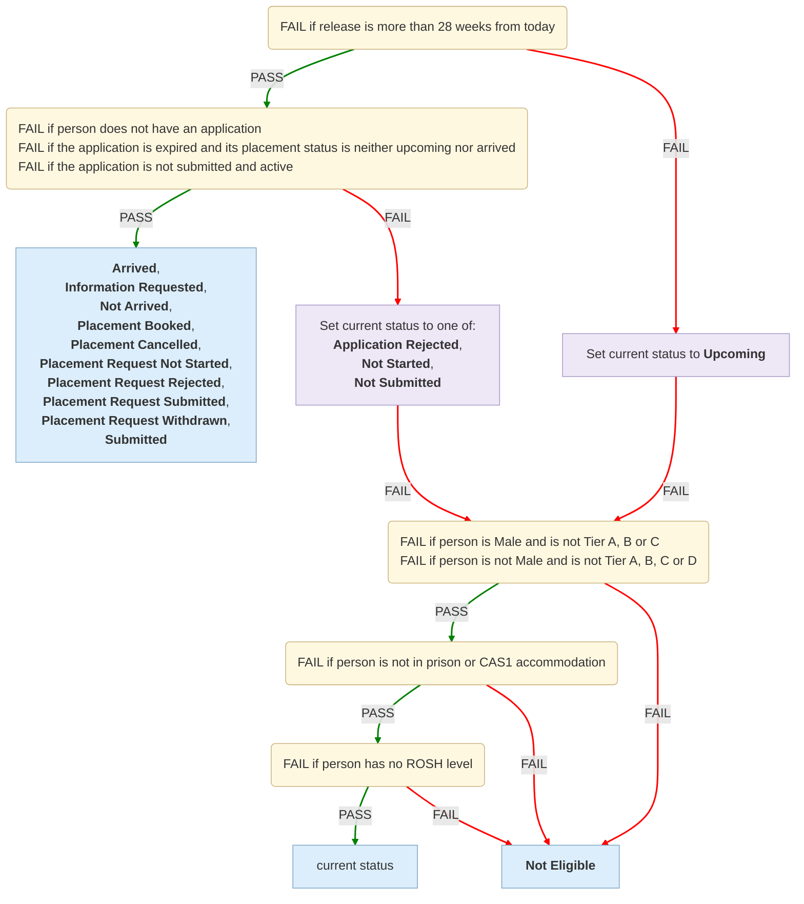
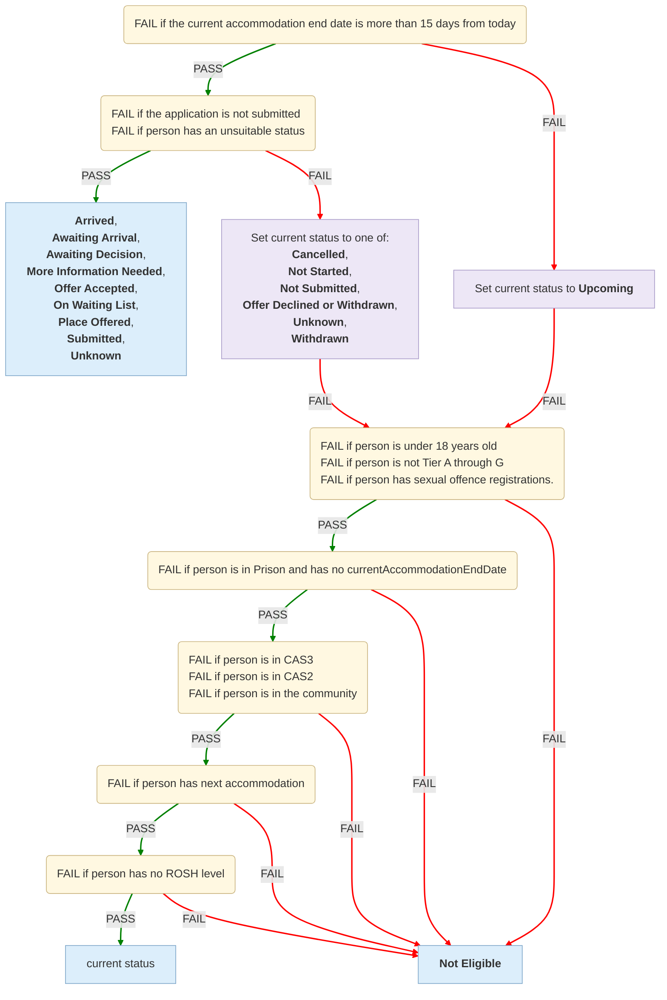
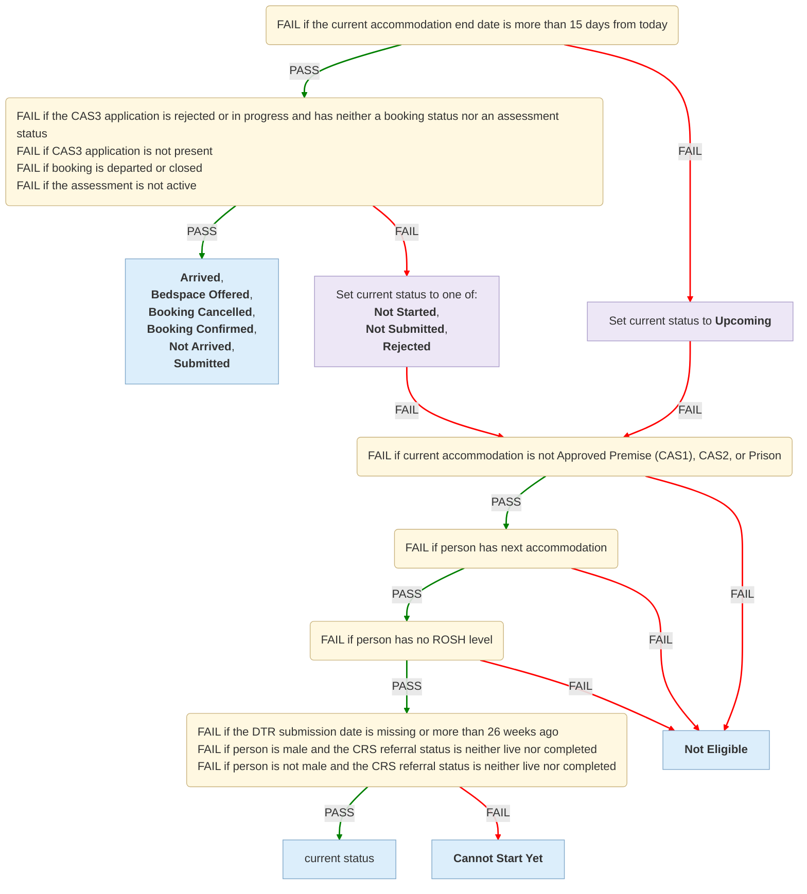
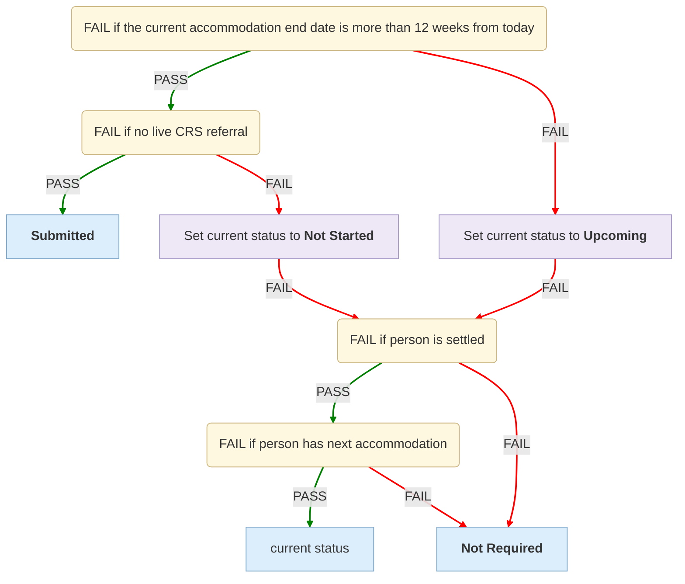
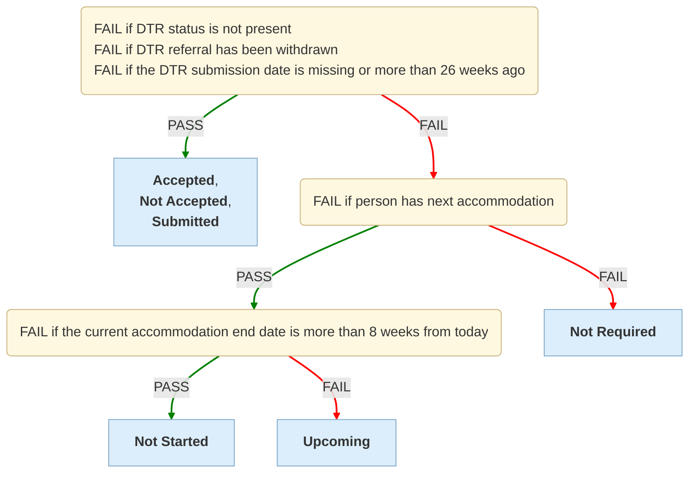
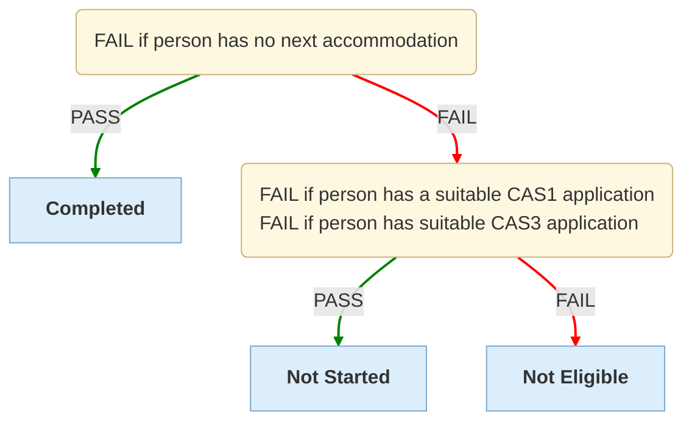

# Eligibility rules graph

Generated by `./gradlew :query:generateEligibilityRulesGraph`. Do not edit by hand.

Diamond RuleSet nodes have a FAIL context updater.

## CAS1

### Nodes

**Upcoming** (RuleSet) `Cas1UpcomingRuleSet`

- [
  `ReleaseWithinTwentyEightWeeksRule`](../query/src/main/kotlin/uk/gov/justice/digital/hmpps/singleaccommodationserviceapi/query/eligibility/domain/cas1/upcoming/ReleaseWithinTwentyEightWeeksRule.kt):
  FAIL if release is more than 28 weeks from today
- FAIL: [
  `Cas1UpcomingContextUpdater`](../query/src/main/kotlin/uk/gov/justice/digital/hmpps/singleaccommodationserviceapi/query/eligibility/domain/cas1/upcoming/Cas1UpcomingContextUpdater.kt) -
  Set current status to Upcoming

| Status        | Action                                    | Link type |
|---------------|-------------------------------------------|-----------|
| CAS1_UPCOMING | START_APPROVED_PREMISE_APPLICATION (CAS1) | -         |

**Suitability** (RuleSet) `Cas1SuitabilityRuleSet`

- [
  `Cas1ApplicationPresentRule`](../query/src/main/kotlin/uk/gov/justice/digital/hmpps/singleaccommodationserviceapi/query/eligibility/domain/cas1/suitability/Cas1ApplicationPresentRule.kt):
  FAIL if person does not have an application
- [
  `Cas1ApplicationRelevantExpiredRule`](../query/src/main/kotlin/uk/gov/justice/digital/hmpps/singleaccommodationserviceapi/query/eligibility/domain/cas1/suitability/Cas1ApplicationRelevantExpiredRule.kt):
  FAIL if the application is expired and its placement status is neither upcoming nor arrived
- [
  `Cas1ApplicationSuitabilityRule`](../query/src/main/kotlin/uk/gov/justice/digital/hmpps/singleaccommodationserviceapi/query/eligibility/domain/cas1/suitability/Cas1ApplicationSuitabilityRule.kt):
  FAIL if the application is not submitted and active
- PASS: [
  `Cas1CompletionContextUpdater`](../query/src/main/kotlin/uk/gov/justice/digital/hmpps/singleaccommodationserviceapi/query/eligibility/domain/cas1/suitability/Cas1CompletionContextUpdater.kt) -
  Arrived,
  Information Requested,
  Not Arrived,
  Placement Booked,
  Placement Cancelled,
  Placement Request Not Started,
  Placement Request Rejected,
  Placement Request Submitted,
  Placement Request Withdrawn,
  Submitted

| Status                               | Action                     | Link type             |
|--------------------------------------|----------------------------|-----------------------|
| CAS1_ARRIVED                         | -                          | CAS1_VIEW_APPLICATION |
| CAS1_NOT_ARRIVED                     | CREATE_PLACEMENT (CAS1)    | CAS1_VIEW_APPLICATION |
| CAS1_PLACEMENT_BOOKED                | -                          | CAS1_VIEW_APPLICATION |
| CAS1_PLACEMENT_CANCELLED             | CREATE_PLACEMENT (CAS1)    | CAS1_VIEW_APPLICATION |
| CAS1_PLACEMENT_REQUEST_NOT_STARTED   | CREATE_PLACEMENT (CAS1)    | CAS1_VIEW_APPLICATION |
| CAS1_PLACEMENT_REQUEST_WITHDRAWN     | CREATE_PLACEMENT (CAS1)    | CAS1_VIEW_APPLICATION |
| CAS1_PLACEMENT_REQUEST_NOT_SUBMITTED | CREATE_PLACEMENT (CAS1)    | CAS1_VIEW_APPLICATION |
| CAS1_PLACEMENT_REQUEST_REJECTED      | CREATE_PLACEMENT (CAS1)    | CAS1_VIEW_APPLICATION |
| CAS1_PLACEMENT_REQUEST_SUBMITTED     | -                          | CAS1_VIEW_APPLICATION |
| CAS1_INFO_REQUESTED                  | PROVIDE_INFORMATION (CAS1) | CAS1_VIEW_APPLICATION |
| CAS1_SUBMITTED                       | -                          | CAS1_VIEW_APPLICATION |

- FAIL: [
  `Cas1SuitabilityContextUpdater`](../query/src/main/kotlin/uk/gov/justice/digital/hmpps/singleaccommodationserviceapi/query/eligibility/domain/cas1/suitability/Cas1SuitabilityContextUpdater.kt) -
  Set current status to one of:
  Application Rejected,
  Not Started,
  Not Submitted

| Status                    | Action                                       | Link type              |
|---------------------------|----------------------------------------------|------------------------|
| CAS1_NOT_SUBMITTED        | CONTINUE_APPROVED_PREMISE_APPLICATION (CAS1) | CAS1_VIEW_APPLICATION  |
| CAS1_APPLICATION_REJECTED | START_APPROVED_PREMISE_APPLICATION (CAS1)    | CAS1_START_APPLICATION |
| CAS1_NOT_STARTED          | START_APPROVED_PREMISE_APPLICATION (CAS1)    | CAS1_START_APPLICATION |

**Arrived, Information Requested, Not Arrived, Placement Booked, Placement Cancelled, Placement Request Not Started,
Placement Request Rejected, Placement Request Submitted, Placement Request Withdrawn, Submitted** (Outcome)

**Eligibility Tier** (RuleSet) `Cas1EligibilityTierRuleSet`

- [
  `MaleRiskEligibilityRule`](../query/src/main/kotlin/uk/gov/justice/digital/hmpps/singleaccommodationserviceapi/query/eligibility/domain/cas1/eligibility/MaleRiskEligibilityRule.kt):
  FAIL if person is Male and is not Tier A, B or C
- [
  `NonMaleRiskEligibilityRule`](../query/src/main/kotlin/uk/gov/justice/digital/hmpps/singleaccommodationserviceapi/query/eligibility/domain/cas1/eligibility/NonMaleRiskEligibilityRule.kt):
  FAIL if person is not Male and is not Tier A, B, C or D

**Eligibility Current Accommodation** (RuleSet) `Cas1EligibilityCurrentAccommodationRuleSet`

- [
  `CurrentAccommodationIsPrisonOrCas1Rule`](../query/src/main/kotlin/uk/gov/justice/digital/hmpps/singleaccommodationserviceapi/query/eligibility/domain/cas1/eligibility/CurrentAccommodationIsPrisonOrCas1Rule.kt):
  FAIL if person is not in prison or CAS1 accommodation

**Eligibility Rosh** (RuleSet) `EligibilityRoshRuleSet`

- [
  `RoshLevelRule`](../query/src/main/kotlin/uk/gov/justice/digital/hmpps/singleaccommodationserviceapi/query/eligibility/domain/common/RoshLevelRule.kt):
  FAIL if person has no ROSH level

**current status** (Outcome)

**Not Eligible** (Outcome)

## CAS2

### Nodes

**Upcoming** (RuleSet) `Cas2UpcomingRuleSet`

- [
  `ReleaseWithin15DaysRule`](../query/src/main/kotlin/uk/gov/justice/digital/hmpps/singleaccommodationserviceapi/query/eligibility/domain/common/ReleaseWithin15DaysRule.kt):
  FAIL if the current accommodation end date is more than 15 days from today
- FAIL: [
  `Cas2UpcomingContextUpdater`](../query/src/main/kotlin/uk/gov/justice/digital/hmpps/singleaccommodationserviceapi/query/eligibility/domain/cas2/upcoming/Cas2UpcomingContextUpdater.kt) -
  Set current status to Upcoming

| Status        | Action                     | Link type |
|---------------|----------------------------|-----------|
| CAS2_UPCOMING | START_CAS2_REFERRAL (CAS2) | -         |

**Suitability** (RuleSet) `Cas2SuitabilityRuleSet`

- [
  `Cas2ApplicationSubmittedRule`](../query/src/main/kotlin/uk/gov/justice/digital/hmpps/singleaccommodationserviceapi/query/eligibility/domain/cas2/suitability/Cas2ApplicationSubmittedRule.kt):
  FAIL if the application is not submitted
- [
  `Cas2SuitableStatusRule`](../query/src/main/kotlin/uk/gov/justice/digital/hmpps/singleaccommodationserviceapi/query/eligibility/domain/cas2/suitability/Cas2SuitableStatusRule.kt):
  FAIL if person has an unsuitable status
- PASS: [
  `Cas2CompletionContextUpdater`](../query/src/main/kotlin/uk/gov/justice/digital/hmpps/singleaccommodationserviceapi/query/eligibility/domain/cas2/suitability/Cas2CompletionContextUpdater.kt) -
  Arrived,
  Awaiting Arrival,
  Awaiting Decision,
  More Information Needed,
  Offer Accepted,
  On Waiting List,
  Place Offered,
  Submitted,
  Unknown

| Status                       | Action                                            | Link type             |
|------------------------------|---------------------------------------------------|-----------------------|
| CAS2_SUBMITTED               | -                                                 | CAS2_VIEW_APPLICATION |
| CAS2_MORE_INFORMATION_NEEDED | PROVIDE_MORE_INFORMATION_FOR_CAS2_REFERRAL (CAS2) | CAS2_VIEW_APPLICATION |
| CAS2_AWAITING_DECISION       | -                                                 | CAS2_VIEW_APPLICATION |
| CAS2_ON_WAITING_LIST         | -                                                 | CAS2_VIEW_APPLICATION |
| CAS2_PLACE_OFFERED           | REPLY_TO_CAS2_PLACE_OFFER (CAS2)                  | CAS2_VIEW_APPLICATION |
| CAS2_OFFER_ACCEPTED          | -                                                 | CAS2_VIEW_APPLICATION |
| CAS2_UNKNOWN                 | -                                                 | -                     |
| CAS2_ARRIVED                 | -                                                 | CAS2_VIEW_APPLICATION |
| CAS2_AWAITING_ARRIVAL        | -                                                 | CAS2_VIEW_APPLICATION |

- FAIL: [
  `Cas2SuitabilityContextUpdater`](../query/src/main/kotlin/uk/gov/justice/digital/hmpps/singleaccommodationserviceapi/query/eligibility/domain/cas2/suitability/Cas2SuitabilityContextUpdater.kt) -
  Set current status to one of:
  Cancelled,
  Not Started,
  Not Submitted,
  Offer Declined or Withdrawn,
  Unknown,
  Withdrawn

| Status                           | Action                          | Link type              |
|----------------------------------|---------------------------------|------------------------|
| CAS2_NOT_STARTED                 | START_CAS2_REFERRAL (CAS2)      | CAS2_START_APPLICATION |
| CAS2_NOT_SUBMITTED               | CONTINUE_A_CAS2_REFERRAL (CAS2) | CAS2_VIEW_APPLICATION  |
| CAS2_OFFER_DECLINED_OR_WITHDRAWN | -                               | CAS2_START_APPLICATION |
| CAS2_CANCELLED                   | -                               | CAS2_START_APPLICATION |
| CAS2_WITHDRAWN                   | -                               | CAS2_START_APPLICATION |
| CAS2_UNKNOWN                     | -                               | -                      |

**Arrived, Awaiting Arrival, Awaiting Decision, More Information Needed, Offer Accepted, On Waiting List, Place Offered,
Submitted, Unknown** (Outcome)

**Eligibility Person** (RuleSet) `Cas2EligibilityPersonRuleSet`

- [
  `Under18Rule`](../query/src/main/kotlin/uk/gov/justice/digital/hmpps/singleaccommodationserviceapi/query/eligibility/domain/cas2/eligibility/Under18Rule.kt):
  FAIL if person is under 18 years old
- [
  `SingleLetterTierRule`](../query/src/main/kotlin/uk/gov/justice/digital/hmpps/singleaccommodationserviceapi/query/eligibility/domain/cas2/eligibility/SingleLetterTierRule.kt):
  FAIL if person is not Tier A through G
- [
  `SexualOffenceRegistrationsRule`](../query/src/main/kotlin/uk/gov/justice/digital/hmpps/singleaccommodationserviceapi/query/eligibility/domain/cas2/eligibility/SexualOffenceRegistrationsRule.kt):
  FAIL if person has sexual offence registrations.

**Eligibility Release Date** (RuleSet) `Cas2EligibilityReleaseDateRuleSet`

- [
  `InPrisonNoReleaseDateRule`](../query/src/main/kotlin/uk/gov/justice/digital/hmpps/singleaccommodationserviceapi/query/eligibility/domain/cas2/eligibility/InPrisonNoReleaseDateRule.kt):
  FAIL if person is in Prison and has no currentAccommodationEndDate

**Eligibility Current Accommodation** (RuleSet) `Cas2EligibilityCurrentAccommodationRuleSet`

- [
  `CurrentAccommodationTypeIsCas3Rule`](../query/src/main/kotlin/uk/gov/justice/digital/hmpps/singleaccommodationserviceapi/query/eligibility/domain/cas2/eligibility/CurrentAccommodationTypeIsCas3Rule.kt):
  FAIL if person is in CAS3
- [
  `CurrentAccommodationTypeIsCas2Rule`](../query/src/main/kotlin/uk/gov/justice/digital/hmpps/singleaccommodationserviceapi/query/eligibility/domain/cas2/eligibility/CurrentAccommodationTypeIsCas2Rule.kt):
  FAIL if person is in CAS2
- [
  `CurrentAccommodationTypeIsCommunityRule`](../query/src/main/kotlin/uk/gov/justice/digital/hmpps/singleaccommodationserviceapi/query/eligibility/domain/cas2/eligibility/CurrentAccommodationTypeIsCommunityRule.kt):
  FAIL if person is in the community

**Eligibility Next Accommodation** (RuleSet) `Cas2EligibilityNextAccommodationRuleSet`

- [
  `NoNextAccommodationRule`](../query/src/main/kotlin/uk/gov/justice/digital/hmpps/singleaccommodationserviceapi/query/eligibility/domain/common/NoNextAccommodationRule.kt):
  FAIL if person has next accommodation

**Eligibility Rosh** (RuleSet) `EligibilityRoshRuleSet`

- [
  `RoshLevelRule`](../query/src/main/kotlin/uk/gov/justice/digital/hmpps/singleaccommodationserviceapi/query/eligibility/domain/common/RoshLevelRule.kt):
  FAIL if person has no ROSH level

**current status** (Outcome)

**Not Eligible** (Outcome)

## CAS3

### Nodes

**Upcoming** (RuleSet) `Cas3UpcomingRuleSet`

- [
  `ReleaseWithin15DaysRule`](../query/src/main/kotlin/uk/gov/justice/digital/hmpps/singleaccommodationserviceapi/query/eligibility/domain/common/ReleaseWithin15DaysRule.kt):
  FAIL if the current accommodation end date is more than 15 days from today
- FAIL: [
  `Cas3UpcomingContextUpdater`](../query/src/main/kotlin/uk/gov/justice/digital/hmpps/singleaccommodationserviceapi/query/eligibility/domain/cas3/upcoming/Cas3UpcomingContextUpdater.kt) -
  Set current status to Upcoming

| Status        | Action                     | Link type |
|---------------|----------------------------|-----------|
| CAS3_UPCOMING | START_CAS3_REFERRAL (CAS3) | -         |

**Suitability** (RuleSet) `Cas3SuitabilityRuleSet`

- [
  `Cas3ApplicationSuitabilityRule`](../query/src/main/kotlin/uk/gov/justice/digital/hmpps/singleaccommodationserviceapi/query/eligibility/domain/cas3/suitability/Cas3ApplicationSuitabilityRule.kt):
  FAIL if the CAS3 application is rejected or in progress and has neither a booking status nor an assessment status
- [
  `Cas3ApplicationPresentSuitabilityRule`](../query/src/main/kotlin/uk/gov/justice/digital/hmpps/singleaccommodationserviceapi/query/eligibility/domain/cas3/suitability/Cas3ApplicationPresentSuitabilityRule.kt):
  FAIL if CAS3 application is not present
- [
  `Cas3BookingSuitabilityRule`](../query/src/main/kotlin/uk/gov/justice/digital/hmpps/singleaccommodationserviceapi/query/eligibility/domain/cas3/suitability/Cas3BookingSuitabilityRule.kt):
  FAIL if booking is departed or closed
- [
  `Cas3AssessmentSuitabilityRule`](../query/src/main/kotlin/uk/gov/justice/digital/hmpps/singleaccommodationserviceapi/query/eligibility/domain/cas3/suitability/Cas3AssessmentSuitabilityRule.kt):
  FAIL if the assessment is not active
- PASS: [
  `Cas3CompletionContextUpdater`](../query/src/main/kotlin/uk/gov/justice/digital/hmpps/singleaccommodationserviceapi/query/eligibility/domain/cas3/suitability/Cas3CompletionContextUpdater.kt) -
  Arrived,
  Bedspace Offered,
  Booking Cancelled,
  Booking Confirmed,
  Not Arrived,
  Submitted

| Status                 | Action                              | Link type          |
|------------------------|-------------------------------------|--------------------|
| CAS3_BEDSPACE_OFFERED  | REPLY_TO_CAS3_BEDSPACE_OFFER (CAS3) | CAS3_VIEW_REFERRAL |
| CAS3_BOOKING_CONFIRMED | -                                   | CAS3_VIEW_REFERRAL |
| CAS3_NOT_ARRIVED       | -                                   | CAS3_VIEW_REFERRAL |
| CAS3_BOOKING_CANCELLED | -                                   | CAS3_VIEW_REFERRAL |
| CAS3_SUBMITTED         | -                                   | CAS3_VIEW_REFERRAL |
| CAS3_ARRIVED           | -                                   | CAS3_VIEW_REFERRAL |

- FAIL: [
  `Cas3SuitabilityContextUpdater`](../query/src/main/kotlin/uk/gov/justice/digital/hmpps/singleaccommodationserviceapi/query/eligibility/domain/cas3/suitability/Cas3SuitabilityContextUpdater.kt) -
  Set current status to one of:
  Not Started,
  Not Submitted,
  Rejected

| Status               | Action                        | Link type           |
|----------------------|-------------------------------|---------------------|
| CAS3_NOT_STARTED_NEW | START_CAS3_REFERRAL (CAS3)    | CAS3_START_REFERRAL |
| CAS3_REJECTED        | START_CAS3_REFERRAL (CAS3)    | CAS3_START_REFERRAL |
| CAS3_NOT_SUBMITTED   | CONTINUE_CAS3_REFERRAL (CAS3) | CAS3_VIEW_REFERRAL  |
| CAS3_NOT_STARTED     | START_CAS3_REFERRAL (CAS3)    | CAS3_START_REFERRAL |

**Arrived, Bedspace Offered, Booking Cancelled, Booking Confirmed, Not Arrived, Submitted** (Outcome)

**Eligibility Current Accommodation** (RuleSet) `Cas3EligibilityCurrentAccommodationRuleSet`

- [
  `CurrentAccommodationTypeRule`](../query/src/main/kotlin/uk/gov/justice/digital/hmpps/singleaccommodationserviceapi/query/eligibility/domain/cas3/eligibility/CurrentAccommodationTypeRule.kt):
  FAIL if current accommodation is not Approved Premise (CAS1), CAS2, or Prison

**Eligibility Next Accommodation** (RuleSet) `Cas3EligibilityNextAccommodationRuleSet`

- [
  `NoNextAccommodationRule`](../query/src/main/kotlin/uk/gov/justice/digital/hmpps/singleaccommodationserviceapi/query/eligibility/domain/common/NoNextAccommodationRule.kt):
  FAIL if person has next accommodation

**Eligibility Rosh** (RuleSet) `EligibilityRoshRuleSet`

- [
  `RoshLevelRule`](../query/src/main/kotlin/uk/gov/justice/digital/hmpps/singleaccommodationserviceapi/query/eligibility/domain/common/RoshLevelRule.kt):
  FAIL if person has no ROSH level

**Prerequisite** (RuleSet) `Cas3PrerequisiteRuleSet`

- [
  `DtrExpiredReferralRule`](../query/src/main/kotlin/uk/gov/justice/digital/hmpps/singleaccommodationserviceapi/query/eligibility/domain/common/DtrExpiredReferralRule.kt):
  FAIL if the DTR submission date is missing or more than 26 weeks ago
- [
  `CrsSubmittedRuleMale`](../query/src/main/kotlin/uk/gov/justice/digital/hmpps/singleaccommodationserviceapi/query/eligibility/domain/cas3/prerequisite/CrsSubmittedRuleMale.kt):
  FAIL if person is male and the CRS referral status is neither live nor completed
- [
  `CrsSubmittedRuleNonMale`](../query/src/main/kotlin/uk/gov/justice/digital/hmpps/singleaccommodationserviceapi/query/eligibility/domain/cas3/prerequisite/CrsSubmittedRuleNonMale.kt):
  FAIL if person is not male and the CRS referral status is neither live nor completed
- FAIL: [
  `Cas3PrerequisiteContextUpdater`](../query/src/main/kotlin/uk/gov/justice/digital/hmpps/singleaccommodationserviceapi/query/eligibility/domain/cas3/prerequisite/Cas3PrerequisiteContextUpdater.kt) -
  Cannot Start Yet

| Status                                             | Action | Link type | Blocking reason                              |
|----------------------------------------------------|--------|-----------|----------------------------------------------|
| CAS3_CANNOT_START_YET_SUBMIT_DTR_CRS_ACCOMMODATION | -      | -         | SUBMIT_DTR_AND_CRS_ACCOMMODATION_BEFORE_CAS3 |
| CAS3_CANNOT_START_YET_SUBMIT_DTR_CRS               | -      | -         | SUBMIT_DTR_AND_CRS_BEFORE_CAS3               |
| CAS3_CANNOT_START_YET_SUBMIT_CRS_ACCOMMODATION     | -      | -         | SUBMIT_CRS_ACCOMMODATION_BEFORE_CAS3         |
| CAS3_CANNOT_START_YET_SUBMIT_CRS                   | -      | -         | SUBMIT_CRS_BEFORE_CAS3                       |
| CAS3_CANNOT_START_YET_SUBMIT_DTR                   | -      | -         | SUBMIT_DTR_BEFORE_CAS3                       |

**current status** (Outcome)

**Cannot Start Yet** (Outcome)

**Not Eligible** (Outcome)

## CRS

### Nodes

**Upcoming** (RuleSet) `CrsUpcomingRuleSet`

- [
  `CrsUpcomingRule`](../query/src/main/kotlin/uk/gov/justice/digital/hmpps/singleaccommodationserviceapi/query/eligibility/domain/crs/upcoming/CrsUpcomingRule.kt):
  FAIL if the current accommodation end date is more than 12 weeks from today
- FAIL: [
  `CrsUpcomingContextUpdater`](../query/src/main/kotlin/uk/gov/justice/digital/hmpps/singleaccommodationserviceapi/query/eligibility/domain/crs/upcoming/CrsUpcomingContextUpdater.kt) -
  Set current status to Upcoming

| Status                              | Action                                  | Link type |
|-------------------------------------|-----------------------------------------|-----------|
| CRS_UPCOMING_ACCOMMODATION_REFERRAL | SUBMIT_CRS_ACCOMMODATION_REFERRAL (CRS) | -         |
| CRS_UPCOMING_REFERRAL               | SUBMIT_CRS_REFERRAL (CRS)               | -         |

**Completion** (RuleSet) `CrsCompletionRuleSet`

- [
  `CrsSubmittedRule`](../query/src/main/kotlin/uk/gov/justice/digital/hmpps/singleaccommodationserviceapi/query/eligibility/domain/crs/completion/CrsSubmittedRule.kt):
  FAIL if no live CRS referral
- FAIL: [
  `CrsCompletionContextUpdater`](../query/src/main/kotlin/uk/gov/justice/digital/hmpps/singleaccommodationserviceapi/query/eligibility/domain/crs/completion/CrsCompletionContextUpdater.kt) -
  Set current status to Not Started

| Status                                 | Action                                  | Link type |
|----------------------------------------|-----------------------------------------|-----------|
| CRS_NOT_STARTED_ACCOMMODATION_REFERRAL | SUBMIT_CRS_ACCOMMODATION_REFERRAL (CRS) | -         |
| CRS_NOT_STARTED_REFERRAL               | SUBMIT_CRS_REFERRAL (CRS)               | -         |

**Submitted** (Outcome)

**Eligibility Settled** (RuleSet) `CrsEligibilitySettledRuleSet`

- [
  `IsSettledRule`](../query/src/main/kotlin/uk/gov/justice/digital/hmpps/singleaccommodationserviceapi/query/eligibility/domain/crs/eligibility/IsSettledRule.kt):
  FAIL if person is settled

**Eligibility Next Accommodation** (RuleSet) `CrsEligibilityNextAccommodationRuleSet`

- [
  `NoNextAccommodationRule`](../query/src/main/kotlin/uk/gov/justice/digital/hmpps/singleaccommodationserviceapi/query/eligibility/domain/common/NoNextAccommodationRule.kt):
  FAIL if person has next accommodation

**current status** (Outcome)

**Not Required** (Outcome)

## DTR

### Nodes

**Suitability** (RuleSet) `DtrSuitabilityRuleSet`

- [
  `DtrPresentRule`](../query/src/main/kotlin/uk/gov/justice/digital/hmpps/singleaccommodationserviceapi/query/eligibility/domain/dtr/suitability/DtrPresentRule.kt):
  FAIL if DTR status is not present
- [
  `DtrNotWithdrawnRule`](../query/src/main/kotlin/uk/gov/justice/digital/hmpps/singleaccommodationserviceapi/query/eligibility/domain/dtr/suitability/DtrNotWithdrawnRule.kt):
  FAIL if DTR referral has been withdrawn
- [
  `DtrExpiredReferralRule`](../query/src/main/kotlin/uk/gov/justice/digital/hmpps/singleaccommodationserviceapi/query/eligibility/domain/common/DtrExpiredReferralRule.kt):
  FAIL if the DTR submission date is missing or more than 26 weeks ago
- PASS: [
  `DtrCompletionContextUpdater`](../query/src/main/kotlin/uk/gov/justice/digital/hmpps/singleaccommodationserviceapi/query/eligibility/domain/dtr/suitability/DtrCompletionContextUpdater.kt) -
  Accepted,
  Not Accepted,
  Submitted

| Status           | Action                | Link type |
|------------------|-----------------------|-----------|
| DTR_ACCEPTED     | -                     | -         |
| DTR_NOT_ACCEPTED | -                     | -         |
| DTR_SUBMITTED    | ADD_DTR_OUTCOME (DTR) | -         |

**Accepted, Not Accepted, Submitted** (Outcome)

**Eligibility** (RuleSet) `DtrEligibilityRuleSet`

- [
  `NoNextAccommodationRule`](../query/src/main/kotlin/uk/gov/justice/digital/hmpps/singleaccommodationserviceapi/query/eligibility/domain/common/NoNextAccommodationRule.kt):
  FAIL if person has next accommodation

**Upcoming** (RuleSet) `DtrUpcomingRuleSet`

- [
  `ReleaseWithinEightWeeksRule`](../query/src/main/kotlin/uk/gov/justice/digital/hmpps/singleaccommodationserviceapi/query/eligibility/domain/dtr/upcoming/ReleaseWithinEightWeeksRule.kt):
  FAIL if the current accommodation end date is more than 8 weeks from today
- FAIL: [
  `DtrUpcomingContextUpdater`](../query/src/main/kotlin/uk/gov/justice/digital/hmpps/singleaccommodationserviceapi/query/eligibility/domain/dtr/upcoming/DtrUpcomingContextUpdater.kt) -
  Upcoming

| Status       | Action                    | Link type |
|--------------|---------------------------|-----------|
| DTR_UPCOMING | SUBMIT_DTR_REFERRAL (DTR) | -         |

**Not Started** (Outcome)

**Upcoming** (Outcome)

**Not Required** (Outcome)

## PA

### Nodes

**Completion** (RuleSet) `PaCompletionRuleSet`

- [
  `HasNextAccommodationRule`](../query/src/main/kotlin/uk/gov/justice/digital/hmpps/singleaccommodationserviceapi/query/eligibility/domain/pa/completion/HasNextAccommodationRule.kt):
  FAIL if person has no next accommodation

**Completed** (Outcome)

**Eligibility** (RuleSet) `PaEligibilityRuleSet`

- [
  `Cas1ApplicationNotSuitableRule`](../query/src/main/kotlin/uk/gov/justice/digital/hmpps/singleaccommodationserviceapi/query/eligibility/domain/pa/eligibility/Cas1ApplicationNotSuitableRule.kt):
  FAIL if person has a suitable CAS1 application
- [
  `Cas3ApplicationNotSuitableRule`](../query/src/main/kotlin/uk/gov/justice/digital/hmpps/singleaccommodationserviceapi/query/eligibility/domain/pa/eligibility/Cas3ApplicationNotSuitableRule.kt):
  FAIL if person has suitable CAS3 application

**Not Started** (Outcome)

**Not Eligible** (Outcome)

## Rule catalogue

| Rule                                    | Description                                                                                                       | RuleSets                                    | Trees                |
|-----------------------------------------|-------------------------------------------------------------------------------------------------------------------|---------------------------------------------|----------------------|
| Cas1ApplicationNotSuitableRule          | FAIL if person has a suitable CAS1 application                                                                    | Eligibility                                 | PA                   |
| Cas1ApplicationPresentRule              | FAIL if person does not have an application                                                                       | Suitability                                 | CAS1                 |
| Cas1ApplicationRelevantExpiredRule      | FAIL if the application is expired and its placement status is neither upcoming nor arrived                       | Suitability                                 | CAS1                 |
| Cas1ApplicationSuitabilityRule          | FAIL if the application is not submitted and active                                                               | Suitability                                 | CAS1                 |
| Cas2ApplicationSubmittedRule            | FAIL if the application is not submitted                                                                          | Suitability                                 | CAS2                 |
| Cas2SuitableStatusRule                  | FAIL if person has an unsuitable status                                                                           | Suitability                                 | CAS2                 |
| Cas3ApplicationNotSuitableRule          | FAIL if person has suitable CAS3 application                                                                      | Eligibility                                 | PA                   |
| Cas3ApplicationPresentSuitabilityRule   | FAIL if CAS3 application is not present                                                                           | Suitability                                 | CAS3                 |
| Cas3ApplicationSuitabilityRule          | FAIL if the CAS3 application is rejected or in progress and has neither a booking status nor an assessment status | Suitability                                 | CAS3                 |
| Cas3AssessmentSuitabilityRule           | FAIL if the assessment is not active                                                                              | Suitability                                 | CAS3                 |
| Cas3BookingSuitabilityRule              | FAIL if booking is departed or closed                                                                             | Suitability                                 | CAS3                 |
| CrsSubmittedRule                        | FAIL if no live CRS referral                                                                                      | Completion                                  | CRS                  |
| CrsSubmittedRuleMale                    | FAIL if person is male and the CRS referral status is neither live nor completed                                  | Prerequisite                                | CAS3                 |
| CrsSubmittedRuleNonMale                 | FAIL if person is not male and the CRS referral status is neither live nor completed                              | Prerequisite                                | CAS3                 |
| CrsUpcomingRule                         | FAIL if the current accommodation end date is more than 12 weeks from today                                       | Upcoming                                    | CRS                  |
| CurrentAccommodationIsPrisonOrCas1Rule  | FAIL if person is not in prison or CAS1 accommodation                                                             | Eligibility Current Accommodation           | CAS1                 |
| CurrentAccommodationTypeIsCas2Rule      | FAIL if person is in CAS2                                                                                         | Eligibility Current Accommodation           | CAS2                 |
| CurrentAccommodationTypeIsCas3Rule      | FAIL if person is in CAS3                                                                                         | Eligibility Current Accommodation           | CAS2                 |
| CurrentAccommodationTypeIsCommunityRule | FAIL if person is in the community                                                                                | Eligibility Current Accommodation           | CAS2                 |
| CurrentAccommodationTypeRule            | FAIL if current accommodation is not Approved Premise (CAS1), CAS2, or Prison                                     | Eligibility Current Accommodation           | CAS3                 |
| DtrExpiredReferralRule                  | FAIL if the DTR submission date is missing or more than 26 weeks ago                                              | Prerequisite, Suitability                   | CAS3, DTR            |
| DtrNotWithdrawnRule                     | FAIL if DTR referral has been withdrawn                                                                           | Suitability                                 | DTR                  |
| DtrPresentRule                          | FAIL if DTR status is not present                                                                                 | Suitability                                 | DTR                  |
| HasNextAccommodationRule                | FAIL if person has no next accommodation                                                                          | Completion                                  | PA                   |
| InPrisonNoReleaseDateRule               | FAIL if person is in Prison and has no currentAccommodationEndDate                                                | Eligibility Release Date                    | CAS2                 |
| IsSettledRule                           | FAIL if person is settled                                                                                         | Eligibility Settled                         | CRS                  |
| MaleRiskEligibilityRule                 | FAIL if person is Male and is not Tier A, B or C                                                                  | Eligibility Tier                            | CAS1                 |
| NoNextAccommodationRule                 | FAIL if person has next accommodation                                                                             | Eligibility, Eligibility Next Accommodation | CAS2, CAS3, CRS, DTR |
| NonMaleRiskEligibilityRule              | FAIL if person is not Male and is not Tier A, B, C or D                                                           | Eligibility Tier                            | CAS1                 |
| ReleaseWithin15DaysRule                 | FAIL if the current accommodation end date is more than 15 days from today                                        | Upcoming                                    | CAS2, CAS3           |
| ReleaseWithinEightWeeksRule             | FAIL if the current accommodation end date is more than 8 weeks from today                                        | Upcoming                                    | DTR                  |
| ReleaseWithinTwentyEightWeeksRule       | FAIL if release is more than 28 weeks from today                                                                  | Upcoming                                    | CAS1                 |
| RoshLevelRule                           | FAIL if person has no ROSH level                                                                                  | Eligibility Rosh                            | CAS1, CAS2, CAS3     |
| SexualOffenceRegistrationsRule          | FAIL if person has sexual offence registrations.                                                                  | Eligibility Person                          | CAS2                 |
| SingleLetterTierRule                    | FAIL if person is not Tier A through G                                                                            | Eligibility Person                          | CAS2                 |
| Under18Rule                             | FAIL if person is under 18 years old                                                                              | Eligibility Person                          | CAS2                 |

## Context updater catalogue

Arrived,
Information Requested,
Not Arrived,
Placement Booked,
Placement Cancelled,
Placement Request Not Started,
Placement Request Rejected,
Placement Request Submitted,
Placement Request Withdrawn,
Submitted

Used by: Suitability (CAS1) on pass

| Status                               | Action                     | Link type             |
|--------------------------------------|----------------------------|-----------------------|
| CAS1_ARRIVED                         | -                          | CAS1_VIEW_APPLICATION |
| CAS1_NOT_ARRIVED                     | CREATE_PLACEMENT (CAS1)    | CAS1_VIEW_APPLICATION |
| CAS1_PLACEMENT_BOOKED                | -                          | CAS1_VIEW_APPLICATION |
| CAS1_PLACEMENT_CANCELLED             | CREATE_PLACEMENT (CAS1)    | CAS1_VIEW_APPLICATION |
| CAS1_PLACEMENT_REQUEST_NOT_STARTED   | CREATE_PLACEMENT (CAS1)    | CAS1_VIEW_APPLICATION |
| CAS1_PLACEMENT_REQUEST_WITHDRAWN     | CREATE_PLACEMENT (CAS1)    | CAS1_VIEW_APPLICATION |
| CAS1_PLACEMENT_REQUEST_NOT_SUBMITTED | CREATE_PLACEMENT (CAS1)    | CAS1_VIEW_APPLICATION |
| CAS1_PLACEMENT_REQUEST_REJECTED      | CREATE_PLACEMENT (CAS1)    | CAS1_VIEW_APPLICATION |
| CAS1_PLACEMENT_REQUEST_SUBMITTED     | -                          | CAS1_VIEW_APPLICATION |
| CAS1_INFO_REQUESTED                  | PROVIDE_INFORMATION (CAS1) | CAS1_VIEW_APPLICATION |
| CAS1_SUBMITTED                       | -                          | CAS1_VIEW_APPLICATION |

Set current status to one of:
Application Rejected,
Not Started,
Not Submitted

Used by: Suitability (CAS1) on fail

| Status                    | Action                                       | Link type              |
|---------------------------|----------------------------------------------|------------------------|
| CAS1_NOT_SUBMITTED        | CONTINUE_APPROVED_PREMISE_APPLICATION (CAS1) | CAS1_VIEW_APPLICATION  |
| CAS1_APPLICATION_REJECTED | START_APPROVED_PREMISE_APPLICATION (CAS1)    | CAS1_START_APPLICATION |
| CAS1_NOT_STARTED          | START_APPROVED_PREMISE_APPLICATION (CAS1)    | CAS1_START_APPLICATION |

Set current status to Upcoming

Used by: Upcoming (CAS1) on fail

| Status        | Action                                    | Link type |
|---------------|-------------------------------------------|-----------|
| CAS1_UPCOMING | START_APPROVED_PREMISE_APPLICATION (CAS1) | -         |

Arrived,
Awaiting Arrival,
Awaiting Decision,
More Information Needed,
Offer Accepted,
On Waiting List,
Place Offered,
Submitted,
Unknown

Used by: Suitability (CAS2) on pass

| Status                       | Action                                            | Link type             |
|------------------------------|---------------------------------------------------|-----------------------|
| CAS2_SUBMITTED               | -                                                 | CAS2_VIEW_APPLICATION |
| CAS2_MORE_INFORMATION_NEEDED | PROVIDE_MORE_INFORMATION_FOR_CAS2_REFERRAL (CAS2) | CAS2_VIEW_APPLICATION |
| CAS2_AWAITING_DECISION       | -                                                 | CAS2_VIEW_APPLICATION |
| CAS2_ON_WAITING_LIST         | -                                                 | CAS2_VIEW_APPLICATION |
| CAS2_PLACE_OFFERED           | REPLY_TO_CAS2_PLACE_OFFER (CAS2)                  | CAS2_VIEW_APPLICATION |
| CAS2_OFFER_ACCEPTED          | -                                                 | CAS2_VIEW_APPLICATION |
| CAS2_UNKNOWN                 | -                                                 | -                     |
| CAS2_ARRIVED                 | -                                                 | CAS2_VIEW_APPLICATION |
| CAS2_AWAITING_ARRIVAL        | -                                                 | CAS2_VIEW_APPLICATION |

Set current status to one of:
Cancelled,
Not Started,
Not Submitted,
Offer Declined or Withdrawn,
Unknown,
Withdrawn

Used by: Suitability (CAS2) on fail

| Status                           | Action                          | Link type              |
|----------------------------------|---------------------------------|------------------------|
| CAS2_NOT_STARTED                 | START_CAS2_REFERRAL (CAS2)      | CAS2_START_APPLICATION |
| CAS2_NOT_SUBMITTED               | CONTINUE_A_CAS2_REFERRAL (CAS2) | CAS2_VIEW_APPLICATION  |
| CAS2_OFFER_DECLINED_OR_WITHDRAWN | -                               | CAS2_START_APPLICATION |
| CAS2_CANCELLED                   | -                               | CAS2_START_APPLICATION |
| CAS2_WITHDRAWN                   | -                               | CAS2_START_APPLICATION |
| CAS2_UNKNOWN                     | -                               | -                      |

Set current status to Upcoming

Used by: Upcoming (CAS2) on fail

| Status        | Action                     | Link type |
|---------------|----------------------------|-----------|
| CAS2_UPCOMING | START_CAS2_REFERRAL (CAS2) | -         |

Arrived,
Bedspace Offered,
Booking Cancelled,
Booking Confirmed,
Not Arrived,
Submitted

Used by: Suitability (CAS3) on pass

| Status                 | Action                              | Link type          |
|------------------------|-------------------------------------|--------------------|
| CAS3_BEDSPACE_OFFERED  | REPLY_TO_CAS3_BEDSPACE_OFFER (CAS3) | CAS3_VIEW_REFERRAL |
| CAS3_BOOKING_CONFIRMED | -                                   | CAS3_VIEW_REFERRAL |
| CAS3_NOT_ARRIVED       | -                                   | CAS3_VIEW_REFERRAL |
| CAS3_BOOKING_CANCELLED | -                                   | CAS3_VIEW_REFERRAL |
| CAS3_SUBMITTED         | -                                   | CAS3_VIEW_REFERRAL |
| CAS3_ARRIVED           | -                                   | CAS3_VIEW_REFERRAL |

Cannot Start Yet

Used by: Prerequisite (CAS3) on fail

| Status                                             | Action | Link type | Blocking reason                              |
|----------------------------------------------------|--------|-----------|----------------------------------------------|
| CAS3_CANNOT_START_YET_SUBMIT_DTR_CRS_ACCOMMODATION | -      | -         | SUBMIT_DTR_AND_CRS_ACCOMMODATION_BEFORE_CAS3 |
| CAS3_CANNOT_START_YET_SUBMIT_DTR_CRS               | -      | -         | SUBMIT_DTR_AND_CRS_BEFORE_CAS3               |
| CAS3_CANNOT_START_YET_SUBMIT_CRS_ACCOMMODATION     | -      | -         | SUBMIT_CRS_ACCOMMODATION_BEFORE_CAS3         |
| CAS3_CANNOT_START_YET_SUBMIT_CRS                   | -      | -         | SUBMIT_CRS_BEFORE_CAS3                       |
| CAS3_CANNOT_START_YET_SUBMIT_DTR                   | -      | -         | SUBMIT_DTR_BEFORE_CAS3                       |

Set current status to one of:
Not Started,
Not Submitted,
Rejected

Used by: Suitability (CAS3) on fail

| Status               | Action                        | Link type           |
|----------------------|-------------------------------|---------------------|
| CAS3_NOT_STARTED_NEW | START_CAS3_REFERRAL (CAS3)    | CAS3_START_REFERRAL |
| CAS3_REJECTED        | START_CAS3_REFERRAL (CAS3)    | CAS3_START_REFERRAL |
| CAS3_NOT_SUBMITTED   | CONTINUE_CAS3_REFERRAL (CAS3) | CAS3_VIEW_REFERRAL  |
| CAS3_NOT_STARTED     | START_CAS3_REFERRAL (CAS3)    | CAS3_START_REFERRAL |

Set current status to Upcoming

Used by: Upcoming (CAS3) on fail

| Status        | Action                     | Link type |
|---------------|----------------------------|-----------|
| CAS3_UPCOMING | START_CAS3_REFERRAL (CAS3) | -         |

Set current status to Not Started

Used by: Completion (CRS) on fail

| Status                                 | Action                                  | Link type |
|----------------------------------------|-----------------------------------------|-----------|
| CRS_NOT_STARTED_ACCOMMODATION_REFERRAL | SUBMIT_CRS_ACCOMMODATION_REFERRAL (CRS) | -         |
| CRS_NOT_STARTED_REFERRAL               | SUBMIT_CRS_REFERRAL (CRS)               | -         |

Set current status to Upcoming

Used by: Upcoming (CRS) on fail

| Status                              | Action                                  | Link type |
|-------------------------------------|-----------------------------------------|-----------|
| CRS_UPCOMING_ACCOMMODATION_REFERRAL | SUBMIT_CRS_ACCOMMODATION_REFERRAL (CRS) | -         |
| CRS_UPCOMING_REFERRAL               | SUBMIT_CRS_REFERRAL (CRS)               | -         |

Accepted,
Not Accepted,
Submitted

Used by: Suitability (DTR) on pass

| Status           | Action                | Link type |
|------------------|-----------------------|-----------|
| DTR_ACCEPTED     | -                     | -         |
| DTR_NOT_ACCEPTED | -                     | -         |
| DTR_SUBMITTED    | ADD_DTR_OUTCOME (DTR) | -         |

Upcoming

Used by: Upcoming (DTR) on fail

| Status       | Action                    | Link type |
|--------------|---------------------------|-----------|
| DTR_UPCOMING | SUBMIT_DTR_REFERRAL (DTR) | -         |

