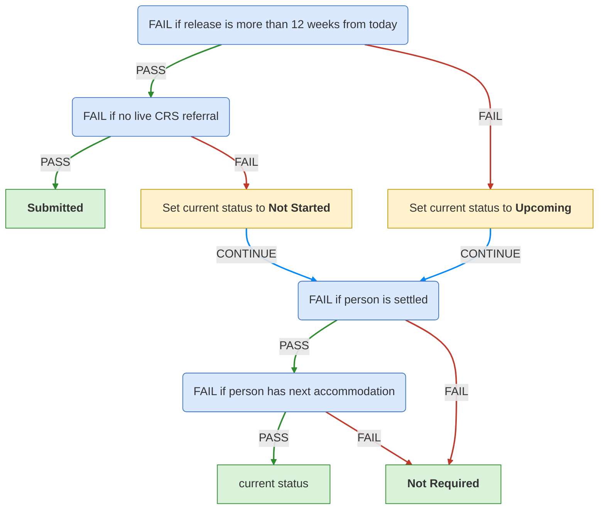
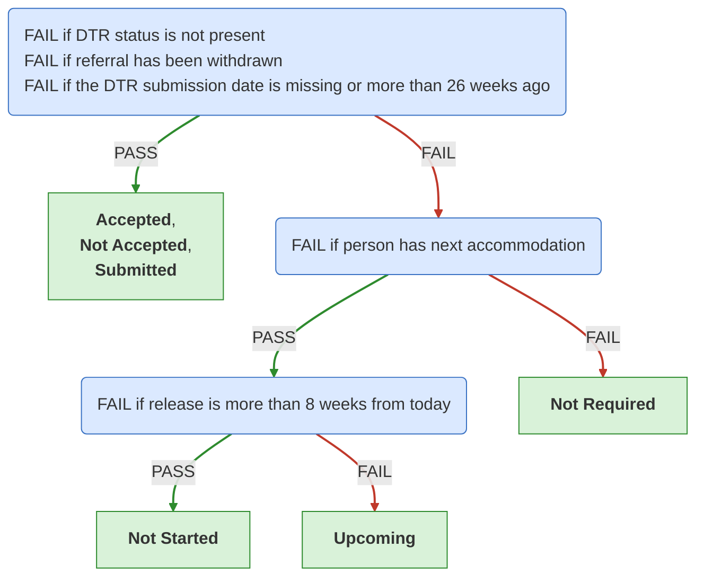
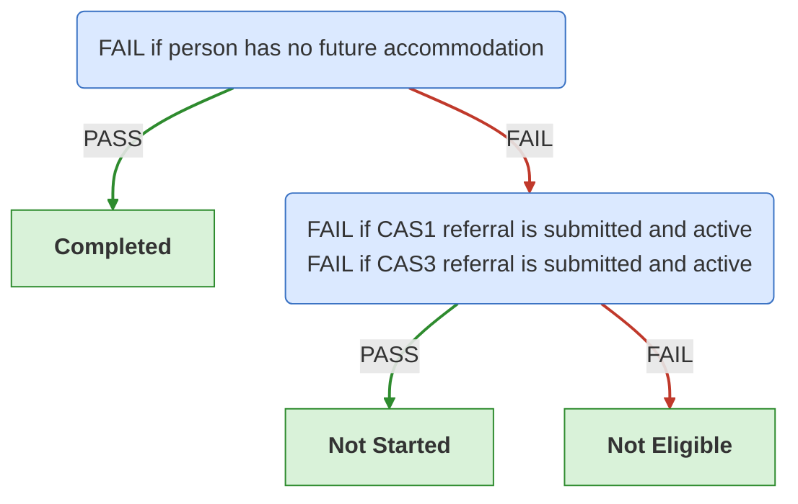

# Eligibility rules graph

Generated by `./gradlew :query:generateEligibilityRulesGraph`. Do not edit by hand.

Diagram colours are shared with the HTML graph in [`RulesGraphColours`](../query/src/main/kotlin/uk/gov/justice/digital/hmpps/singleaccommodationserviceapi/query/eligibility/graph/RulesGraphColours.kt). Regenerate both graphs after changing the palette.

Diamond RuleSet nodes have a FAIL context updater.

## CAS1

```mermaid
%%{init: {"flowchart": {"wrappingWidth": 800}}}%%
flowchart TD
  Release_Within_28_Weeks("<div style='text-align:left'>FAIL if release is more than 28 weeks from today</div>")
  PASS_if_placement_is_active("<div style='text-align:left'>FAIL if current placement is not active</div>")
  PASS_if_placement_is_booked("<div style='text-align:left'>FAIL if current placement is arrived</div>")
  CAS1_PLACEMENT_BOOKED["<b>Placement Booked</b>"]
  CAS1_ARRIVED["<b>Arrived</b>"]
  CAS1_Referral("<div style='text-align:left'>FAIL if person does not have a referral
FAIL if the referral is expired and there is no pending or active placement</div>")
  Placement("<div style='text-align:left'>FAIL if no placement</div>")
  PASS_if_placement_is_not_departed("<div style='text-align:left'>FAIL if current placement is departed</div>")
  PASS_if_placement_is_not_arrived("<div style='text-align:left'>FAIL if current placement is cancelled</div>")
  CAS1_NOT_ARRIVED["<b>Not Arrived</b>"]
  CAS1_PLACEMENT_CANCELLED["<b>Placement Cancelled</b>"]
  CAS1_PLACEMENT_REQUEST_NOT_STARTED["<b>Placement Request Not Started</b>"]
  Request_For_Placement("<div style='text-align:left'>FAIL if no current request for placement</div>")
  PASS_if_placement_is_not_rejected("<div style='text-align:left'>FAIL if request for placement is rejected</div>")
  PASS_if_placement_is_not_withdrawn("<div style='text-align:left'>FAIL if request for placement is withdrawn</div>")
  PASS_if_referral_is_submitted_or_awaiting_placement("<div style='text-align:left'>FAIL if request for placement is unsubmitted</div>")
  CAS1_PLACEMENT_REQUEST_SUBMITTED["<b>Placement Request Submitted</b>"]
  CAS1_PLACEMENT_REQUEST_NOT_SUBMITTED["<b>Placement Request Not Started</b>"]
  CAS1_PLACEMENT_REQUEST_WITHDRAWN["<b>Placement Request Withdrawn</b>"]
  CAS1_PLACEMENT_REQUEST_REJECTED["<b>Placement Request Rejected</b>"]
  CAS1_Active_Referral("<div style='text-align:left'>FAIL if the referral is not active</div>")
  PASS_if_application_is_not_pending_a_placement_request("<div style='text-align:left'>FAIL if referral is pending placement request</div>")
  PASS_if_more_information_has_not_been_requested_for_referral("<div style='text-align:left'>FAIL if more information has been requested for referral</div>")
  CAS1_SUBMITTED["<b>Submitted</b>"]
  CAS1_INFO_REQUESTED["<b>Information Requested</b>"]
  CAS1_Rejected_Referral("<div style='text-align:left'>FAIL if the referral is not rejected</div>")
  Not_Male("<div style='text-align:left'>FAIL if person is Male</div>")
  Not_Male_Tier_Eligible_For_CAS1("<div style='text-align:left'>FAIL if person is not Tier A, B, C or D</div>")
  Current_Accommodation_Eligible_For_CAS1("<div style='text-align:left'>FAIL if person is not in prison or CAS1</div>")
  ROSH_Eligible("<div style='text-align:left'>FAIL if person has no ROSH level</div>")
  confirmed["current status"]
  CAS1_NOT_ELIGIBLE["<b>Not Eligible</b>"]
  Male_Tier_Eligible_For_CAS1("<div style='text-align:left'>FAIL if person is not Tier A, B or C</div>")
  updater_Cas1RejectedContextUpdater_Not_Male["Set current status to <b>Application Rejected</b>"]
  CAS1_Not_Submitted_Referral("<div style='text-align:left'>FAIL if the referral is submitted</div>")
  updater_Cas1NotSubmittedContextUpdater_Not_Male["Set current status to <b>Not Submitted</b>"]
  updater_Cas1StartContextUpdater_Not_Male["Set current status to <b>Not Started</b>"]
  updater_Cas1UpcomingContextUpdater_Not_Male["Set current status to <b>Upcoming</b>"]
  PASS_if_placement_is_booked -->|PASS| CAS1_PLACEMENT_BOOKED
  PASS_if_placement_is_booked -->|FAIL| CAS1_ARRIVED
  PASS_if_placement_is_active -->|PASS| PASS_if_placement_is_booked
  PASS_if_placement_is_not_arrived -->|PASS| CAS1_NOT_ARRIVED
  PASS_if_placement_is_not_arrived -->|FAIL| CAS1_PLACEMENT_CANCELLED
  PASS_if_placement_is_not_departed -->|PASS| PASS_if_placement_is_not_arrived
  PASS_if_placement_is_not_departed -->|FAIL| CAS1_PLACEMENT_REQUEST_NOT_STARTED
  Placement -->|PASS| PASS_if_placement_is_not_departed
  PASS_if_referral_is_submitted_or_awaiting_placement -->|PASS| CAS1_PLACEMENT_REQUEST_SUBMITTED
  PASS_if_referral_is_submitted_or_awaiting_placement -->|FAIL| CAS1_PLACEMENT_REQUEST_NOT_SUBMITTED
  PASS_if_placement_is_not_withdrawn -->|PASS| PASS_if_referral_is_submitted_or_awaiting_placement
  PASS_if_placement_is_not_withdrawn -->|FAIL| CAS1_PLACEMENT_REQUEST_WITHDRAWN
  PASS_if_placement_is_not_rejected -->|PASS| PASS_if_placement_is_not_withdrawn
  PASS_if_placement_is_not_rejected -->|FAIL| CAS1_PLACEMENT_REQUEST_REJECTED
  Request_For_Placement -->|PASS| PASS_if_placement_is_not_rejected
  PASS_if_more_information_has_not_been_requested_for_referral -->|PASS| CAS1_SUBMITTED
  PASS_if_more_information_has_not_been_requested_for_referral -->|FAIL| CAS1_INFO_REQUESTED
  PASS_if_application_is_not_pending_a_placement_request -->|PASS| PASS_if_more_information_has_not_been_requested_for_referral
  PASS_if_application_is_not_pending_a_placement_request -->|FAIL| CAS1_PLACEMENT_REQUEST_NOT_SUBMITTED
  CAS1_Active_Referral -->|PASS| PASS_if_application_is_not_pending_a_placement_request
  ROSH_Eligible -->|PASS| confirmed
  ROSH_Eligible -->|FAIL| CAS1_NOT_ELIGIBLE
  Current_Accommodation_Eligible_For_CAS1 -->|PASS| ROSH_Eligible
  Current_Accommodation_Eligible_For_CAS1 -->|FAIL| CAS1_NOT_ELIGIBLE
  Not_Male_Tier_Eligible_For_CAS1 -->|PASS| Current_Accommodation_Eligible_For_CAS1
  Not_Male_Tier_Eligible_For_CAS1 -->|FAIL| CAS1_NOT_ELIGIBLE
  Not_Male -->|PASS| Not_Male_Tier_Eligible_For_CAS1
  Male_Tier_Eligible_For_CAS1 -->|PASS| Current_Accommodation_Eligible_For_CAS1
  Male_Tier_Eligible_For_CAS1 -->|FAIL| CAS1_NOT_ELIGIBLE
  Not_Male -->|FAIL| Male_Tier_Eligible_For_CAS1
  CAS1_Rejected_Referral -->|PASS| updater_Cas1RejectedContextUpdater_Not_Male
  updater_Cas1RejectedContextUpdater_Not_Male -->|CONTINUE| Not_Male
  CAS1_Not_Submitted_Referral -->|PASS| updater_Cas1NotSubmittedContextUpdater_Not_Male
  updater_Cas1NotSubmittedContextUpdater_Not_Male -->|CONTINUE| Not_Male
  CAS1_Not_Submitted_Referral -->|FAIL| updater_Cas1StartContextUpdater_Not_Male
  updater_Cas1StartContextUpdater_Not_Male -->|CONTINUE| Not_Male
  CAS1_Rejected_Referral -->|FAIL| CAS1_Not_Submitted_Referral
  CAS1_Active_Referral -->|FAIL| CAS1_Rejected_Referral
  Request_For_Placement -->|FAIL| CAS1_Active_Referral
  Placement -->|FAIL| Request_For_Placement
  CAS1_Referral -->|PASS| Placement
  CAS1_Referral -->|FAIL| updater_Cas1StartContextUpdater_Not_Male
  PASS_if_placement_is_active -->|FAIL| CAS1_Referral
  Release_Within_28_Weeks -->|PASS| PASS_if_placement_is_active
  Release_Within_28_Weeks -->|FAIL| updater_Cas1UpcomingContextUpdater_Not_Male
  updater_Cas1UpcomingContextUpdater_Not_Male -->|CONTINUE| Not_Male
  linkStyle 0,2,3,5,7,8,10,12,14,15,17,19,20,22,24,26,27,30,32,40,43 stroke:#2e8b2e,stroke-width:2px
  linkStyle 1,4,6,9,11,13,16,18,21,23,25,28,29,34,36,37,38,39,41,42,44 stroke:#c0392b,stroke-width:2px
  linkStyle 31,33,35,45 stroke:#0088ff,stroke-width:2px
  classDef ruleSetNode fill:#dbe9ff,stroke:#3b73c4,color:#333
  classDef outcomeNode fill:#d9f2d9,stroke:#2e8b2e,color:#333
  classDef updaterNode fill:#fff2cc,stroke:#c99a00,color:#333
  class Release_Within_28_Weeks,PASS_if_placement_is_active,PASS_if_placement_is_booked,CAS1_Referral,Placement,PASS_if_placement_is_not_departed,PASS_if_placement_is_not_arrived,Request_For_Placement,PASS_if_placement_is_not_rejected,PASS_if_placement_is_not_withdrawn,PASS_if_referral_is_submitted_or_awaiting_placement,CAS1_Active_Referral,PASS_if_application_is_not_pending_a_placement_request,PASS_if_more_information_has_not_been_requested_for_referral,CAS1_Rejected_Referral,Not_Male,Not_Male_Tier_Eligible_For_CAS1,Current_Accommodation_Eligible_For_CAS1,ROSH_Eligible,Male_Tier_Eligible_For_CAS1,CAS1_Not_Submitted_Referral ruleSetNode
  class CAS1_PLACEMENT_BOOKED,CAS1_ARRIVED,CAS1_NOT_ARRIVED,CAS1_PLACEMENT_CANCELLED,CAS1_PLACEMENT_REQUEST_NOT_STARTED,CAS1_PLACEMENT_REQUEST_SUBMITTED,CAS1_PLACEMENT_REQUEST_NOT_SUBMITTED,CAS1_PLACEMENT_REQUEST_WITHDRAWN,CAS1_PLACEMENT_REQUEST_REJECTED,CAS1_SUBMITTED,CAS1_INFO_REQUESTED,confirmed,CAS1_NOT_ELIGIBLE outcomeNode
  class updater_Cas1RejectedContextUpdater_Not_Male,updater_Cas1NotSubmittedContextUpdater_Not_Male,updater_Cas1StartContextUpdater_Not_Male,updater_Cas1UpcomingContextUpdater_Not_Male updaterNode
```

### Nodes

**Release Within 28 Weeks** (RuleSet) `ReleaseWithin28WeeksRuleSet`
- [`ReleaseOutside28WeeksRule`](../query/src/main/kotlin/uk/gov/justice/digital/hmpps/singleaccommodationserviceapi/query/eligibility/domain/rules/ReleaseOutside28WeeksRule.kt): FAIL if release is more than 28 weeks from today
- FAIL: [`Cas1UpcomingContextUpdater`](../query/src/main/kotlin/uk/gov/justice/digital/hmpps/singleaccommodationserviceapi/query/eligibility/domain/contextupdaters/Cas1UpcomingContextUpdater.kt) - Set current status to Upcoming

**PASS if placement is active** (RuleSet) `Cas1ActivePlacementRuleSet`
- [`Cas1PlacementNotActiveRule`](../query/src/main/kotlin/uk/gov/justice/digital/hmpps/singleaccommodationserviceapi/query/eligibility/domain/rules/Cas1PlacementNotActiveRule.kt): FAIL if current placement is not active

**PASS if placement is booked** (RuleSet) `Cas1UpcomingPlacementRuleSet`
- [`Cas1ArrivedPlacementRule`](../query/src/main/kotlin/uk/gov/justice/digital/hmpps/singleaccommodationserviceapi/query/eligibility/domain/rules/Cas1ArrivedPlacementRule.kt): FAIL if current placement is arrived

**Placement Booked** (Outcome)

**Arrived** (Outcome)

**CAS1 Referral** (RuleSet) `Cas1RuleSet`
- [`Cas1NoReferralRule`](../query/src/main/kotlin/uk/gov/justice/digital/hmpps/singleaccommodationserviceapi/query/eligibility/domain/rules/Cas1NoReferralRule.kt): FAIL if person does not have a referral
- [`Cas1ReferralExpiredRule`](../query/src/main/kotlin/uk/gov/justice/digital/hmpps/singleaccommodationserviceapi/query/eligibility/domain/rules/Cas1ReferralExpiredRule.kt): FAIL if the referral is expired and there is no pending or active placement
- FAIL: [`Cas1StartContextUpdater`](../query/src/main/kotlin/uk/gov/justice/digital/hmpps/singleaccommodationserviceapi/query/eligibility/domain/contextupdaters/Cas1StartContextUpdater.kt) - Set current status to Not Started

**Placement** (RuleSet) `Cas1PlacementRuleSet`
- [`Cas1NoPlacementRule`](../query/src/main/kotlin/uk/gov/justice/digital/hmpps/singleaccommodationserviceapi/query/eligibility/domain/rules/Cas1NoPlacementRule.kt): FAIL if no placement

**PASS if placement is not departed** (RuleSet) `Cas1NotDepartedPlacementRuleSet`
- [`Cas1DepartedPlacementRule`](../query/src/main/kotlin/uk/gov/justice/digital/hmpps/singleaccommodationserviceapi/query/eligibility/domain/rules/Cas1DepartedPlacementRule.kt): FAIL if current placement is departed

**PASS if placement is not arrived** (RuleSet) `Cas1NotArrivedPlacementRuleSet`
- [`Cas1CancelledPlacementRule`](../query/src/main/kotlin/uk/gov/justice/digital/hmpps/singleaccommodationserviceapi/query/eligibility/domain/rules/Cas1CancelledPlacementRule.kt): FAIL if current placement is cancelled

**Not Arrived** (Outcome)

**Placement Cancelled** (Outcome)

**Placement Request Not Started** (Outcome)

**Request For Placement** (RuleSet) `Cas1RequestForPlacementRuleSet`
- [`Cas1NotRequestForPlacementRule`](../query/src/main/kotlin/uk/gov/justice/digital/hmpps/singleaccommodationserviceapi/query/eligibility/domain/rules/Cas1NotRequestForPlacementRule.kt): FAIL if no current request for placement

**PASS if placement is not rejected** (RuleSet) `Cas1NotRejectedRequestRuleSet`
- [`Cas1RejectedRequestRule`](../query/src/main/kotlin/uk/gov/justice/digital/hmpps/singleaccommodationserviceapi/query/eligibility/domain/rules/Cas1RejectedRequestRule.kt): FAIL if request for placement is rejected

**PASS if placement is not withdrawn** (RuleSet) `Cas1NotWithdrawnRequestRuleSet`
- [`Cas1WithdrawnRequestRule`](../query/src/main/kotlin/uk/gov/justice/digital/hmpps/singleaccommodationserviceapi/query/eligibility/domain/rules/Cas1WithdrawnRequestRule.kt): FAIL if request for placement is withdrawn

**PASS if referral is submitted or awaiting placement** (RuleSet) `Cas1SubmittedRequestRuleSet`
- [`Cas1NotSubmittedRequestRule`](../query/src/main/kotlin/uk/gov/justice/digital/hmpps/singleaccommodationserviceapi/query/eligibility/domain/rules/Cas1NotSubmittedRequestRule.kt): FAIL if request for placement is unsubmitted

**Placement Request Submitted** (Outcome)

**Placement Request Not Started** (Outcome)

**Placement Request Withdrawn** (Outcome)

**Placement Request Rejected** (Outcome)

**CAS1 Active Referral** (RuleSet) `Cas1ActiveRuleSet`
- [`Cas1ReferralNotActiveRule`](../query/src/main/kotlin/uk/gov/justice/digital/hmpps/singleaccommodationserviceapi/query/eligibility/domain/rules/Cas1ReferralNotActiveRule.kt): FAIL if the referral is not active

**PASS if application is not pending a placement request** (RuleSet) `Cas1SubmittedRuleSet`
- [`Cas1PendingPlacementRequestRule`](../query/src/main/kotlin/uk/gov/justice/digital/hmpps/singleaccommodationserviceapi/query/eligibility/domain/rules/Cas1PendingPlacementRequestRule.kt): FAIL if referral is pending placement request

**PASS if more information has not been requested for referral** (RuleSet) `Cas1MoreInfoNotRequestedRuleSet`
- [`Cas1MoreInfoRequestedRequestRule`](../query/src/main/kotlin/uk/gov/justice/digital/hmpps/singleaccommodationserviceapi/query/eligibility/domain/rules/Cas1MoreInfoRequestedRequestRule.kt): FAIL if more information has been requested for referral

**Submitted** (Outcome)

**Information Requested** (Outcome)

**CAS1 Rejected Referral** (RuleSet) `Cas1RejectedRuleSet`
- [`Cas1ReferralNotRejectedRule`](../query/src/main/kotlin/uk/gov/justice/digital/hmpps/singleaccommodationserviceapi/query/eligibility/domain/rules/Cas1ReferralNotRejectedRule.kt): FAIL if the referral is not rejected
- PASS: [`Cas1RejectedContextUpdater`](../query/src/main/kotlin/uk/gov/justice/digital/hmpps/singleaccommodationserviceapi/query/eligibility/domain/contextupdaters/Cas1RejectedContextUpdater.kt) - Set current status to Application Rejected

**Not Male** (RuleSet) `NotMaleRuleSet`
- [`MaleRule`](../query/src/main/kotlin/uk/gov/justice/digital/hmpps/singleaccommodationserviceapi/query/eligibility/domain/rules/MaleRule.kt): FAIL if person is Male

**Not Male Tier Eligible For CAS1** (RuleSet) `NotMaleTierEligibleForCas1RuleSet`
- [`NonMaleRiskEligibilityRule`](../query/src/main/kotlin/uk/gov/justice/digital/hmpps/singleaccommodationserviceapi/query/eligibility/domain/rules/NonMaleRiskEligibilityRule.kt): FAIL if person is not Tier A, B, C or D

**Current Accommodation Eligible For CAS1** (RuleSet) `CurrentAccommodationEligibleForCas1RuleSet`
- [`CurrentAccommodationIsPrisonOrCas1Rule`](../query/src/main/kotlin/uk/gov/justice/digital/hmpps/singleaccommodationserviceapi/query/eligibility/domain/rules/CurrentAccommodationIsPrisonOrCas1Rule.kt): FAIL if person is not in prison or CAS1

**ROSH Eligible** (RuleSet) `RoshEligibleRuleSet`
- [`NoRoshLevelRule`](../query/src/main/kotlin/uk/gov/justice/digital/hmpps/singleaccommodationserviceapi/query/eligibility/domain/rules/NoRoshLevelRule.kt): FAIL if person has no ROSH level

**current status** (Outcome)

**Not Eligible** (Outcome)

**Male Tier Eligible For CAS1** (RuleSet) `MaleTierEligibleForCas1RuleSet`
- [`MaleRiskEligibilityRule`](../query/src/main/kotlin/uk/gov/justice/digital/hmpps/singleaccommodationserviceapi/query/eligibility/domain/rules/MaleRiskEligibilityRule.kt): FAIL if person is not Tier A, B or C

**CAS1 Not Submitted Referral** (RuleSet) `Cas1NotSubmittedRuleSet`
- [`Cas1ReferralSubmittedRule`](../query/src/main/kotlin/uk/gov/justice/digital/hmpps/singleaccommodationserviceapi/query/eligibility/domain/rules/Cas1ReferralSubmittedRule.kt): FAIL if the referral is submitted
- PASS: [`Cas1NotSubmittedContextUpdater`](../query/src/main/kotlin/uk/gov/justice/digital/hmpps/singleaccommodationserviceapi/query/eligibility/domain/contextupdaters/Cas1NotSubmittedContextUpdater.kt) - Set current status to Not Submitted
- FAIL: [`Cas1StartContextUpdater`](../query/src/main/kotlin/uk/gov/justice/digital/hmpps/singleaccommodationserviceapi/query/eligibility/domain/contextupdaters/Cas1StartContextUpdater.kt) - Set current status to Not Started

## CAS2

```mermaid
%%{init: {"flowchart": {"wrappingWidth": 800}}}%%
flowchart TD
  Release_Within_15_Days("<div style='text-align:left'>FAIL if release is more than 15 days from today</div>")
  PASS_if_a_CAS2_application_exists("<div style='text-align:left'>FAIL if no CAS2 application exists</div>")
  PASS_if_the_CAS2_application_is_submitted("<div style='text-align:left'>FAIL if the referral is unsubmitted</div>")
  PASS_if_the_CAS2_assessment_status_is_present("<div style='text-align:left'>FAIL if the CAS2 assessor has not yet set a status</div>")
  PASS_if_the_CAS2_assessment_status_is_active("<div style='text-align:left'>FAIL if assessment is inactive</div>")
  PASS_if_CAS2_is_marked_as_arrived("<div style='text-align:left'>FAIL if the CAS2 arrival timestamp is missing</div>")
  CAS2_ARRIVED["<b>Arrived</b>"]
  PASS_if_the_CAS2_assessment_status_is_Awaiting_Arrival("<div style='text-align:left'>FAIL if the CAS2 assessment status is not Awaiting Arrival</div>")
  CAS2_AWAITING_ARRIVAL["<b>Awaiting Arrival</b>"]
  PASS_if_the_CAS2_assessment_status_is_Offer_Accepted("<div style='text-align:left'>FAIL if the CAS2 assessment status is not Offer Accepted</div>")
  CAS2_OFFER_ACCEPTED["<b>Offer Accepted</b>"]
  PASS_if_the_CAS2_assessment_status_is_Place_Offered("<div style='text-align:left'>FAIL if the CAS2 assessment status is not Place Offered</div>")
  CAS2_PLACE_OFFERED["<b>Place Offered</b>"]
  PASS_if_the_CAS2_assessment_status_is_On_Waiting_List("<div style='text-align:left'>FAIL if the CAS2 assessment status is not On Waiting List</div>")
  CAS2_ON_WAITING_LIST["<b>On Waiting List</b>"]
  PASS_if_the_CAS2_assessment_status_is_More_Information_Requested("<div style='text-align:left'>FAIL if the CAS2 assessment status is not More Information Requested</div>")
  CAS2_MORE_INFORMATION_NEEDED["<b>More Information Needed</b>"]
  CAS2_AWAITING_DECISION["<b>Awaiting Decision</b>"]
  PASS_if_the_CAS2_assessment_status_is_Offer_Declined("<div style='text-align:left'>FAIL if the CAS2 assessment status is not Offer Declined</div>")
  Person_Eligible("<div style='text-align:left'>FAIL if person is under 18 years old
FAIL if person is not Tier A through G
FAIL if person has sexual offence registrations.</div>")
  Release_Date_Eligible("<div style='text-align:left'>FAIL if person is in prison and has no release date</div>")
  Current_Accommodation_Eligible_For_CAS2("<div style='text-align:left'>FAIL if person is in CAS3
FAIL if person is in CAS2
FAIL if person is in the community</div>")
  No_Next_Accommodation("<div style='text-align:left'>FAIL if person has next accommodation</div>")
  ROSH_Eligible("<div style='text-align:left'>FAIL if person has no ROSH level</div>")
  confirmed["current status"]
  CAS2_NOT_ELIGIBLE["<b>Not Eligible</b>"]
  updater_Cas2OfferDeclinedContextUpdater_Person_Eligible["Set current status to <b>Offer Declined or Withdrawn</b>"]
  PASS_if_the_CAS2_assessment_status_is_Cancelled("<div style='text-align:left'>FAIL if the CAS2 assessment status is not Cancelled</div>")
  updater_Cas2CancelledContextUpdater_Person_Eligible["Set current status to <b>Cancelled</b>"]
  updater_Cas2WithdrawnContextUpdater_Person_Eligible["Set current status to <b>Withdrawn</b>"]
  CAS2_SUBMITTED["<b>Submitted</b>"]
  updater_Cas2NotSubmittedContextUpdater_Person_Eligible["Set current status to <b>Not Submitted</b>"]
  updater_Cas2NotStartedContextUpdater_Person_Eligible["Set current status to <b>Not Started</b>"]
  updater_Cas2UpcomingContextUpdater_Person_Eligible["Set current status to <b>Upcoming</b>"]
  PASS_if_CAS2_is_marked_as_arrived -->|PASS| CAS2_ARRIVED
  PASS_if_the_CAS2_assessment_status_is_Awaiting_Arrival -->|PASS| CAS2_AWAITING_ARRIVAL
  PASS_if_the_CAS2_assessment_status_is_Offer_Accepted -->|PASS| CAS2_OFFER_ACCEPTED
  PASS_if_the_CAS2_assessment_status_is_Place_Offered -->|PASS| CAS2_PLACE_OFFERED
  PASS_if_the_CAS2_assessment_status_is_On_Waiting_List -->|PASS| CAS2_ON_WAITING_LIST
  PASS_if_the_CAS2_assessment_status_is_More_Information_Requested -->|PASS| CAS2_MORE_INFORMATION_NEEDED
  PASS_if_the_CAS2_assessment_status_is_More_Information_Requested -->|FAIL| CAS2_AWAITING_DECISION
  PASS_if_the_CAS2_assessment_status_is_On_Waiting_List -->|FAIL| PASS_if_the_CAS2_assessment_status_is_More_Information_Requested
  PASS_if_the_CAS2_assessment_status_is_Place_Offered -->|FAIL| PASS_if_the_CAS2_assessment_status_is_On_Waiting_List
  PASS_if_the_CAS2_assessment_status_is_Offer_Accepted -->|FAIL| PASS_if_the_CAS2_assessment_status_is_Place_Offered
  PASS_if_the_CAS2_assessment_status_is_Awaiting_Arrival -->|FAIL| PASS_if_the_CAS2_assessment_status_is_Offer_Accepted
  PASS_if_CAS2_is_marked_as_arrived -->|FAIL| PASS_if_the_CAS2_assessment_status_is_Awaiting_Arrival
  PASS_if_the_CAS2_assessment_status_is_active -->|PASS| PASS_if_CAS2_is_marked_as_arrived
  ROSH_Eligible -->|PASS| confirmed
  ROSH_Eligible -->|FAIL| CAS2_NOT_ELIGIBLE
  No_Next_Accommodation -->|PASS| ROSH_Eligible
  No_Next_Accommodation -->|FAIL| CAS2_NOT_ELIGIBLE
  Current_Accommodation_Eligible_For_CAS2 -->|PASS| No_Next_Accommodation
  Current_Accommodation_Eligible_For_CAS2 -->|FAIL| CAS2_NOT_ELIGIBLE
  Release_Date_Eligible -->|PASS| Current_Accommodation_Eligible_For_CAS2
  Release_Date_Eligible -->|FAIL| CAS2_NOT_ELIGIBLE
  Person_Eligible -->|PASS| Release_Date_Eligible
  Person_Eligible -->|FAIL| CAS2_NOT_ELIGIBLE
  PASS_if_the_CAS2_assessment_status_is_Offer_Declined -->|PASS| updater_Cas2OfferDeclinedContextUpdater_Person_Eligible
  updater_Cas2OfferDeclinedContextUpdater_Person_Eligible -->|CONTINUE| Person_Eligible
  PASS_if_the_CAS2_assessment_status_is_Cancelled -->|PASS| updater_Cas2CancelledContextUpdater_Person_Eligible
  updater_Cas2CancelledContextUpdater_Person_Eligible -->|CONTINUE| Person_Eligible
  PASS_if_the_CAS2_assessment_status_is_Cancelled -->|FAIL| updater_Cas2WithdrawnContextUpdater_Person_Eligible
  updater_Cas2WithdrawnContextUpdater_Person_Eligible -->|CONTINUE| Person_Eligible
  PASS_if_the_CAS2_assessment_status_is_Offer_Declined -->|FAIL| PASS_if_the_CAS2_assessment_status_is_Cancelled
  PASS_if_the_CAS2_assessment_status_is_active -->|FAIL| PASS_if_the_CAS2_assessment_status_is_Offer_Declined
  PASS_if_the_CAS2_assessment_status_is_present -->|PASS| PASS_if_the_CAS2_assessment_status_is_active
  PASS_if_the_CAS2_assessment_status_is_present -->|FAIL| CAS2_SUBMITTED
  PASS_if_the_CAS2_application_is_submitted -->|PASS| PASS_if_the_CAS2_assessment_status_is_present
  PASS_if_the_CAS2_application_is_submitted -->|FAIL| updater_Cas2NotSubmittedContextUpdater_Person_Eligible
  updater_Cas2NotSubmittedContextUpdater_Person_Eligible -->|CONTINUE| Person_Eligible
  PASS_if_a_CAS2_application_exists -->|PASS| PASS_if_the_CAS2_application_is_submitted
  PASS_if_a_CAS2_application_exists -->|FAIL| updater_Cas2NotStartedContextUpdater_Person_Eligible
  updater_Cas2NotStartedContextUpdater_Person_Eligible -->|CONTINUE| Person_Eligible
  Release_Within_15_Days -->|PASS| PASS_if_a_CAS2_application_exists
  Release_Within_15_Days -->|FAIL| updater_Cas2UpcomingContextUpdater_Person_Eligible
  updater_Cas2UpcomingContextUpdater_Person_Eligible -->|CONTINUE| Person_Eligible
  linkStyle 0,1,2,3,4,5,12,13,15,17,19,21,23,25,31,33,36,39 stroke:#2e8b2e,stroke-width:2px
  linkStyle 6,7,8,9,10,11,14,16,18,20,22,27,29,30,32,34,37,40 stroke:#c0392b,stroke-width:2px
  linkStyle 24,26,28,35,38,41 stroke:#0088ff,stroke-width:2px
  classDef ruleSetNode fill:#dbe9ff,stroke:#3b73c4,color:#333
  classDef outcomeNode fill:#d9f2d9,stroke:#2e8b2e,color:#333
  classDef updaterNode fill:#fff2cc,stroke:#c99a00,color:#333
  class Release_Within_15_Days,PASS_if_a_CAS2_application_exists,PASS_if_the_CAS2_application_is_submitted,PASS_if_the_CAS2_assessment_status_is_present,PASS_if_the_CAS2_assessment_status_is_active,PASS_if_CAS2_is_marked_as_arrived,PASS_if_the_CAS2_assessment_status_is_Awaiting_Arrival,PASS_if_the_CAS2_assessment_status_is_Offer_Accepted,PASS_if_the_CAS2_assessment_status_is_Place_Offered,PASS_if_the_CAS2_assessment_status_is_On_Waiting_List,PASS_if_the_CAS2_assessment_status_is_More_Information_Requested,PASS_if_the_CAS2_assessment_status_is_Offer_Declined,Person_Eligible,Release_Date_Eligible,Current_Accommodation_Eligible_For_CAS2,No_Next_Accommodation,ROSH_Eligible,PASS_if_the_CAS2_assessment_status_is_Cancelled ruleSetNode
  class CAS2_ARRIVED,CAS2_AWAITING_ARRIVAL,CAS2_OFFER_ACCEPTED,CAS2_PLACE_OFFERED,CAS2_ON_WAITING_LIST,CAS2_MORE_INFORMATION_NEEDED,CAS2_AWAITING_DECISION,confirmed,CAS2_NOT_ELIGIBLE,CAS2_SUBMITTED outcomeNode
  class updater_Cas2OfferDeclinedContextUpdater_Person_Eligible,updater_Cas2CancelledContextUpdater_Person_Eligible,updater_Cas2WithdrawnContextUpdater_Person_Eligible,updater_Cas2NotSubmittedContextUpdater_Person_Eligible,updater_Cas2NotStartedContextUpdater_Person_Eligible,updater_Cas2UpcomingContextUpdater_Person_Eligible updaterNode
```

### Nodes

**Release Within 15 Days** (RuleSet) `ReleaseWithin15DaysRuleSet`
- [`ReleaseOutside15DaysRule`](../query/src/main/kotlin/uk/gov/justice/digital/hmpps/singleaccommodationserviceapi/query/eligibility/domain/rules/ReleaseOutside15DaysRule.kt): FAIL if release is more than 15 days from today
- FAIL: [`Cas2UpcomingContextUpdater`](../query/src/main/kotlin/uk/gov/justice/digital/hmpps/singleaccommodationserviceapi/query/eligibility/domain/contextupdaters/Cas2UpcomingContextUpdater.kt) - Set current status to Upcoming

**PASS if a CAS2 application exists** (RuleSet) `Cas2PresentRuleSet`
- [`Cas2NotPresentRule`](../query/src/main/kotlin/uk/gov/justice/digital/hmpps/singleaccommodationserviceapi/query/eligibility/domain/rules/Cas2NotPresentRule.kt): FAIL if no CAS2 application exists
- FAIL: [`Cas2NotStartedContextUpdater`](../query/src/main/kotlin/uk/gov/justice/digital/hmpps/singleaccommodationserviceapi/query/eligibility/domain/contextupdaters/Cas2NotStartedContextUpdater.kt) - Set current status to Not Started

**PASS if the CAS2 application is submitted** (RuleSet) `Cas2SubmittedRuleSet`
- [`Cas2NotSubmittedRule`](../query/src/main/kotlin/uk/gov/justice/digital/hmpps/singleaccommodationserviceapi/query/eligibility/domain/rules/Cas2NotSubmittedRule.kt): FAIL if the referral is unsubmitted
- FAIL: [`Cas2NotSubmittedContextUpdater`](../query/src/main/kotlin/uk/gov/justice/digital/hmpps/singleaccommodationserviceapi/query/eligibility/domain/contextupdaters/Cas2NotSubmittedContextUpdater.kt) - Set current status to Not Submitted

**PASS if the CAS2 assessment status is present** (RuleSet) `Cas2AssessedRuleSet`
- [`Cas2NotAssessedRule`](../query/src/main/kotlin/uk/gov/justice/digital/hmpps/singleaccommodationserviceapi/query/eligibility/domain/rules/Cas2NotAssessedRule.kt): FAIL if the CAS2 assessor has not yet set a status

**PASS if the CAS2 assessment status is active** (RuleSet) `Cas2ActiveRuleSet`
- [`Cas2NotActiveRule`](../query/src/main/kotlin/uk/gov/justice/digital/hmpps/singleaccommodationserviceapi/query/eligibility/domain/rules/Cas2NotActiveRule.kt): FAIL if assessment is inactive

**PASS if CAS2 is marked as arrived** (RuleSet) `Cas2MarkedAsArrivedRuleSet`
- [`Cas2NotMarkedAsArrivedRule`](../query/src/main/kotlin/uk/gov/justice/digital/hmpps/singleaccommodationserviceapi/query/eligibility/domain/rules/Cas2NotMarkedAsArrivedRule.kt): FAIL if the CAS2 arrival timestamp is missing

**Arrived** (Outcome)

**PASS if the CAS2 assessment status is Awaiting Arrival** (RuleSet) `Cas2AwaitingArrivalRuleSet`
- [`Cas2NotAwaitingArrivalRule`](../query/src/main/kotlin/uk/gov/justice/digital/hmpps/singleaccommodationserviceapi/query/eligibility/domain/rules/Cas2NotAwaitingArrivalRule.kt): FAIL if the CAS2 assessment status is not Awaiting Arrival

**Awaiting Arrival** (Outcome)

**PASS if the CAS2 assessment status is Offer Accepted** (RuleSet) `Cas2OfferAcceptedRuleSet`
- [`Cas2NotOfferAcceptedRule`](../query/src/main/kotlin/uk/gov/justice/digital/hmpps/singleaccommodationserviceapi/query/eligibility/domain/rules/Cas2NotOfferAcceptedRule.kt): FAIL if the CAS2 assessment status is not Offer Accepted

**Offer Accepted** (Outcome)

**PASS if the CAS2 assessment status is Place Offered** (RuleSet) `Cas2PlaceOfferedRuleSet`
- [`Cas2NotPlaceOfferedRule`](../query/src/main/kotlin/uk/gov/justice/digital/hmpps/singleaccommodationserviceapi/query/eligibility/domain/rules/Cas2NotPlaceOfferedRule.kt): FAIL if the CAS2 assessment status is not Place Offered

**Place Offered** (Outcome)

**PASS if the CAS2 assessment status is On Waiting List** (RuleSet) `Cas2OnWaitingListRuleSet`
- [`Cas2NotOnWaitingListRule`](../query/src/main/kotlin/uk/gov/justice/digital/hmpps/singleaccommodationserviceapi/query/eligibility/domain/rules/Cas2NotOnWaitingListRule.kt): FAIL if the CAS2 assessment status is not On Waiting List

**On Waiting List** (Outcome)

**PASS if the CAS2 assessment status is More Information Requested** (RuleSet) `Cas2MoreInformationNeededRuleSet`
- [`Cas2NotMoreInformationNeededRule`](../query/src/main/kotlin/uk/gov/justice/digital/hmpps/singleaccommodationserviceapi/query/eligibility/domain/rules/Cas2NotMoreInformationNeededRule.kt): FAIL if the CAS2 assessment status is not More Information Requested

**More Information Needed** (Outcome)

**Awaiting Decision** (Outcome)

**PASS if the CAS2 assessment status is Offer Declined** (RuleSet) `Cas2OfferDeclinedRuleSet`
- [`Cas2NotOfferDeclinedRule`](../query/src/main/kotlin/uk/gov/justice/digital/hmpps/singleaccommodationserviceapi/query/eligibility/domain/rules/Cas2NotOfferDeclinedRule.kt): FAIL if the CAS2 assessment status is not Offer Declined
- PASS: [`Cas2OfferDeclinedContextUpdater`](../query/src/main/kotlin/uk/gov/justice/digital/hmpps/singleaccommodationserviceapi/query/eligibility/domain/contextupdaters/Cas2OfferDeclinedContextUpdater.kt) - Set current status to Offer Declined or Withdrawn

**Person Eligible** (RuleSet) `PersonEligibleRuleSet`
- [`Under18Rule`](../query/src/main/kotlin/uk/gov/justice/digital/hmpps/singleaccommodationserviceapi/query/eligibility/domain/rules/Under18Rule.kt): FAIL if person is under 18 years old
- [`WrongTierRule`](../query/src/main/kotlin/uk/gov/justice/digital/hmpps/singleaccommodationserviceapi/query/eligibility/domain/rules/WrongTierRule.kt): FAIL if person is not Tier A through G
- [`HasSexualOffenceRegistrationsRule`](../query/src/main/kotlin/uk/gov/justice/digital/hmpps/singleaccommodationserviceapi/query/eligibility/domain/rules/HasSexualOffenceRegistrationsRule.kt): FAIL if person has sexual offence registrations.

**Release Date Eligible** (RuleSet) `ReleaseDateEligibleRuleSet`
- [`InPrisonNoReleaseRule`](../query/src/main/kotlin/uk/gov/justice/digital/hmpps/singleaccommodationserviceapi/query/eligibility/domain/rules/InPrisonNoReleaseRule.kt): FAIL if person is in prison and has no release date

**Current Accommodation Eligible For CAS2** (RuleSet) `CurrentAccommodationEligibleForCas2RuleSet`
- [`CurrentAccommodationTypeIsCas3Rule`](../query/src/main/kotlin/uk/gov/justice/digital/hmpps/singleaccommodationserviceapi/query/eligibility/domain/rules/CurrentAccommodationTypeIsCas3Rule.kt): FAIL if person is in CAS3
- [`CurrentAccommodationTypeIsCas2Rule`](../query/src/main/kotlin/uk/gov/justice/digital/hmpps/singleaccommodationserviceapi/query/eligibility/domain/rules/CurrentAccommodationTypeIsCas2Rule.kt): FAIL if person is in CAS2
- [`CurrentAccommodationTypeIsCommunityRule`](../query/src/main/kotlin/uk/gov/justice/digital/hmpps/singleaccommodationserviceapi/query/eligibility/domain/rules/CurrentAccommodationTypeIsCommunityRule.kt): FAIL if person is in the community

**No Next Accommodation** (RuleSet) `NoNextAccommodationRuleSet`
- [`HasNextAccommodationRule`](../query/src/main/kotlin/uk/gov/justice/digital/hmpps/singleaccommodationserviceapi/query/eligibility/domain/rules/HasNextAccommodationRule.kt): FAIL if person has next accommodation

**ROSH Eligible** (RuleSet) `RoshEligibleRuleSet`
- [`NoRoshLevelRule`](../query/src/main/kotlin/uk/gov/justice/digital/hmpps/singleaccommodationserviceapi/query/eligibility/domain/rules/NoRoshLevelRule.kt): FAIL if person has no ROSH level

**current status** (Outcome)

**Not Eligible** (Outcome)

**PASS if the CAS2 assessment status is Cancelled** (RuleSet) `Cas2CancelledRuleSet`
- [`Cas2NotCancelledRule`](../query/src/main/kotlin/uk/gov/justice/digital/hmpps/singleaccommodationserviceapi/query/eligibility/domain/rules/Cas2NotCancelledRule.kt): FAIL if the CAS2 assessment status is not Cancelled
- PASS: [`Cas2CancelledContextUpdater`](../query/src/main/kotlin/uk/gov/justice/digital/hmpps/singleaccommodationserviceapi/query/eligibility/domain/contextupdaters/Cas2CancelledContextUpdater.kt) - Set current status to Cancelled
- FAIL: [`Cas2WithdrawnContextUpdater`](../query/src/main/kotlin/uk/gov/justice/digital/hmpps/singleaccommodationserviceapi/query/eligibility/domain/contextupdaters/Cas2WithdrawnContextUpdater.kt) - Set current status to Withdrawn

**Submitted** (Outcome)

## CAS3

```mermaid
%%{init: {"flowchart": {"wrappingWidth": 800}}}%%
flowchart TD
  Release_Within_15_Days("<div style='text-align:left'>FAIL if release is more than 15 days from today</div>")
  PASS_if_a_CAS3_application_exists("<div style='text-align:left'>FAIL if the person has no CAS3 application</div>")
  PASS_if_the_CAS3_application_is_submitted("<div style='text-align:left'>FAIL if the CAS3 application is not submitted</div>")
  PASS_if_there_is_no_booking_and_the_assessment_or_application_is_rejected("<div style='text-align:left'>FAIL unless there is no booking and either the assessment is rejected, or there is no assessment and the application is rejected</div>")
  Current_Accommodation_Eligible_For_CAS3("<div style='text-align:left'>FAIL if person is not in CAS1, CAS2 or prison</div>")
  No_Next_Accommodation("<div style='text-align:left'>FAIL if person has next accommodation</div>")
  ROSH_Eligible("<div style='text-align:left'>FAIL if person has no ROSH level</div>")
  PASS_if_the_DTR_is_in_date_and_the_CRS_referral_is_live_or_completed("<div style='text-align:left'>FAIL if the DTR submission date is missing or more than 26 weeks ago
FAIL if person is male and the referral is neither live nor completed
FAIL if person is not male and the referral is neither live nor completed</div>")
  confirmed["current status"]
  outcome_Cas3CannotStartContextUpdater["<b>Cannot Start Yet</b>"]
  CAS3_NOT_ELIGIBLE["<b>Not Eligible</b>"]
  updater_Cas3RejectedContextUpdater_Current_Accommodation_Eligible_For_CAS3["Set current status to <b>Rejected</b>"]
  PASS_if_the_booking_is_not_departed_or_closed__and_the_assessment_is_not_closed__when_there_is_no_booking_("<div style='text-align:left'>FAIL if the booking is departed or closed
FAIL if there is no booking and the assessment is closed</div>")
  PASS_if_the_CAS3_booking_status_is_Confirmed("<div style='text-align:left'>FAIL if the CAS3 booking status is not Confirmed</div>")
  CAS3_BOOKING_CONFIRMED["<b>Booking Confirmed</b>"]
  PASS_if_the_CAS3_booking_status_is_Arrived("<div style='text-align:left'>FAIL if the CAS3 booking status is not Arrived</div>")
  CAS3_ARRIVED["<b>Arrived</b>"]
  PASS_if_the_CAS3_booking_status_is_Provisional("<div style='text-align:left'>FAIL if the CAS3 booking status is not Provisional</div>")
  CAS3_BEDSPACE_OFFERED["<b>Bedspace Offered</b>"]
  PASS_if_the_CAS3_booking_status_is_Not_Arrived("<div style='text-align:left'>FAIL if the CAS3 booking status is anything other than Not Arrived</div>")
  CAS3_NOT_ARRIVED["<b>Not Arrived</b>"]
  PASS_if_the_CAS3_booking_status_is_Cancelled("<div style='text-align:left'>FAIL if the CAS3 booking status is not Cancelled</div>")
  CAS3_BOOKING_CANCELLED["<b>Booking Cancelled</b>"]
  CAS3_SUBMITTED["<b>Submitted</b>"]
  updater_Cas3NotStartedNewContextUpdater_Current_Accommodation_Eligible_For_CAS3["Set current status to <b>Not Started</b>"]
  updater_Cas3NotSubmittedContextUpdater_Current_Accommodation_Eligible_For_CAS3["Set current status to <b>Not Submitted</b>"]
  updater_Cas3NotStartedContextUpdater_Current_Accommodation_Eligible_For_CAS3["Set current status to <b>Not Started</b>"]
  updater_Cas3UpcomingContextUpdater_Current_Accommodation_Eligible_For_CAS3["Set current status to <b>Upcoming</b>"]
  PASS_if_the_DTR_is_in_date_and_the_CRS_referral_is_live_or_completed -->|PASS| confirmed
  PASS_if_the_DTR_is_in_date_and_the_CRS_referral_is_live_or_completed -->|FAIL| outcome_Cas3CannotStartContextUpdater
  ROSH_Eligible -->|PASS| PASS_if_the_DTR_is_in_date_and_the_CRS_referral_is_live_or_completed
  ROSH_Eligible -->|FAIL| CAS3_NOT_ELIGIBLE
  No_Next_Accommodation -->|PASS| ROSH_Eligible
  No_Next_Accommodation -->|FAIL| CAS3_NOT_ELIGIBLE
  Current_Accommodation_Eligible_For_CAS3 -->|PASS| No_Next_Accommodation
  Current_Accommodation_Eligible_For_CAS3 -->|FAIL| CAS3_NOT_ELIGIBLE
  PASS_if_there_is_no_booking_and_the_assessment_or_application_is_rejected -->|PASS| updater_Cas3RejectedContextUpdater_Current_Accommodation_Eligible_For_CAS3
  updater_Cas3RejectedContextUpdater_Current_Accommodation_Eligible_For_CAS3 -->|CONTINUE| Current_Accommodation_Eligible_For_CAS3
  PASS_if_the_CAS3_booking_status_is_Confirmed -->|PASS| CAS3_BOOKING_CONFIRMED
  PASS_if_the_CAS3_booking_status_is_Arrived -->|PASS| CAS3_ARRIVED
  PASS_if_the_CAS3_booking_status_is_Provisional -->|PASS| CAS3_BEDSPACE_OFFERED
  PASS_if_the_CAS3_booking_status_is_Not_Arrived -->|PASS| CAS3_NOT_ARRIVED
  PASS_if_the_CAS3_booking_status_is_Cancelled -->|PASS| CAS3_BOOKING_CANCELLED
  PASS_if_the_CAS3_booking_status_is_Cancelled -->|FAIL| CAS3_SUBMITTED
  PASS_if_the_CAS3_booking_status_is_Not_Arrived -->|FAIL| PASS_if_the_CAS3_booking_status_is_Cancelled
  PASS_if_the_CAS3_booking_status_is_Provisional -->|FAIL| PASS_if_the_CAS3_booking_status_is_Not_Arrived
  PASS_if_the_CAS3_booking_status_is_Arrived -->|FAIL| PASS_if_the_CAS3_booking_status_is_Provisional
  PASS_if_the_CAS3_booking_status_is_Confirmed -->|FAIL| PASS_if_the_CAS3_booking_status_is_Arrived
  PASS_if_the_booking_is_not_departed_or_closed__and_the_assessment_is_not_closed__when_there_is_no_booking_ -->|PASS| PASS_if_the_CAS3_booking_status_is_Confirmed
  PASS_if_the_booking_is_not_departed_or_closed__and_the_assessment_is_not_closed__when_there_is_no_booking_ -->|FAIL| updater_Cas3NotStartedNewContextUpdater_Current_Accommodation_Eligible_For_CAS3
  updater_Cas3NotStartedNewContextUpdater_Current_Accommodation_Eligible_For_CAS3 -->|CONTINUE| Current_Accommodation_Eligible_For_CAS3
  PASS_if_there_is_no_booking_and_the_assessment_or_application_is_rejected -->|FAIL| PASS_if_the_booking_is_not_departed_or_closed__and_the_assessment_is_not_closed__when_there_is_no_booking_
  PASS_if_the_CAS3_application_is_submitted -->|PASS| PASS_if_there_is_no_booking_and_the_assessment_or_application_is_rejected
  PASS_if_the_CAS3_application_is_submitted -->|FAIL| updater_Cas3NotSubmittedContextUpdater_Current_Accommodation_Eligible_For_CAS3
  updater_Cas3NotSubmittedContextUpdater_Current_Accommodation_Eligible_For_CAS3 -->|CONTINUE| Current_Accommodation_Eligible_For_CAS3
  PASS_if_a_CAS3_application_exists -->|PASS| PASS_if_the_CAS3_application_is_submitted
  PASS_if_a_CAS3_application_exists -->|FAIL| updater_Cas3NotStartedContextUpdater_Current_Accommodation_Eligible_For_CAS3
  updater_Cas3NotStartedContextUpdater_Current_Accommodation_Eligible_For_CAS3 -->|CONTINUE| Current_Accommodation_Eligible_For_CAS3
  Release_Within_15_Days -->|PASS| PASS_if_a_CAS3_application_exists
  Release_Within_15_Days -->|FAIL| updater_Cas3UpcomingContextUpdater_Current_Accommodation_Eligible_For_CAS3
  updater_Cas3UpcomingContextUpdater_Current_Accommodation_Eligible_For_CAS3 -->|CONTINUE| Current_Accommodation_Eligible_For_CAS3
  linkStyle 0,2,4,6,8,10,11,12,13,14,20,24,27,30 stroke:#2e8b2e,stroke-width:2px
  linkStyle 1,3,5,7,15,16,17,18,19,21,23,25,28,31 stroke:#c0392b,stroke-width:2px
  linkStyle 9,22,26,29,32 stroke:#0088ff,stroke-width:2px
  classDef ruleSetNode fill:#dbe9ff,stroke:#3b73c4,color:#333
  classDef outcomeNode fill:#d9f2d9,stroke:#2e8b2e,color:#333
  classDef updaterNode fill:#fff2cc,stroke:#c99a00,color:#333
  class Release_Within_15_Days,PASS_if_a_CAS3_application_exists,PASS_if_the_CAS3_application_is_submitted,PASS_if_there_is_no_booking_and_the_assessment_or_application_is_rejected,Current_Accommodation_Eligible_For_CAS3,No_Next_Accommodation,ROSH_Eligible,PASS_if_the_DTR_is_in_date_and_the_CRS_referral_is_live_or_completed,PASS_if_the_booking_is_not_departed_or_closed__and_the_assessment_is_not_closed__when_there_is_no_booking_,PASS_if_the_CAS3_booking_status_is_Confirmed,PASS_if_the_CAS3_booking_status_is_Arrived,PASS_if_the_CAS3_booking_status_is_Provisional,PASS_if_the_CAS3_booking_status_is_Not_Arrived,PASS_if_the_CAS3_booking_status_is_Cancelled ruleSetNode
  class confirmed,outcome_Cas3CannotStartContextUpdater,CAS3_NOT_ELIGIBLE,CAS3_BOOKING_CONFIRMED,CAS3_ARRIVED,CAS3_BEDSPACE_OFFERED,CAS3_NOT_ARRIVED,CAS3_BOOKING_CANCELLED,CAS3_SUBMITTED outcomeNode
  class updater_Cas3RejectedContextUpdater_Current_Accommodation_Eligible_For_CAS3,updater_Cas3NotStartedNewContextUpdater_Current_Accommodation_Eligible_For_CAS3,updater_Cas3NotSubmittedContextUpdater_Current_Accommodation_Eligible_For_CAS3,updater_Cas3NotStartedContextUpdater_Current_Accommodation_Eligible_For_CAS3,updater_Cas3UpcomingContextUpdater_Current_Accommodation_Eligible_For_CAS3 updaterNode
```

### Nodes

**Release Within 15 Days** (RuleSet) `ReleaseWithin15DaysRuleSet`
- [`ReleaseOutside15DaysRule`](../query/src/main/kotlin/uk/gov/justice/digital/hmpps/singleaccommodationserviceapi/query/eligibility/domain/rules/ReleaseOutside15DaysRule.kt): FAIL if release is more than 15 days from today
- FAIL: [`Cas3UpcomingContextUpdater`](../query/src/main/kotlin/uk/gov/justice/digital/hmpps/singleaccommodationserviceapi/query/eligibility/domain/contextupdaters/Cas3UpcomingContextUpdater.kt) - Set current status to Upcoming

**PASS if a CAS3 application exists** (RuleSet) `Cas3PresentRuleSet`
- [`Cas3NotPresentRule`](../query/src/main/kotlin/uk/gov/justice/digital/hmpps/singleaccommodationserviceapi/query/eligibility/domain/rules/Cas3NotPresentRule.kt): FAIL if the person has no CAS3 application
- FAIL: [`Cas3NotStartedContextUpdater`](../query/src/main/kotlin/uk/gov/justice/digital/hmpps/singleaccommodationserviceapi/query/eligibility/domain/contextupdaters/Cas3NotStartedContextUpdater.kt) - Set current status to Not Started

**PASS if the CAS3 application is submitted** (RuleSet) `Cas3SubmittedRuleSet`
- [`Cas3NotSubmittedRule`](../query/src/main/kotlin/uk/gov/justice/digital/hmpps/singleaccommodationserviceapi/query/eligibility/domain/rules/Cas3NotSubmittedRule.kt): FAIL if the CAS3 application is not submitted
- FAIL: [`Cas3NotSubmittedContextUpdater`](../query/src/main/kotlin/uk/gov/justice/digital/hmpps/singleaccommodationserviceapi/query/eligibility/domain/contextupdaters/Cas3NotSubmittedContextUpdater.kt) - Set current status to Not Submitted

**PASS if there is no booking and the assessment or application is rejected** (RuleSet) `Cas3RejectedRuleSet`
- [`Cas3NotRejectedRule`](../query/src/main/kotlin/uk/gov/justice/digital/hmpps/singleaccommodationserviceapi/query/eligibility/domain/rules/Cas3NotRejectedRule.kt): FAIL unless there is no booking and either the assessment is rejected, or there is no assessment and the application is rejected
- PASS: [`Cas3RejectedContextUpdater`](../query/src/main/kotlin/uk/gov/justice/digital/hmpps/singleaccommodationserviceapi/query/eligibility/domain/contextupdaters/Cas3RejectedContextUpdater.kt) - Set current status to Rejected

**Current Accommodation Eligible For CAS3** (RuleSet) `CurrentAccommodationEligibleForCas3RuleSet`
- [`WrongCurrentAccommodationForCas3TypeRule`](../query/src/main/kotlin/uk/gov/justice/digital/hmpps/singleaccommodationserviceapi/query/eligibility/domain/rules/WrongCurrentAccommodationForCas3TypeRule.kt): FAIL if person is not in CAS1, CAS2 or prison

**No Next Accommodation** (RuleSet) `NoNextAccommodationRuleSet`
- [`HasNextAccommodationRule`](../query/src/main/kotlin/uk/gov/justice/digital/hmpps/singleaccommodationserviceapi/query/eligibility/domain/rules/HasNextAccommodationRule.kt): FAIL if person has next accommodation

**ROSH Eligible** (RuleSet) `RoshEligibleRuleSet`
- [`NoRoshLevelRule`](../query/src/main/kotlin/uk/gov/justice/digital/hmpps/singleaccommodationserviceapi/query/eligibility/domain/rules/NoRoshLevelRule.kt): FAIL if person has no ROSH level

**PASS if the DTR is in date and the CRS referral is live or completed** (RuleSet) `Cas3PrerequisiteRuleSet`
- [`DtrExpiredRule`](../query/src/main/kotlin/uk/gov/justice/digital/hmpps/singleaccommodationserviceapi/query/eligibility/domain/rules/DtrExpiredRule.kt): FAIL if the DTR submission date is missing or more than 26 weeks ago
- [`CrsSubmittedRuleMale`](../query/src/main/kotlin/uk/gov/justice/digital/hmpps/singleaccommodationserviceapi/query/eligibility/domain/rules/CrsSubmittedRuleMale.kt): FAIL if person is male and the referral is neither live nor completed
- [`CrsSubmittedRuleNonMale`](../query/src/main/kotlin/uk/gov/justice/digital/hmpps/singleaccommodationserviceapi/query/eligibility/domain/rules/CrsSubmittedRuleNonMale.kt): FAIL if person is not male and the referral is neither live nor completed
- FAIL: [`Cas3CannotStartContextUpdater`](../query/src/main/kotlin/uk/gov/justice/digital/hmpps/singleaccommodationserviceapi/query/eligibility/domain/contextupdaters/Cas3CannotStartContextUpdater.kt) - Cannot Start Yet

**current status** (Outcome)

**Cannot Start Yet** (Outcome)

**Not Eligible** (Outcome)

**PASS if the booking is not departed or closed, and the assessment is not closed (when there is no booking)** (RuleSet) `Cas3ActiveRuleSet`
- [`Cas3BookingNotActiveRule`](../query/src/main/kotlin/uk/gov/justice/digital/hmpps/singleaccommodationserviceapi/query/eligibility/domain/rules/Cas3BookingNotActiveRule.kt): FAIL if the booking is departed or closed
- [`Cas3AssessmentNotActiveRule`](../query/src/main/kotlin/uk/gov/justice/digital/hmpps/singleaccommodationserviceapi/query/eligibility/domain/rules/Cas3AssessmentNotActiveRule.kt): FAIL if there is no booking and the assessment is closed
- FAIL: [`Cas3NotStartedNewContextUpdater`](../query/src/main/kotlin/uk/gov/justice/digital/hmpps/singleaccommodationserviceapi/query/eligibility/domain/contextupdaters/Cas3NotStartedNewContextUpdater.kt) - Set current status to Not Started

**PASS if the CAS3 booking status is Confirmed** (RuleSet) `Cas3BookingConfirmedRuleSet`
- [`Cas3NotBookingConfirmedRule`](../query/src/main/kotlin/uk/gov/justice/digital/hmpps/singleaccommodationserviceapi/query/eligibility/domain/rules/Cas3NotBookingConfirmedRule.kt): FAIL if the CAS3 booking status is not Confirmed

**Booking Confirmed** (Outcome)

**PASS if the CAS3 booking status is Arrived** (RuleSet) `Cas3MarkedAsArrivedRuleSet`
- [`Cas3NotMarkedAsArrivedRule`](../query/src/main/kotlin/uk/gov/justice/digital/hmpps/singleaccommodationserviceapi/query/eligibility/domain/rules/Cas3NotMarkedAsArrivedRule.kt): FAIL if the CAS3 booking status is not Arrived

**Arrived** (Outcome)

**PASS if the CAS3 booking status is Provisional** (RuleSet) `Cas3BedspaceOfferedRuleSet`
- [`Cas3NotBedspaceOfferedRule`](../query/src/main/kotlin/uk/gov/justice/digital/hmpps/singleaccommodationserviceapi/query/eligibility/domain/rules/Cas3NotBedspaceOfferedRule.kt): FAIL if the CAS3 booking status is not Provisional

**Bedspace Offered** (Outcome)

**PASS if the CAS3 booking status is Not Arrived** (RuleSet) `Cas3MarkedAsNotArrivedRuleSet`
- [`Cas3NotMarkedAsNotArrivedRule`](../query/src/main/kotlin/uk/gov/justice/digital/hmpps/singleaccommodationserviceapi/query/eligibility/domain/rules/Cas3NotMarkedAsNotArrivedRule.kt): FAIL if the CAS3 booking status is anything other than Not Arrived

**Not Arrived** (Outcome)

**PASS if the CAS3 booking status is Cancelled** (RuleSet) `Cas3BookingCancelledRuleSet`
- [`Cas3NotBookingCancelledRule`](../query/src/main/kotlin/uk/gov/justice/digital/hmpps/singleaccommodationserviceapi/query/eligibility/domain/rules/Cas3NotBookingCancelledRule.kt): FAIL if the CAS3 booking status is not Cancelled

**Booking Cancelled** (Outcome)

**Submitted** (Outcome)

## CRS

### Nodes

**Release Within 12 Weeks** (RuleSet) `ReleaseWithin12WeeksRuleSet`
- [`ReleaseOutside12WeeksRule`](../query/src/main/kotlin/uk/gov/justice/digital/hmpps/singleaccommodationserviceapi/query/eligibility/domain/rules/ReleaseOutside12WeeksRule.kt): FAIL if release is more than 12 weeks from today
- FAIL: [`CrsUpcomingContextUpdater`](../query/src/main/kotlin/uk/gov/justice/digital/hmpps/singleaccommodationserviceapi/query/eligibility/domain/contextupdaters/CrsUpcomingContextUpdater.kt) - Set current status to Upcoming

**Live CRS** (RuleSet) `LiveCrsRuleSet`
- [`NoLiveCrsRule`](../query/src/main/kotlin/uk/gov/justice/digital/hmpps/singleaccommodationserviceapi/query/eligibility/domain/rules/NoLiveCrsRule.kt): FAIL if no live CRS referral
- FAIL: [`CrsStartContextUpdater`](../query/src/main/kotlin/uk/gov/justice/digital/hmpps/singleaccommodationserviceapi/query/eligibility/domain/contextupdaters/CrsStartContextUpdater.kt) - Set current status to Not Started

**Submitted** (Outcome)

**Not Settled** (RuleSet) `NotSettledRuleSet`
- [`IsSettledRule`](../query/src/main/kotlin/uk/gov/justice/digital/hmpps/singleaccommodationserviceapi/query/eligibility/domain/rules/IsSettledRule.kt): FAIL if person is settled

**No Next Accommodation** (RuleSet) `NoNextAccommodationRuleSet`
- [`HasNextAccommodationRule`](../query/src/main/kotlin/uk/gov/justice/digital/hmpps/singleaccommodationserviceapi/query/eligibility/domain/rules/HasNextAccommodationRule.kt): FAIL if person has next accommodation

**current status** (Outcome)

**Not Required** (Outcome)

## DTR

### Nodes

**DTR** (RuleSet) `DtrRuleSet`
- [`DtrNotPresentRule`](../query/src/main/kotlin/uk/gov/justice/digital/hmpps/singleaccommodationserviceapi/query/eligibility/domain/rules/DtrNotPresentRule.kt): FAIL if DTR status is not present
- [`DtrWithdrawnRule`](../query/src/main/kotlin/uk/gov/justice/digital/hmpps/singleaccommodationserviceapi/query/eligibility/domain/rules/DtrWithdrawnRule.kt): FAIL if referral has been withdrawn
- [`DtrExpiredRule`](../query/src/main/kotlin/uk/gov/justice/digital/hmpps/singleaccommodationserviceapi/query/eligibility/domain/rules/DtrExpiredRule.kt): FAIL if the DTR submission date is missing or more than 26 weeks ago
- PASS: [`DtrActiveContextUpdater`](../query/src/main/kotlin/uk/gov/justice/digital/hmpps/singleaccommodationserviceapi/query/eligibility/domain/contextupdaters/DtrActiveContextUpdater.kt) - Accepted,
 Not Accepted,
 Submitted

**Accepted, Not Accepted, Submitted** (Outcome)

**No Next Accommodation** (RuleSet) `NoNextAccommodationRuleSet`
- [`HasNextAccommodationRule`](../query/src/main/kotlin/uk/gov/justice/digital/hmpps/singleaccommodationserviceapi/query/eligibility/domain/rules/HasNextAccommodationRule.kt): FAIL if person has next accommodation

**Release Within 8 Weeks** (RuleSet) `ReleaseWithin8WeeksRuleSet`
- [`ReleaseOutside8WeeksRule`](../query/src/main/kotlin/uk/gov/justice/digital/hmpps/singleaccommodationserviceapi/query/eligibility/domain/rules/ReleaseOutside8WeeksRule.kt): FAIL if release is more than 8 weeks from today
- FAIL: [`DtrUpcomingContextUpdater`](../query/src/main/kotlin/uk/gov/justice/digital/hmpps/singleaccommodationserviceapi/query/eligibility/domain/contextupdaters/DtrUpcomingContextUpdater.kt) - Upcoming

**Not Started** (Outcome)

**Upcoming** (Outcome)

**Not Required** (Outcome)

## PA

### Nodes

**Has Next Accommodation** (RuleSet) `HasNextAccommodationRuleSet`
- [`NoNextAccommodationRule`](../query/src/main/kotlin/uk/gov/justice/digital/hmpps/singleaccommodationserviceapi/query/eligibility/domain/rules/NoNextAccommodationRule.kt): FAIL if person has no future accommodation

**Completed** (Outcome)

**No Active CAS1 Or CAS3 Referrals** (RuleSet) `NoActiveCas1OrCas3ReferralsRuleSet`
- [`Cas1ReferralActiveRule`](../query/src/main/kotlin/uk/gov/justice/digital/hmpps/singleaccommodationserviceapi/query/eligibility/domain/rules/Cas1ReferralActiveRule.kt): FAIL if CAS1 referral is submitted and active
- [`Cas3ActiveRule`](../query/src/main/kotlin/uk/gov/justice/digital/hmpps/singleaccommodationserviceapi/query/eligibility/domain/rules/Cas3ActiveRule.kt): FAIL if CAS3 referral is submitted and active

**Not Started** (Outcome)

**Not Eligible** (Outcome)

## Rule catalogue

| Rule | Description | RuleSets | Trees |
| --- | --- | --- | --- |
| Cas1ArrivedPlacementRule | FAIL if current placement is arrived | PASS if placement is booked | CAS1 |
| Cas1CancelledPlacementRule | FAIL if current placement is cancelled | PASS if placement is not arrived | CAS1 |
| Cas1DepartedPlacementRule | FAIL if current placement is departed | PASS if placement is not departed | CAS1 |
| Cas1MoreInfoRequestedRequestRule | FAIL if more information has been requested for referral | PASS if more information has not been requested for referral | CAS1 |
| Cas1NoPlacementRule | FAIL if no placement | Placement | CAS1 |
| Cas1NoReferralRule | FAIL if person does not have a referral | CAS1 Referral | CAS1 |
| Cas1NotRequestForPlacementRule | FAIL if no current request for placement | Request For Placement | CAS1 |
| Cas1NotSubmittedRequestRule | FAIL if request for placement is unsubmitted | PASS if referral is submitted or awaiting placement | CAS1 |
| Cas1PendingPlacementRequestRule | FAIL if referral is pending placement request | PASS if application is not pending a placement request | CAS1 |
| Cas1PlacementNotActiveRule | FAIL if current placement is not active | PASS if placement is active | CAS1 |
| Cas1ReferralActiveRule | FAIL if CAS1 referral is submitted and active | No Active CAS1 Or CAS3 Referrals | PA |
| Cas1ReferralExpiredRule | FAIL if the referral is expired and there is no pending or active placement | CAS1 Referral | CAS1 |
| Cas1ReferralNotActiveRule | FAIL if the referral is not active | CAS1 Active Referral | CAS1 |
| Cas1ReferralNotRejectedRule | FAIL if the referral is not rejected | CAS1 Rejected Referral | CAS1 |
| Cas1ReferralSubmittedRule | FAIL if the referral is submitted | CAS1 Not Submitted Referral | CAS1 |
| Cas1RejectedRequestRule | FAIL if request for placement is rejected | PASS if placement is not rejected | CAS1 |
| Cas1WithdrawnRequestRule | FAIL if request for placement is withdrawn | PASS if placement is not withdrawn | CAS1 |
| Cas2NotActiveRule | FAIL if assessment is inactive | PASS if the CAS2 assessment status is active | CAS2 |
| Cas2NotAssessedRule | FAIL if the CAS2 assessor has not yet set a status | PASS if the CAS2 assessment status is present | CAS2 |
| Cas2NotAwaitingArrivalRule | FAIL if the CAS2 assessment status is not Awaiting Arrival | PASS if the CAS2 assessment status is Awaiting Arrival | CAS2 |
| Cas2NotCancelledRule | FAIL if the CAS2 assessment status is not Cancelled | PASS if the CAS2 assessment status is Cancelled | CAS2 |
| Cas2NotMarkedAsArrivedRule | FAIL if the CAS2 arrival timestamp is missing | PASS if CAS2 is marked as arrived | CAS2 |
| Cas2NotMoreInformationNeededRule | FAIL if the CAS2 assessment status is not More Information Requested | PASS if the CAS2 assessment status is More Information Requested | CAS2 |
| Cas2NotOfferAcceptedRule | FAIL if the CAS2 assessment status is not Offer Accepted | PASS if the CAS2 assessment status is Offer Accepted | CAS2 |
| Cas2NotOfferDeclinedRule | FAIL if the CAS2 assessment status is not Offer Declined | PASS if the CAS2 assessment status is Offer Declined | CAS2 |
| Cas2NotOnWaitingListRule | FAIL if the CAS2 assessment status is not On Waiting List | PASS if the CAS2 assessment status is On Waiting List | CAS2 |
| Cas2NotPlaceOfferedRule | FAIL if the CAS2 assessment status is not Place Offered | PASS if the CAS2 assessment status is Place Offered | CAS2 |
| Cas2NotPresentRule | FAIL if no CAS2 application exists | PASS if a CAS2 application exists | CAS2 |
| Cas2NotSubmittedRule | FAIL if the referral is unsubmitted | PASS if the CAS2 application is submitted | CAS2 |
| Cas3ActiveRule | FAIL if CAS3 referral is submitted and active | No Active CAS1 Or CAS3 Referrals | PA |
| Cas3AssessmentNotActiveRule | FAIL if there is no booking and the assessment is closed | PASS if the booking is not departed or closed, and the assessment is not closed (when there is no booking) | CAS3 |
| Cas3BookingNotActiveRule | FAIL if the booking is departed or closed | PASS if the booking is not departed or closed, and the assessment is not closed (when there is no booking) | CAS3 |
| Cas3NotBedspaceOfferedRule | FAIL if the CAS3 booking status is not Provisional | PASS if the CAS3 booking status is Provisional | CAS3 |
| Cas3NotBookingCancelledRule | FAIL if the CAS3 booking status is not Cancelled | PASS if the CAS3 booking status is Cancelled | CAS3 |
| Cas3NotBookingConfirmedRule | FAIL if the CAS3 booking status is not Confirmed | PASS if the CAS3 booking status is Confirmed | CAS3 |
| Cas3NotMarkedAsArrivedRule | FAIL if the CAS3 booking status is not Arrived | PASS if the CAS3 booking status is Arrived | CAS3 |
| Cas3NotMarkedAsNotArrivedRule | FAIL if the CAS3 booking status is anything other than Not Arrived | PASS if the CAS3 booking status is Not Arrived | CAS3 |
| Cas3NotPresentRule | FAIL if the person has no CAS3 application | PASS if a CAS3 application exists | CAS3 |
| Cas3NotRejectedRule | FAIL unless there is no booking and either the assessment is rejected, or there is no assessment and the application is rejected | PASS if there is no booking and the assessment or application is rejected | CAS3 |
| Cas3NotSubmittedRule | FAIL if the CAS3 application is not submitted | PASS if the CAS3 application is submitted | CAS3 |
| CrsSubmittedRuleMale | FAIL if person is male and the referral is neither live nor completed | PASS if the DTR is in date and the CRS referral is live or completed | CAS3 |
| CrsSubmittedRuleNonMale | FAIL if person is not male and the referral is neither live nor completed | PASS if the DTR is in date and the CRS referral is live or completed | CAS3 |
| CurrentAccommodationIsPrisonOrCas1Rule | FAIL if person is not in prison or CAS1 | Current Accommodation Eligible For CAS1 | CAS1 |
| CurrentAccommodationTypeIsCas2Rule | FAIL if person is in CAS2 | Current Accommodation Eligible For CAS2 | CAS2 |
| CurrentAccommodationTypeIsCas3Rule | FAIL if person is in CAS3 | Current Accommodation Eligible For CAS2 | CAS2 |
| CurrentAccommodationTypeIsCommunityRule | FAIL if person is in the community | Current Accommodation Eligible For CAS2 | CAS2 |
| DtrExpiredRule | FAIL if the DTR submission date is missing or more than 26 weeks ago | DTR, PASS if the DTR is in date and the CRS referral is live or completed | CAS3, DTR |
| DtrNotPresentRule | FAIL if DTR status is not present | DTR | DTR |
| DtrWithdrawnRule | FAIL if referral has been withdrawn | DTR | DTR |
| HasNextAccommodationRule | FAIL if person has next accommodation | No Next Accommodation | CAS2, CAS3, CRS, DTR |
| HasSexualOffenceRegistrationsRule | FAIL if person has sexual offence registrations. | Person Eligible | CAS2 |
| InPrisonNoReleaseRule | FAIL if person is in prison and has no release date | Release Date Eligible | CAS2 |
| IsSettledRule | FAIL if person is settled | Not Settled | CRS |
| MaleRiskEligibilityRule | FAIL if person is not Tier A, B or C | Male Tier Eligible For CAS1 | CAS1 |
| MaleRule | FAIL if person is Male | Not Male | CAS1 |
| NoLiveCrsRule | FAIL if no live CRS referral | Live CRS | CRS |
| NoNextAccommodationRule | FAIL if person has no future accommodation | Has Next Accommodation | PA |
| NoRoshLevelRule | FAIL if person has no ROSH level | ROSH Eligible | CAS1, CAS2, CAS3 |
| NonMaleRiskEligibilityRule | FAIL if person is not Tier A, B, C or D | Not Male Tier Eligible For CAS1 | CAS1 |
| ReleaseOutside12WeeksRule | FAIL if release is more than 12 weeks from today | Release Within 12 Weeks | CRS |
| ReleaseOutside15DaysRule | FAIL if release is more than 15 days from today | Release Within 15 Days | CAS2, CAS3 |
| ReleaseOutside28WeeksRule | FAIL if release is more than 28 weeks from today | Release Within 28 Weeks | CAS1 |
| ReleaseOutside8WeeksRule | FAIL if release is more than 8 weeks from today | Release Within 8 Weeks | DTR |
| Under18Rule | FAIL if person is under 18 years old | Person Eligible | CAS2 |
| WrongCurrentAccommodationForCas3TypeRule | FAIL if person is not in CAS1, CAS2 or prison | Current Accommodation Eligible For CAS3 | CAS3 |
| WrongTierRule | FAIL if person is not Tier A through G | Person Eligible | CAS2 |

## Context updater catalogue

Set current status to Not Submitted

Used by: CAS1 Not Submitted Referral (CAS1) on pass

Set current status to Application Rejected

Used by: CAS1 Rejected Referral (CAS1) on pass

Set current status to Not Started

Used by: CAS1 Not Submitted Referral (CAS1), CAS1 Referral (CAS1) on fail

Set current status to Upcoming

Used by: Release Within 28 Weeks (CAS1) on fail

Set current status to Cancelled

Used by: PASS if the CAS2 assessment status is Cancelled (CAS2) on pass

Set current status to Not Started

Used by: PASS if a CAS2 application exists (CAS2) on fail

Set current status to Not Submitted

Used by: PASS if the CAS2 application is submitted (CAS2) on fail

Set current status to Offer Declined or Withdrawn

Used by: PASS if the CAS2 assessment status is Offer Declined (CAS2) on pass

Set current status to Upcoming

Used by: Release Within 15 Days (CAS2) on fail

Set current status to Withdrawn

Used by: PASS if the CAS2 assessment status is Cancelled (CAS2) on fail

Cannot Start Yet

Used by: PASS if the DTR is in date and the CRS referral is live or completed (CAS3) on fail

Set current status to Not Started

Used by: PASS if a CAS3 application exists (CAS3) on fail

Set current status to Not Started

Used by: PASS if the booking is not departed or closed, and the assessment is not closed (when there is no booking) (CAS3) on fail

Set current status to Not Submitted

Used by: PASS if the CAS3 application is submitted (CAS3) on fail

Set current status to Rejected

Used by: PASS if there is no booking and the assessment or application is rejected (CAS3) on pass

Set current status to Upcoming

Used by: Release Within 15 Days (CAS3) on fail

Set current status to Not Started

Used by: Live CRS (CRS) on fail

Set current status to Upcoming

Used by: Release Within 12 Weeks (CRS) on fail

Accepted,
 Not Accepted,
 Submitted

Used by: DTR (DTR) on pass

Upcoming

Used by: Release Within 8 Weeks (DTR) on fail
