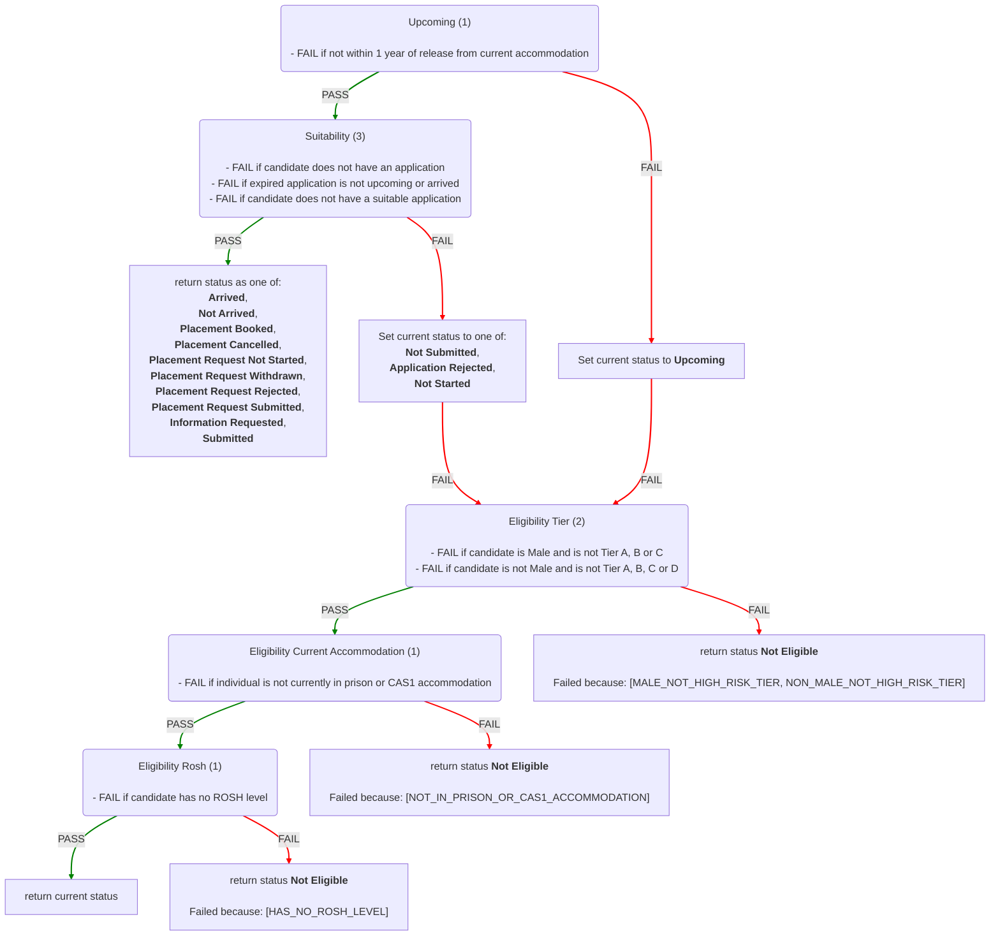
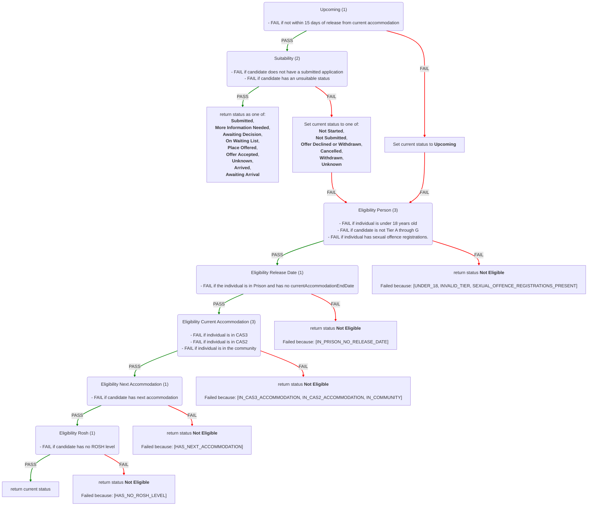
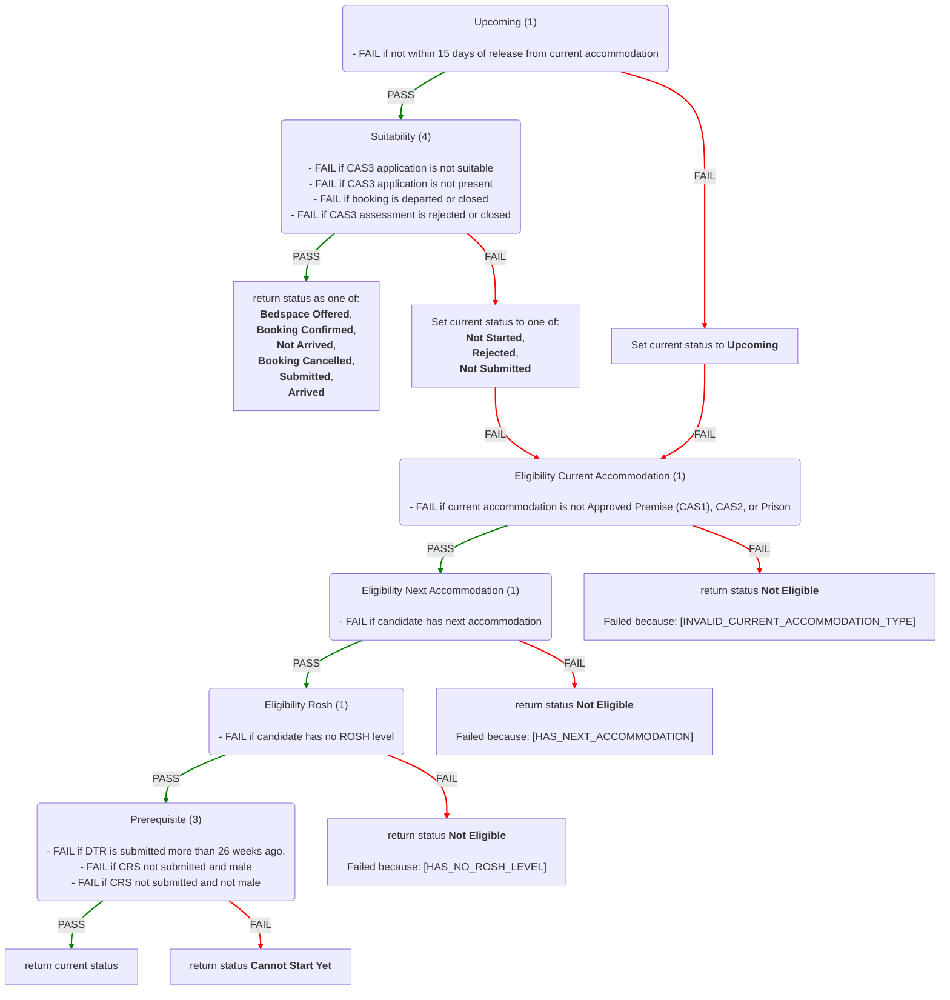
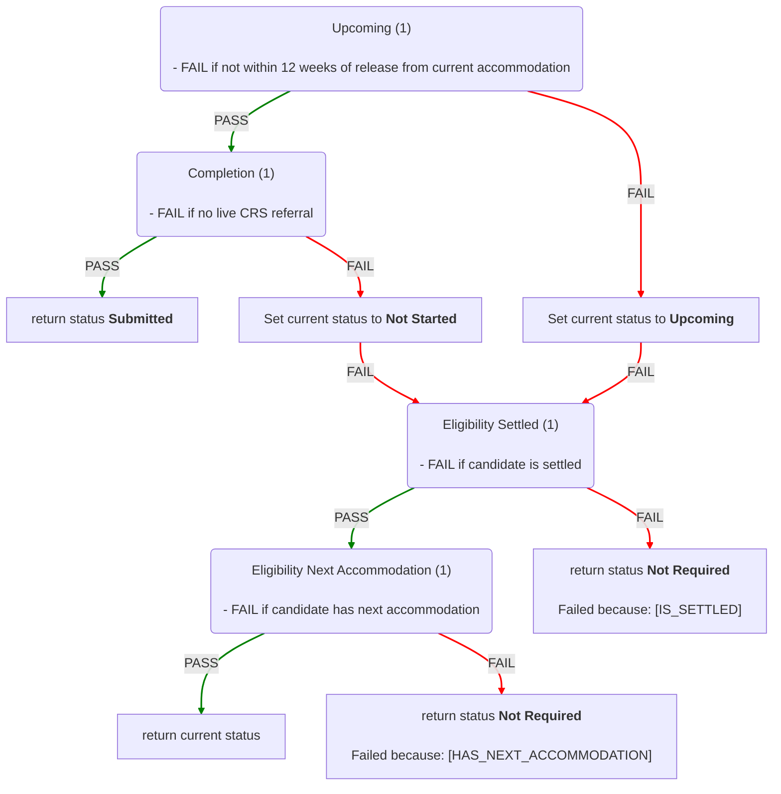
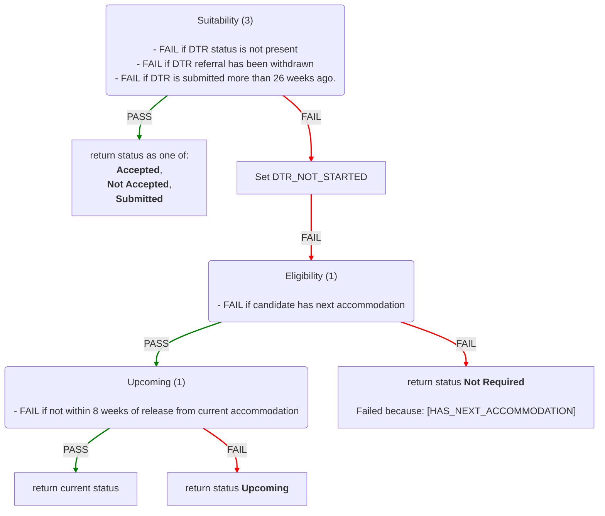
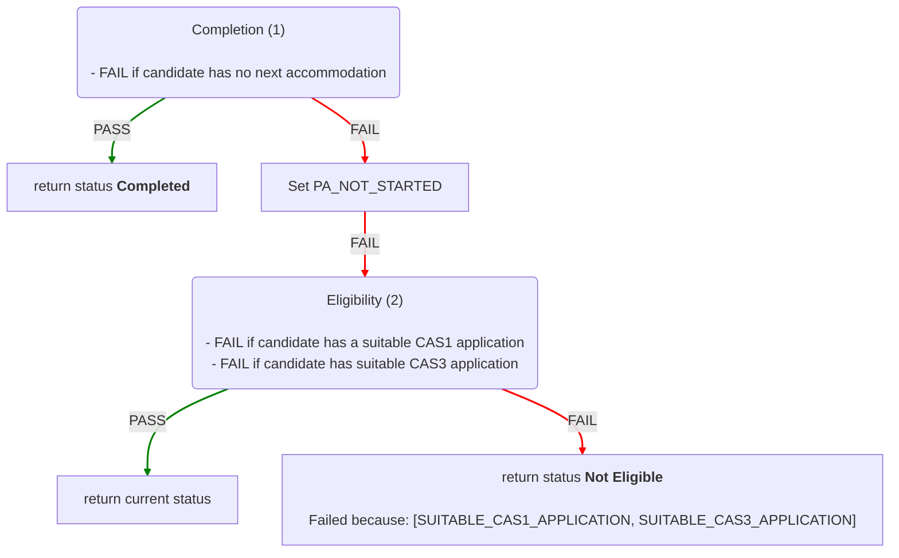

# Eligibility rules graph

Generated by `./gradlew :query:generateEligibilityRulesGraph`. Do not edit by hand.

Diamond RuleSet nodes have a FAIL context updater.

## CAS1

### Nodes

**Upcoming** (RuleSet) `Cas1UpcomingRuleSet`
- [`ReleaseWithinTwentyEightWeeksRule`](../query/src/main/kotlin/uk/gov/justice/digital/hmpps/singleaccommodationserviceapi/query/eligibility/domain/cas1/upcoming/ReleaseWithinTwentyEightWeeksRule.kt): FAIL if not within 1 year of release from current accommodation
- FAIL: [`Cas1UpcomingContextUpdater`](../query/src/main/kotlin/uk/gov/justice/digital/hmpps/singleaccommodationserviceapi/query/eligibility/domain/cas1/upcoming/Cas1UpcomingContextUpdater.kt) - Set current status to Upcoming

| Status | Action | Link type |
| --- | --- | --- |
| CAS1_UPCOMING | START_APPROVED_PREMISE_APPLICATION (CAS1) | - |

**Suitability** (RuleSet) `Cas1SuitabilityRuleSet`
- [`Cas1ApplicationPresentRule`](../query/src/main/kotlin/uk/gov/justice/digital/hmpps/singleaccommodationserviceapi/query/eligibility/domain/cas1/suitability/Cas1ApplicationPresentRule.kt): FAIL if candidate does not have an application
- [`Cas1ApplicationRelevantExpiredRule`](../query/src/main/kotlin/uk/gov/justice/digital/hmpps/singleaccommodationserviceapi/query/eligibility/domain/cas1/suitability/Cas1ApplicationRelevantExpiredRule.kt): FAIL if expired application is not upcoming or arrived
- [`Cas1ApplicationSuitabilityRule`](../query/src/main/kotlin/uk/gov/justice/digital/hmpps/singleaccommodationserviceapi/query/eligibility/domain/cas1/suitability/Cas1ApplicationSuitabilityRule.kt): FAIL if candidate does not have a suitable application
- PASS: [`Cas1CompletionContextUpdater`](../query/src/main/kotlin/uk/gov/justice/digital/hmpps/singleaccommodationserviceapi/query/eligibility/domain/cas1/suitability/Cas1CompletionContextUpdater.kt) - return status as one of:
Arrived,
 Not Arrived,
 Placement Booked,
 Placement Cancelled,
 Placement Request Not Started,
 Placement Request Withdrawn,
 Placement Request Rejected,
 Placement Request Submitted,
 Information Requested,
 Submitted

| Status | Action | Link type |
| --- | --- | --- |
| CAS1_ARRIVED | - | CAS1_VIEW_APPLICATION |
| CAS1_NOT_ARRIVED | CREATE_PLACEMENT (CAS1) | CAS1_VIEW_APPLICATION |
| CAS1_PLACEMENT_BOOKED | - | CAS1_VIEW_APPLICATION |
| CAS1_PLACEMENT_CANCELLED | CREATE_PLACEMENT (CAS1) | CAS1_VIEW_APPLICATION |
| CAS1_PLACEMENT_REQUEST_NOT_STARTED | CREATE_PLACEMENT (CAS1) | CAS1_VIEW_APPLICATION |
| CAS1_PLACEMENT_REQUEST_WITHDRAWN | CREATE_PLACEMENT (CAS1) | CAS1_VIEW_APPLICATION |
| CAS1_PLACEMENT_REQUEST_NOT_SUBMITTED | CREATE_PLACEMENT (CAS1) | CAS1_VIEW_APPLICATION |
| CAS1_PLACEMENT_REQUEST_REJECTED | CREATE_PLACEMENT (CAS1) | CAS1_VIEW_APPLICATION |
| CAS1_PLACEMENT_REQUEST_SUBMITTED | - | CAS1_VIEW_APPLICATION |
| CAS1_INFO_REQUESTED | PROVIDE_INFORMATION (CAS1) | CAS1_VIEW_APPLICATION |
| CAS1_SUBMITTED | - | CAS1_VIEW_APPLICATION |
- FAIL: [`Cas1SuitabilityContextUpdater`](../query/src/main/kotlin/uk/gov/justice/digital/hmpps/singleaccommodationserviceapi/query/eligibility/domain/cas1/suitability/Cas1SuitabilityContextUpdater.kt) - Set current status to one of:
Not Submitted,
 Application Rejected,
 Not Started

| Status | Action | Link type |
| --- | --- | --- |
| CAS1_NOT_SUBMITTED | CONTINUE_APPROVED_PREMISE_APPLICATION (CAS1) | CAS1_VIEW_APPLICATION |
| CAS1_APPLICATION_REJECTED | START_APPROVED_PREMISE_APPLICATION (CAS1) | CAS1_START_APPLICATION |
| CAS1_NOT_STARTED | START_APPROVED_PREMISE_APPLICATION (CAS1) | CAS1_START_APPLICATION |

**Eligibility Tier** (RuleSet) `Cas1EligibilityTierRuleSet`
- [`MaleRiskEligibilityRule`](../query/src/main/kotlin/uk/gov/justice/digital/hmpps/singleaccommodationserviceapi/query/eligibility/domain/cas1/eligibility/MaleRiskEligibilityRule.kt): FAIL if candidate is Male and is not Tier A, B or C
- [`NonMaleRiskEligibilityRule`](../query/src/main/kotlin/uk/gov/justice/digital/hmpps/singleaccommodationserviceapi/query/eligibility/domain/cas1/eligibility/NonMaleRiskEligibilityRule.kt): FAIL if candidate is not Male and is not Tier A, B, C or D

**Eligibility Current Accommodation** (RuleSet) `Cas1EligibilityCurrentAccommodationRuleSet`
- [`CurrentAccommodationIsPrisonOrCas1Rule`](../query/src/main/kotlin/uk/gov/justice/digital/hmpps/singleaccommodationserviceapi/query/eligibility/domain/cas1/eligibility/CurrentAccommodationIsPrisonOrCas1Rule.kt): FAIL if individual is not currently in prison or CAS1 accommodation

**Eligibility Rosh** (RuleSet) `EligibilityRoshRuleSet`
- [`RoshLevelRule`](../query/src/main/kotlin/uk/gov/justice/digital/hmpps/singleaccommodationserviceapi/query/eligibility/domain/common/RoshLevelRule.kt): FAIL if candidate has no ROSH level

**return current status** (Outcome)

**return status Not Eligible** (Outcome) Failed because: [HAS_NO_ROSH_LEVEL]

**return status Not Eligible** (Outcome) Failed because: [NOT_IN_PRISON_OR_CAS1_ACCOMMODATION]

**return status Not Eligible** (Outcome) Failed because: [MALE_NOT_HIGH_RISK_TIER, NON_MALE_NOT_HIGH_RISK_TIER]

## CAS2

### Nodes

**Upcoming** (RuleSet) `Cas2UpcomingRuleSet`
- [`ReleaseWithin15DaysRule`](../query/src/main/kotlin/uk/gov/justice/digital/hmpps/singleaccommodationserviceapi/query/eligibility/domain/common/ReleaseWithin15DaysRule.kt): FAIL if not within 15 days of release from current accommodation
- FAIL: [`Cas2UpcomingContextUpdater`](../query/src/main/kotlin/uk/gov/justice/digital/hmpps/singleaccommodationserviceapi/query/eligibility/domain/cas2/upcoming/Cas2UpcomingContextUpdater.kt) - Set current status to Upcoming

| Status | Action | Link type |
| --- | --- | --- |
| CAS2_UPCOMING | START_CAS2_REFERRAL (CAS2) | - |

**Suitability** (RuleSet) `Cas2SuitabilityRuleSet`
- [`Cas2ApplicationSubmittedRule`](../query/src/main/kotlin/uk/gov/justice/digital/hmpps/singleaccommodationserviceapi/query/eligibility/domain/cas2/suitability/Cas2ApplicationSubmittedRule.kt): FAIL if candidate does not have a submitted application
- [`Cas2SuitableStatusRule`](../query/src/main/kotlin/uk/gov/justice/digital/hmpps/singleaccommodationserviceapi/query/eligibility/domain/cas2/suitability/Cas2SuitableStatusRule.kt): FAIL if candidate has an unsuitable status
- PASS: [`Cas2CompletionContextUpdater`](../query/src/main/kotlin/uk/gov/justice/digital/hmpps/singleaccommodationserviceapi/query/eligibility/domain/cas2/suitability/Cas2CompletionContextUpdater.kt) - return status as one of:
Submitted,
 More Information Needed,
 Awaiting Decision,
 On Waiting List,
 Place Offered,
 Offer Accepted,
 Unknown,
 Arrived,
 Awaiting Arrival

| Status | Action | Link type |
| --- | --- | --- |
| CAS2_SUBMITTED | - | CAS2_VIEW_APPLICATION |
| CAS2_MORE_INFORMATION_NEEDED | PROVIDE_MORE_INFORMATION_FOR_CAS2_REFERRAL (CAS2) | CAS2_VIEW_APPLICATION |
| CAS2_AWAITING_DECISION | - | CAS2_VIEW_APPLICATION |
| CAS2_ON_WAITING_LIST | - | CAS2_VIEW_APPLICATION |
| CAS2_PLACE_OFFERED | REPLY_TO_CAS2_PLACE_OFFER (CAS2) | CAS2_VIEW_APPLICATION |
| CAS2_OFFER_ACCEPTED | - | CAS2_VIEW_APPLICATION |
| CAS2_UNKNOWN | - | - |
| CAS2_ARRIVED | - | CAS2_VIEW_APPLICATION |
| CAS2_AWAITING_ARRIVAL | - | CAS2_VIEW_APPLICATION |
- FAIL: [`Cas2SuitabilityContextUpdater`](../query/src/main/kotlin/uk/gov/justice/digital/hmpps/singleaccommodationserviceapi/query/eligibility/domain/cas2/suitability/Cas2SuitabilityContextUpdater.kt) - Set current status to one of:
Not Started,
 Not Submitted,
 Offer Declined or Withdrawn,
 Cancelled,
 Withdrawn,
 Unknown

| Status | Action | Link type |
| --- | --- | --- |
| CAS2_NOT_STARTED | START_CAS2_REFERRAL (CAS2) | CAS2_START_APPLICATION |
| CAS2_NOT_SUBMITTED | CONTINUE_A_CAS2_REFERRAL (CAS2) | CAS2_VIEW_APPLICATION |
| CAS2_OFFER_DECLINED_OR_WITHDRAWN | - | CAS2_START_APPLICATION |
| CAS2_CANCELLED | - | CAS2_START_APPLICATION |
| CAS2_WITHDRAWN | - | CAS2_START_APPLICATION |
| CAS2_UNKNOWN | - | - |

**Eligibility Person** (RuleSet) `Cas2EligibilityPersonRuleSet`
- [`Under18Rule`](../query/src/main/kotlin/uk/gov/justice/digital/hmpps/singleaccommodationserviceapi/query/eligibility/domain/cas2/eligibility/Under18Rule.kt): FAIL if individual is under 18 years old
- [`SingleLetterTierRule`](../query/src/main/kotlin/uk/gov/justice/digital/hmpps/singleaccommodationserviceapi/query/eligibility/domain/cas2/eligibility/SingleLetterTierRule.kt): FAIL if candidate is not Tier A through G
- [`SexualOffenceRegistrationsRule`](../query/src/main/kotlin/uk/gov/justice/digital/hmpps/singleaccommodationserviceapi/query/eligibility/domain/cas2/eligibility/SexualOffenceRegistrationsRule.kt): FAIL if individual has sexual offence registrations.

**Eligibility Release Date** (RuleSet) `Cas2EligibilityReleaseDateRuleSet`
- [`InPrisonNoReleaseDateRule`](../query/src/main/kotlin/uk/gov/justice/digital/hmpps/singleaccommodationserviceapi/query/eligibility/domain/cas2/eligibility/InPrisonNoReleaseDateRule.kt): FAIL if the individual is in Prison and has no currentAccommodationEndDate

**Eligibility Current Accommodation** (RuleSet) `Cas2EligibilityCurrentAccommodationRuleSet`
- [`CurrentAccommodationTypeIsCas3Rule`](../query/src/main/kotlin/uk/gov/justice/digital/hmpps/singleaccommodationserviceapi/query/eligibility/domain/cas2/eligibility/CurrentAccommodationTypeIsCas3Rule.kt): FAIL if individual is in CAS3
- [`CurrentAccommodationTypeIsCas2Rule`](../query/src/main/kotlin/uk/gov/justice/digital/hmpps/singleaccommodationserviceapi/query/eligibility/domain/cas2/eligibility/CurrentAccommodationTypeIsCas2Rule.kt): FAIL if individual is in CAS2
- [`CurrentAccommodationTypeIsCommunityRule`](../query/src/main/kotlin/uk/gov/justice/digital/hmpps/singleaccommodationserviceapi/query/eligibility/domain/cas2/eligibility/CurrentAccommodationTypeIsCommunityRule.kt): FAIL if individual is in the community

**Eligibility Next Accommodation** (RuleSet) `Cas2EligibilityNextAccommodationRuleSet`
- [`NoNextAccommodationRule`](../query/src/main/kotlin/uk/gov/justice/digital/hmpps/singleaccommodationserviceapi/query/eligibility/domain/common/NoNextAccommodationRule.kt): FAIL if candidate has next accommodation

**Eligibility Rosh** (RuleSet) `EligibilityRoshRuleSet`
- [`RoshLevelRule`](../query/src/main/kotlin/uk/gov/justice/digital/hmpps/singleaccommodationserviceapi/query/eligibility/domain/common/RoshLevelRule.kt): FAIL if candidate has no ROSH level

**return current status** (Outcome)

**return status Not Eligible** (Outcome) Failed because: [HAS_NO_ROSH_LEVEL]

**return status Not Eligible** (Outcome) Failed because: [HAS_NEXT_ACCOMMODATION]

**return status Not Eligible** (Outcome) Failed because: [IN_CAS3_ACCOMMODATION, IN_CAS2_ACCOMMODATION, IN_COMMUNITY]

**return status Not Eligible** (Outcome) Failed because: [IN_PRISON_NO_RELEASE_DATE]

**return status Not Eligible** (Outcome) Failed because: [UNDER_18, INVALID_TIER, SEXUAL_OFFENCE_REGISTRATIONS_PRESENT]

## CAS3

### Nodes

**Upcoming** (RuleSet) `Cas3UpcomingRuleSet`
- [`ReleaseWithin15DaysRule`](../query/src/main/kotlin/uk/gov/justice/digital/hmpps/singleaccommodationserviceapi/query/eligibility/domain/common/ReleaseWithin15DaysRule.kt): FAIL if not within 15 days of release from current accommodation
- FAIL: [`Cas3UpcomingContextUpdater`](../query/src/main/kotlin/uk/gov/justice/digital/hmpps/singleaccommodationserviceapi/query/eligibility/domain/cas3/upcoming/Cas3UpcomingContextUpdater.kt) - Set current status to Upcoming

| Status | Action | Link type |
| --- | --- | --- |
| CAS3_UPCOMING | START_CAS3_REFERRAL (CAS3) | - |

**Suitability** (RuleSet) `Cas3SuitabilityRuleSet`
- [`Cas3ApplicationSuitabilityRule`](../query/src/main/kotlin/uk/gov/justice/digital/hmpps/singleaccommodationserviceapi/query/eligibility/domain/cas3/suitability/Cas3ApplicationSuitabilityRule.kt): FAIL if CAS3 application is not suitable
- [`Cas3ApplicationPresentSuitabilityRule`](../query/src/main/kotlin/uk/gov/justice/digital/hmpps/singleaccommodationserviceapi/query/eligibility/domain/cas3/suitability/Cas3ApplicationPresentSuitabilityRule.kt): FAIL if CAS3 application is not present
- [`Cas3BookingSuitabilityRule`](../query/src/main/kotlin/uk/gov/justice/digital/hmpps/singleaccommodationserviceapi/query/eligibility/domain/cas3/suitability/Cas3BookingSuitabilityRule.kt): FAIL if booking is departed or closed
- [`Cas3AssessmentSuitabilityRule`](../query/src/main/kotlin/uk/gov/justice/digital/hmpps/singleaccommodationserviceapi/query/eligibility/domain/cas3/suitability/Cas3AssessmentSuitabilityRule.kt): FAIL if CAS3 assessment is rejected or closed
- PASS: [`Cas3CompletionContextUpdater`](../query/src/main/kotlin/uk/gov/justice/digital/hmpps/singleaccommodationserviceapi/query/eligibility/domain/cas3/suitability/Cas3CompletionContextUpdater.kt) - return status as one of:
Bedspace Offered,
 Booking Confirmed,
 Not Arrived,
 Booking Cancelled,
 Submitted,
 Arrived

| Status | Action | Link type |
| --- | --- | --- |
| CAS3_BEDSPACE_OFFERED | REPLY_TO_CAS3_BEDSPACE_OFFER (CAS3) | CAS3_VIEW_REFERRAL |
| CAS3_BOOKING_CONFIRMED | - | CAS3_VIEW_REFERRAL |
| CAS3_NOT_ARRIVED | - | CAS3_VIEW_REFERRAL |
| CAS3_BOOKING_CANCELLED | - | CAS3_VIEW_REFERRAL |
| CAS3_SUBMITTED | - | CAS3_VIEW_REFERRAL |
| CAS3_ARRIVED | - | CAS3_VIEW_REFERRAL |
- FAIL: [`Cas3SuitabilityContextUpdater`](../query/src/main/kotlin/uk/gov/justice/digital/hmpps/singleaccommodationserviceapi/query/eligibility/domain/cas3/suitability/Cas3SuitabilityContextUpdater.kt) - Set current status to one of:
Not Started,
 Rejected,
 Not Submitted

| Status | Action | Link type |
| --- | --- | --- |
| CAS3_NOT_STARTED_NEW | START_CAS3_REFERRAL (CAS3) | CAS3_START_REFERRAL |
| CAS3_REJECTED | START_CAS3_REFERRAL (CAS3) | CAS3_START_REFERRAL |
| CAS3_NOT_SUBMITTED | CONTINUE_CAS3_REFERRAL (CAS3) | CAS3_VIEW_REFERRAL |
| CAS3_NOT_STARTED | START_CAS3_REFERRAL (CAS3) | CAS3_START_REFERRAL |

**Eligibility Current Accommodation** (RuleSet) `Cas3EligibilityCurrentAccommodationRuleSet`
- [`CurrentAccommodationTypeRule`](../query/src/main/kotlin/uk/gov/justice/digital/hmpps/singleaccommodationserviceapi/query/eligibility/domain/cas3/eligibility/CurrentAccommodationTypeRule.kt): FAIL if current accommodation is not Approved Premise (CAS1), CAS2, or Prison

**Eligibility Next Accommodation** (RuleSet) `Cas3EligibilityNextAccommodationRuleSet`
- [`NoNextAccommodationRule`](../query/src/main/kotlin/uk/gov/justice/digital/hmpps/singleaccommodationserviceapi/query/eligibility/domain/common/NoNextAccommodationRule.kt): FAIL if candidate has next accommodation

**Eligibility Rosh** (RuleSet) `EligibilityRoshRuleSet`
- [`RoshLevelRule`](../query/src/main/kotlin/uk/gov/justice/digital/hmpps/singleaccommodationserviceapi/query/eligibility/domain/common/RoshLevelRule.kt): FAIL if candidate has no ROSH level

**Prerequisite** (RuleSet) `Cas3PrerequisiteRuleSet`
- [`DtrExpiredReferralRule`](../query/src/main/kotlin/uk/gov/justice/digital/hmpps/singleaccommodationserviceapi/query/eligibility/domain/common/DtrExpiredReferralRule.kt): FAIL if DTR is submitted more than 26 weeks ago.
- [`CrsSubmittedRuleMale`](../query/src/main/kotlin/uk/gov/justice/digital/hmpps/singleaccommodationserviceapi/query/eligibility/domain/cas3/prerequisite/CrsSubmittedRuleMale.kt): FAIL if CRS not submitted and male
- [`CrsSubmittedRuleNonMale`](../query/src/main/kotlin/uk/gov/justice/digital/hmpps/singleaccommodationserviceapi/query/eligibility/domain/cas3/prerequisite/CrsSubmittedRuleNonMale.kt): FAIL if CRS not submitted and not male
- FAIL: [`Cas3PrerequisiteContextUpdater`](../query/src/main/kotlin/uk/gov/justice/digital/hmpps/singleaccommodationserviceapi/query/eligibility/domain/cas3/prerequisite/Cas3PrerequisiteContextUpdater.kt) - return status Cannot Start Yet

| Status | Action | Link type | Blocking reason |
| --- | --- | --- | --- |
| CAS3_CANNOT_START_YET_SUBMIT_DTR_CRS_ACCOMMODATION | - | - | SUBMIT_DTR_AND_CRS_ACCOMMODATION_BEFORE_CAS3 |
| CAS3_CANNOT_START_YET_SUBMIT_DTR_CRS | - | - | SUBMIT_DTR_AND_CRS_BEFORE_CAS3 |
| CAS3_CANNOT_START_YET_SUBMIT_CRS_ACCOMMODATION | - | - | SUBMIT_CRS_ACCOMMODATION_BEFORE_CAS3 |
| CAS3_CANNOT_START_YET_SUBMIT_CRS | - | - | SUBMIT_CRS_BEFORE_CAS3 |
| CAS3_CANNOT_START_YET_SUBMIT_DTR | - | - | SUBMIT_DTR_BEFORE_CAS3 |

**return current status** (Outcome)

**return status Not Eligible** (Outcome) Failed because: [HAS_NO_ROSH_LEVEL]

**return status Not Eligible** (Outcome) Failed because: [HAS_NEXT_ACCOMMODATION]

**return status Not Eligible** (Outcome) Failed because: [INVALID_CURRENT_ACCOMMODATION_TYPE]

## CRS

### Nodes

**Upcoming** (RuleSet) `CrsUpcomingRuleSet`
- [`CrsUpcomingRule`](../query/src/main/kotlin/uk/gov/justice/digital/hmpps/singleaccommodationserviceapi/query/eligibility/domain/crs/upcoming/CrsUpcomingRule.kt): FAIL if not within 12 weeks of release from current accommodation
- FAIL: [`CrsUpcomingContextUpdater`](../query/src/main/kotlin/uk/gov/justice/digital/hmpps/singleaccommodationserviceapi/query/eligibility/domain/crs/upcoming/CrsUpcomingContextUpdater.kt) - Set current status to Upcoming

| Status | Action | Link type |
| --- | --- | --- |
| CRS_UPCOMING_ACCOMMODATION_REFERRAL | SUBMIT_CRS_ACCOMMODATION_REFERRAL (CRS) | - |
| CRS_UPCOMING_REFERRAL | SUBMIT_CRS_REFERRAL (CRS) | - |

**Completion** (RuleSet) `CrsCompletionRuleSet`
- [`CrsSubmittedRule`](../query/src/main/kotlin/uk/gov/justice/digital/hmpps/singleaccommodationserviceapi/query/eligibility/domain/crs/completion/CrsSubmittedRule.kt): FAIL if no live CRS referral
- FAIL: [`CrsCompletionContextUpdater`](../query/src/main/kotlin/uk/gov/justice/digital/hmpps/singleaccommodationserviceapi/query/eligibility/domain/crs/completion/CrsCompletionContextUpdater.kt) - Set current status to Not Started

| Status | Action | Link type |
| --- | --- | --- |
| CRS_NOT_STARTED_ACCOMMODATION_REFERRAL | SUBMIT_CRS_ACCOMMODATION_REFERRAL (CRS) | - |
| CRS_NOT_STARTED_REFERRAL | SUBMIT_CRS_REFERRAL (CRS) | - |

**return status Submitted** (Outcome)

**Eligibility Settled** (RuleSet) `CrsEligibilitySettledRuleSet`
- [`IsSettledRule`](../query/src/main/kotlin/uk/gov/justice/digital/hmpps/singleaccommodationserviceapi/query/eligibility/domain/crs/eligibility/IsSettledRule.kt): FAIL if candidate is settled

**Eligibility Next Accommodation** (RuleSet) `CrsEligibilityNextAccommodationRuleSet`
- [`NoNextAccommodationRule`](../query/src/main/kotlin/uk/gov/justice/digital/hmpps/singleaccommodationserviceapi/query/eligibility/domain/common/NoNextAccommodationRule.kt): FAIL if candidate has next accommodation

**return current status** (Outcome)

**return status Not Required** (Outcome) Failed because: [HAS_NEXT_ACCOMMODATION]

**return status Not Required** (Outcome) Failed because: [IS_SETTLED]

## DTR

### Nodes

**Suitability** (RuleSet) `DtrSuitabilityRuleSet`
- [`DtrPresentRule`](../query/src/main/kotlin/uk/gov/justice/digital/hmpps/singleaccommodationserviceapi/query/eligibility/domain/dtr/suitability/DtrPresentRule.kt): FAIL if DTR status is not present
- [`DtrNotWithdrawnRule`](../query/src/main/kotlin/uk/gov/justice/digital/hmpps/singleaccommodationserviceapi/query/eligibility/domain/dtr/suitability/DtrNotWithdrawnRule.kt): FAIL if DTR referral has been withdrawn
- [`DtrExpiredReferralRule`](../query/src/main/kotlin/uk/gov/justice/digital/hmpps/singleaccommodationserviceapi/query/eligibility/domain/common/DtrExpiredReferralRule.kt): FAIL if DTR is submitted more than 26 weeks ago.
- PASS: [`DtrCompletionContextUpdater`](../query/src/main/kotlin/uk/gov/justice/digital/hmpps/singleaccommodationserviceapi/query/eligibility/domain/dtr/suitability/DtrCompletionContextUpdater.kt) - return status as one of:
Accepted,
 Not Accepted,
 Submitted

| Status | Action | Link type |
| --- | --- | --- |
| DTR_ACCEPTED | - | - |
| DTR_NOT_ACCEPTED | - | - |
| DTR_SUBMITTED | ADD_DTR_OUTCOME (DTR) | - |
- FAIL: Set DTR_NOT_STARTED

| Status | Action | Link type |
| --- | --- | --- |
| DTR_NOT_STARTED | ADD_DTR_REFERRAL_DETAILS (DTR) | - |

**Eligibility** (RuleSet) `DtrEligibilityRuleSet`
- [`NoNextAccommodationRule`](../query/src/main/kotlin/uk/gov/justice/digital/hmpps/singleaccommodationserviceapi/query/eligibility/domain/common/NoNextAccommodationRule.kt): FAIL if candidate has next accommodation

**Upcoming** (RuleSet) `DtrUpcomingRuleSet`
- [`ReleaseWithinEightWeeksRule`](../query/src/main/kotlin/uk/gov/justice/digital/hmpps/singleaccommodationserviceapi/query/eligibility/domain/dtr/upcoming/ReleaseWithinEightWeeksRule.kt): FAIL if not within 8 weeks of release from current accommodation
- FAIL: [`DtrUpcomingContextUpdater`](../query/src/main/kotlin/uk/gov/justice/digital/hmpps/singleaccommodationserviceapi/query/eligibility/domain/dtr/upcoming/DtrUpcomingContextUpdater.kt) - return status Upcoming

| Status | Action | Link type |
| --- | --- | --- |
| DTR_UPCOMING | SUBMIT_DTR_REFERRAL (DTR) | - |

**return current status** (Outcome)

**return status Not Required** (Outcome) Failed because: [HAS_NEXT_ACCOMMODATION]

## PA

### Nodes

**Completion** (RuleSet) `PaCompletionRuleSet`
- [`HasNextAccommodationRule`](../query/src/main/kotlin/uk/gov/justice/digital/hmpps/singleaccommodationserviceapi/query/eligibility/domain/pa/completion/HasNextAccommodationRule.kt): FAIL if candidate has no next accommodation
- FAIL: Set PA_NOT_STARTED

| Status | Action | Link type |
| --- | --- | --- |
| PA_NOT_STARTED | ADD_AND_CONFIRM_PROPOSED_ADDRESS (PA) | - |

**return status Completed** (Outcome)

**Eligibility** (RuleSet) `PaEligibilityRuleSet`
- [`Cas1ApplicationNotSuitableRule`](../query/src/main/kotlin/uk/gov/justice/digital/hmpps/singleaccommodationserviceapi/query/eligibility/domain/pa/eligibility/Cas1ApplicationNotSuitableRule.kt): FAIL if candidate has a suitable CAS1 application
- [`Cas3ApplicationNotSuitableRule`](../query/src/main/kotlin/uk/gov/justice/digital/hmpps/singleaccommodationserviceapi/query/eligibility/domain/pa/eligibility/Cas3ApplicationNotSuitableRule.kt): FAIL if candidate has suitable CAS3 application

**return current status** (Outcome)

**return status Not Eligible** (Outcome) Failed because: [SUITABLE_CAS1_APPLICATION, SUITABLE_CAS3_APPLICATION]

## Rule catalogue

| Rule | Description | RuleSets | Trees |
| --- | --- | --- | --- |
| Cas1ApplicationNotSuitableRule | FAIL if candidate has a suitable CAS1 application | Eligibility | PA |
| Cas1ApplicationPresentRule | FAIL if candidate does not have an application | Suitability | CAS1 |
| Cas1ApplicationRelevantExpiredRule | FAIL if expired application is not upcoming or arrived | Suitability | CAS1 |
| Cas1ApplicationSuitabilityRule | FAIL if candidate does not have a suitable application | Suitability | CAS1 |
| Cas2ApplicationSubmittedRule | FAIL if candidate does not have a submitted application | Suitability | CAS2 |
| Cas2SuitableStatusRule | FAIL if candidate has an unsuitable status | Suitability | CAS2 |
| Cas3ApplicationNotSuitableRule | FAIL if candidate has suitable CAS3 application | Eligibility | PA |
| Cas3ApplicationPresentSuitabilityRule | FAIL if CAS3 application is not present | Suitability | CAS3 |
| Cas3ApplicationSuitabilityRule | FAIL if CAS3 application is not suitable | Suitability | CAS3 |
| Cas3AssessmentSuitabilityRule | FAIL if CAS3 assessment is rejected or closed | Suitability | CAS3 |
| Cas3BookingSuitabilityRule | FAIL if booking is departed or closed | Suitability | CAS3 |
| CrsSubmittedRule | FAIL if no live CRS referral | Completion | CRS |
| CrsSubmittedRuleMale | FAIL if CRS not submitted and male | Prerequisite | CAS3 |
| CrsSubmittedRuleNonMale | FAIL if CRS not submitted and not male | Prerequisite | CAS3 |
| CrsUpcomingRule | FAIL if not within 12 weeks of release from current accommodation | Upcoming | CRS |
| CurrentAccommodationIsPrisonOrCas1Rule | FAIL if individual is not currently in prison or CAS1 accommodation | Eligibility Current Accommodation | CAS1 |
| CurrentAccommodationTypeIsCas2Rule | FAIL if individual is in CAS2 | Eligibility Current Accommodation | CAS2 |
| CurrentAccommodationTypeIsCas3Rule | FAIL if individual is in CAS3 | Eligibility Current Accommodation | CAS2 |
| CurrentAccommodationTypeIsCommunityRule | FAIL if individual is in the community | Eligibility Current Accommodation | CAS2 |
| CurrentAccommodationTypeRule | FAIL if current accommodation is not Approved Premise (CAS1), CAS2, or Prison | Eligibility Current Accommodation | CAS3 |
| DtrExpiredReferralRule | FAIL if DTR is submitted more than 26 weeks ago. | Prerequisite, Suitability | CAS3, DTR |
| DtrNotWithdrawnRule | FAIL if DTR referral has been withdrawn | Suitability | DTR |
| DtrPresentRule | FAIL if DTR status is not present | Suitability | DTR |
| HasNextAccommodationRule | FAIL if candidate has no next accommodation | Completion | PA |
| InPrisonNoReleaseDateRule | FAIL if the individual is in Prison and has no currentAccommodationEndDate | Eligibility Release Date | CAS2 |
| IsSettledRule | FAIL if candidate is settled | Eligibility Settled | CRS |
| MaleRiskEligibilityRule | FAIL if candidate is Male and is not Tier A, B or C | Eligibility Tier | CAS1 |
| NoNextAccommodationRule | FAIL if candidate has next accommodation | Eligibility, Eligibility Next Accommodation | CAS2, CAS3, CRS, DTR |
| NonMaleRiskEligibilityRule | FAIL if candidate is not Male and is not Tier A, B, C or D | Eligibility Tier | CAS1 |
| ReleaseWithin15DaysRule | FAIL if not within 15 days of release from current accommodation | Upcoming | CAS2, CAS3 |
| ReleaseWithinEightWeeksRule | FAIL if not within 8 weeks of release from current accommodation | Upcoming | DTR |
| ReleaseWithinTwentyEightWeeksRule | FAIL if not within 1 year of release from current accommodation | Upcoming | CAS1 |
| RoshLevelRule | FAIL if candidate has no ROSH level | Eligibility Rosh | CAS1, CAS2, CAS3 |
| SexualOffenceRegistrationsRule | FAIL if individual has sexual offence registrations. | Eligibility Person | CAS2 |
| SingleLetterTierRule | FAIL if candidate is not Tier A through G | Eligibility Person | CAS2 |
| Under18Rule | FAIL if individual is under 18 years old | Eligibility Person | CAS2 |

## Context updater catalogue

return status as one of:
Arrived,
 Not Arrived,
 Placement Booked,
 Placement Cancelled,
 Placement Request Not Started,
 Placement Request Withdrawn,
 Placement Request Rejected,
 Placement Request Submitted,
 Information Requested,
 Submitted

Used by: Suitability (CAS1) on pass

| Status | Action | Link type |
| --- | --- | --- |
| CAS1_ARRIVED | - | CAS1_VIEW_APPLICATION |
| CAS1_NOT_ARRIVED | CREATE_PLACEMENT (CAS1) | CAS1_VIEW_APPLICATION |
| CAS1_PLACEMENT_BOOKED | - | CAS1_VIEW_APPLICATION |
| CAS1_PLACEMENT_CANCELLED | CREATE_PLACEMENT (CAS1) | CAS1_VIEW_APPLICATION |
| CAS1_PLACEMENT_REQUEST_NOT_STARTED | CREATE_PLACEMENT (CAS1) | CAS1_VIEW_APPLICATION |
| CAS1_PLACEMENT_REQUEST_WITHDRAWN | CREATE_PLACEMENT (CAS1) | CAS1_VIEW_APPLICATION |
| CAS1_PLACEMENT_REQUEST_NOT_SUBMITTED | CREATE_PLACEMENT (CAS1) | CAS1_VIEW_APPLICATION |
| CAS1_PLACEMENT_REQUEST_REJECTED | CREATE_PLACEMENT (CAS1) | CAS1_VIEW_APPLICATION |
| CAS1_PLACEMENT_REQUEST_SUBMITTED | - | CAS1_VIEW_APPLICATION |
| CAS1_INFO_REQUESTED | PROVIDE_INFORMATION (CAS1) | CAS1_VIEW_APPLICATION |
| CAS1_SUBMITTED | - | CAS1_VIEW_APPLICATION |

Set current status to one of:
Not Submitted,
 Application Rejected,
 Not Started

Used by: Suitability (CAS1) on fail

| Status | Action | Link type |
| --- | --- | --- |
| CAS1_NOT_SUBMITTED | CONTINUE_APPROVED_PREMISE_APPLICATION (CAS1) | CAS1_VIEW_APPLICATION |
| CAS1_APPLICATION_REJECTED | START_APPROVED_PREMISE_APPLICATION (CAS1) | CAS1_START_APPLICATION |
| CAS1_NOT_STARTED | START_APPROVED_PREMISE_APPLICATION (CAS1) | CAS1_START_APPLICATION |

Set current status to Upcoming

Used by: Upcoming (CAS1) on fail

| Status | Action | Link type |
| --- | --- | --- |
| CAS1_UPCOMING | START_APPROVED_PREMISE_APPLICATION (CAS1) | - |

return status as one of:
Submitted,
 More Information Needed,
 Awaiting Decision,
 On Waiting List,
 Place Offered,
 Offer Accepted,
 Unknown,
 Arrived,
 Awaiting Arrival

Used by: Suitability (CAS2) on pass

| Status | Action | Link type |
| --- | --- | --- |
| CAS2_SUBMITTED | - | CAS2_VIEW_APPLICATION |
| CAS2_MORE_INFORMATION_NEEDED | PROVIDE_MORE_INFORMATION_FOR_CAS2_REFERRAL (CAS2) | CAS2_VIEW_APPLICATION |
| CAS2_AWAITING_DECISION | - | CAS2_VIEW_APPLICATION |
| CAS2_ON_WAITING_LIST | - | CAS2_VIEW_APPLICATION |
| CAS2_PLACE_OFFERED | REPLY_TO_CAS2_PLACE_OFFER (CAS2) | CAS2_VIEW_APPLICATION |
| CAS2_OFFER_ACCEPTED | - | CAS2_VIEW_APPLICATION |
| CAS2_UNKNOWN | - | - |
| CAS2_ARRIVED | - | CAS2_VIEW_APPLICATION |
| CAS2_AWAITING_ARRIVAL | - | CAS2_VIEW_APPLICATION |

Set current status to one of:
Not Started,
 Not Submitted,
 Offer Declined or Withdrawn,
 Cancelled,
 Withdrawn,
 Unknown

Used by: Suitability (CAS2) on fail

| Status | Action | Link type |
| --- | --- | --- |
| CAS2_NOT_STARTED | START_CAS2_REFERRAL (CAS2) | CAS2_START_APPLICATION |
| CAS2_NOT_SUBMITTED | CONTINUE_A_CAS2_REFERRAL (CAS2) | CAS2_VIEW_APPLICATION |
| CAS2_OFFER_DECLINED_OR_WITHDRAWN | - | CAS2_START_APPLICATION |
| CAS2_CANCELLED | - | CAS2_START_APPLICATION |
| CAS2_WITHDRAWN | - | CAS2_START_APPLICATION |
| CAS2_UNKNOWN | - | - |

Set current status to Upcoming

Used by: Upcoming (CAS2) on fail

| Status | Action | Link type |
| --- | --- | --- |
| CAS2_UPCOMING | START_CAS2_REFERRAL (CAS2) | - |

return status as one of:
Bedspace Offered,
 Booking Confirmed,
 Not Arrived,
 Booking Cancelled,
 Submitted,
 Arrived

Used by: Suitability (CAS3) on pass

| Status | Action | Link type |
| --- | --- | --- |
| CAS3_BEDSPACE_OFFERED | REPLY_TO_CAS3_BEDSPACE_OFFER (CAS3) | CAS3_VIEW_REFERRAL |
| CAS3_BOOKING_CONFIRMED | - | CAS3_VIEW_REFERRAL |
| CAS3_NOT_ARRIVED | - | CAS3_VIEW_REFERRAL |
| CAS3_BOOKING_CANCELLED | - | CAS3_VIEW_REFERRAL |
| CAS3_SUBMITTED | - | CAS3_VIEW_REFERRAL |
| CAS3_ARRIVED | - | CAS3_VIEW_REFERRAL |

return status Cannot Start Yet

Used by: Prerequisite (CAS3) on fail

| Status | Action | Link type | Blocking reason |
| --- | --- | --- | --- |
| CAS3_CANNOT_START_YET_SUBMIT_DTR_CRS_ACCOMMODATION | - | - | SUBMIT_DTR_AND_CRS_ACCOMMODATION_BEFORE_CAS3 |
| CAS3_CANNOT_START_YET_SUBMIT_DTR_CRS | - | - | SUBMIT_DTR_AND_CRS_BEFORE_CAS3 |
| CAS3_CANNOT_START_YET_SUBMIT_CRS_ACCOMMODATION | - | - | SUBMIT_CRS_ACCOMMODATION_BEFORE_CAS3 |
| CAS3_CANNOT_START_YET_SUBMIT_CRS | - | - | SUBMIT_CRS_BEFORE_CAS3 |
| CAS3_CANNOT_START_YET_SUBMIT_DTR | - | - | SUBMIT_DTR_BEFORE_CAS3 |

Set current status to one of:
Not Started,
 Rejected,
 Not Submitted

Used by: Suitability (CAS3) on fail

| Status | Action | Link type |
| --- | --- | --- |
| CAS3_NOT_STARTED_NEW | START_CAS3_REFERRAL (CAS3) | CAS3_START_REFERRAL |
| CAS3_REJECTED | START_CAS3_REFERRAL (CAS3) | CAS3_START_REFERRAL |
| CAS3_NOT_SUBMITTED | CONTINUE_CAS3_REFERRAL (CAS3) | CAS3_VIEW_REFERRAL |
| CAS3_NOT_STARTED | START_CAS3_REFERRAL (CAS3) | CAS3_START_REFERRAL |

Set current status to Upcoming

Used by: Upcoming (CAS3) on fail

| Status | Action | Link type |
| --- | --- | --- |
| CAS3_UPCOMING | START_CAS3_REFERRAL (CAS3) | - |

Set current status to Not Started

Used by: Completion (CRS) on fail

| Status | Action | Link type |
| --- | --- | --- |
| CRS_NOT_STARTED_ACCOMMODATION_REFERRAL | SUBMIT_CRS_ACCOMMODATION_REFERRAL (CRS) | - |
| CRS_NOT_STARTED_REFERRAL | SUBMIT_CRS_REFERRAL (CRS) | - |

Set current status to Upcoming

Used by: Upcoming (CRS) on fail

| Status | Action | Link type |
| --- | --- | --- |
| CRS_UPCOMING_ACCOMMODATION_REFERRAL | SUBMIT_CRS_ACCOMMODATION_REFERRAL (CRS) | - |
| CRS_UPCOMING_REFERRAL | SUBMIT_CRS_REFERRAL (CRS) | - |

return status as one of:
Accepted,
 Not Accepted,
 Submitted

Used by: Suitability (DTR) on pass

| Status | Action | Link type |
| --- | --- | --- |
| DTR_ACCEPTED | - | - |
| DTR_NOT_ACCEPTED | - | - |
| DTR_SUBMITTED | ADD_DTR_OUTCOME (DTR) | - |

return status Upcoming

Used by: Upcoming (DTR) on fail

| Status | Action | Link type |
| --- | --- | --- |
| DTR_UPCOMING | SUBMIT_DTR_REFERRAL (DTR) | - |

Set PA_NOT_STARTED

Used by: Completion (PA) on fail

| Status | Action | Link type |
| --- | --- | --- |
| PA_NOT_STARTED | ADD_AND_CONFIRM_PROPOSED_ADDRESS (PA) | - |

Set DTR_NOT_STARTED

Used by: Suitability (DTR) on fail

| Status | Action | Link type |
| --- | --- | --- |
| DTR_NOT_STARTED | ADD_DTR_REFERRAL_DETAILS (DTR) | - |

