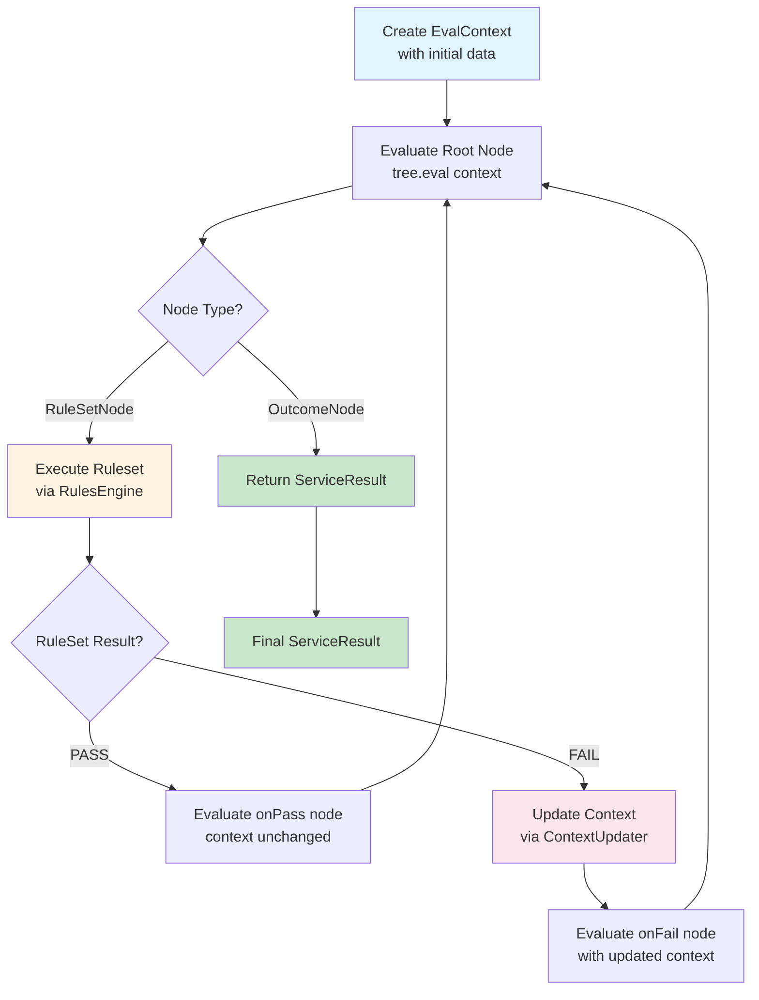
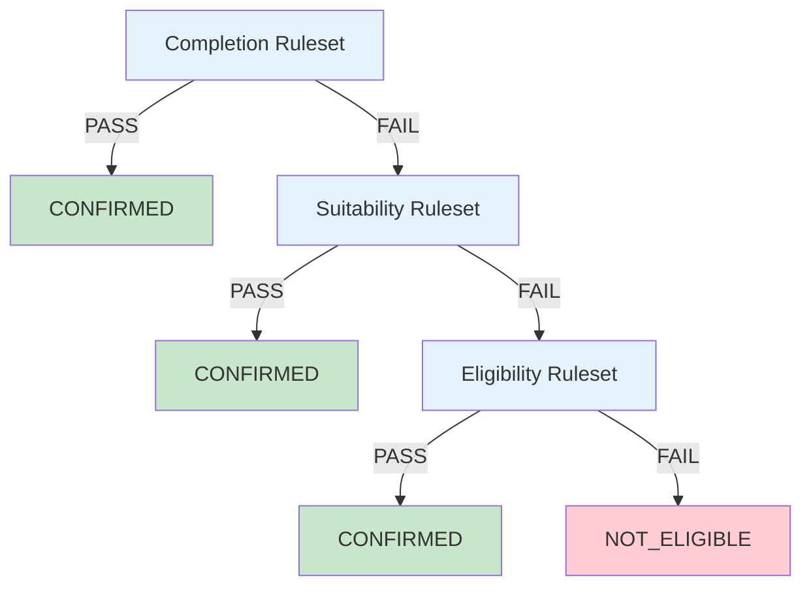

# Decision Tree Model

A declarative, clean architecture for evaluating eligibility rules using an explicit decision tree pattern. With an
attempt to separate

- orchestration
- execution
- and analysis concerns

The goal being to make rule evaluation, testable, and extensible

## Overview

The decision was made to favour an explicit tree structure over a recursive model because:

- **Developers can focus on building logical nodes and outcomes**
- **Each node executes a ruleset and explicity branches based on results**
- **Context updates are separated from tree traversal, seperating node outcome from context update**

## Key Concepts

### Decision Tree Structure

A decision tree is composed of two types of nodes:

1. **RuleSetNode**: Executes a ruleset and branches to different nodes based on PASS/FAIL
2. **OutcomeNode**: Terminal node that returns a final `ServiceResult`

### Evaluation Context

`EvaluationContext<D>` carries state through tree traversal:

- `data`: The domain data (prisoner info, applications, etc.)
- `current`: The current best-known `ServiceResult` (status, actions, application ID) etc

### Service-specific inputs

Each tree accepts its own input type: `Cas1DomainData`, `Cas2DomainData`, `Cas3DomainData`,
`CrsDomainData`, `DtrDomainData` or `PaDomainData`. These contain only that service's inputs.
For example, CAS1 has tier, sex, RoSH, current accommodation and CAS1 application data; CAS3 also
needs DTR and CRS referrals for its prerequisites, but does not need tier or date of birth.

`DomainDataFactory` still aggregates upstream data once into `DomainData`. `EligibilityService`
uses the `toCas1DomainData()` and equivalent projections before evaluating each tree. These are
explicit mappings, not casts; null values and existing precomputed application outcomes are preserved.

Rules consume focused interfaces from `DomainDataInputs.kt`, such as `TierData` or
`CurrentAccommodationData`, rather than the aggregate `DomainData`. Combined interfaces describe
ruleset requirements spanning several inputs, such as `Cas3PrerequisiteData`.

`Rule<in D>`, `RuleSet<in D>` and `ContextUpdater<in D>` allow shared components to be used by
any service data type implementing their required interface. `DecisionTreeBuilder<D>` and
`EligibilityTreeProvider<D>` retain the service's type throughout the tree. Adding an incompatible
rule, ruleset or updater is a compile-time error. If a tree genuinely needs a new input, extend its
data class and projection deliberately rather than supplying unrelated service data.

Tree providers receive the shared `RulesEngine` and create their own typed builder. Providers for
CAS1, CAS2 and CAS3 also expose their application URL from their typed inputs, so deep-link
resolution does not need the aggregate domain data.

### Context Updaters

`ContextUpdater` implementations handle the analysis/mapping logic:

- Transform `RuleSetResult` into updated `ServiceResult`
- Extract business logic from tree traversal

## How It Works

### Tree Evaluation Flow



**Step-by-step process:**

1. **Start**: Create `EvalContext` with initial domain data and default `ServiceResult`
2. **Evaluate Root Node**: Call `tree.eval(initialContext)`
3. **RuleSetNode Execution**:
    - Execute ruleset using `RulesEngine`
    - If **PASS**: Evaluate `onPass` node with current context (unchanged)
    - If **FAIL**: Update context using `ContextUpdater`, then evaluate `onFail` node
4. **OutcomeNode**: Return final `ServiceResult`

### Example: CAS1 Tree Structure



## Usage Examples

### Building a Chain Tree (CAS1)

```kotlin
val treeBuilder = DecisionTreeBuilder<Cas1DomainData>(engine)
val contextUpdater = Cas1ContextUpdater()

val confirmed = treeBuilder.confirmed()
val notEligible = treeBuilder.notEligible(ServiceType.CAS1)

// Build from bottom up (last → first)
val eligibility = treeBuilder
    .ruleSet(eligibilityRuleSet)
    .applyContextUpdaterOnFailure(contextUpdater)
    .onPass(confirmed)
    .onFail(notEligible)
    .build()

val suitability = treeBuilder
    .ruleSet(suitabilityRuleSet)
    .applyContextUpdaterOnFailure(contextUpdater)
    .onPass(confirmed)
    .onFail(eligibility)
    .build()

val tree = treeBuilder
    .ruleSet(completionRuleSet)
    .applyContextUpdaterOnFailure(contextUpdater)
    .onPass(confirmed)
    .onFail(suitability)
    .build()
```

### Custom Outcome

```kotlin
val customOutcome = treeBuilder.outcome(
    ServiceResult(
        serviceStatus = ServiceStatus.REJECTED,
        suitableApplicationId = null,
        actions = listOf("Something")
    )
)

val tree = treeBuilder
    .ruleSet(myRuleSet)
    .applyContextUpdaterOnFailure(myContextUpdater)
    .onPass(customOutcome)
    .onFail(treeBuilder.notEligible(ServiceType.CAS1))
    .build()
```

## Design Decisions

### Domain-data tables in the rules graph

Each `Rule` declares its `inputFields` using `DomainDataField` values, for example
`override val inputFields = setOf(DomainDataField.TIER_SCORE)`. Context updaters that read domain
data also override `inputFields`; constant updaters use the default empty set. Declare inputs that
affect decisions or returned values, not identifiers used only for links or logging.

`RulesGraphWalker` collects the declarations from the actual rulesets and their context updaters.
The HTML table uses their union, including availability rows for nullable parent objects, with
duplicates removed. Adding or removing a rule or ruleset therefore updates the relevant service's
table when the graph is regenerated; there are no per-service field lists to maintain.

When adding a genuinely new input, add a `DomainDataField` entry and its label/options to
`DomainDataFieldCatalog`. The exhaustive catalogue mapping requires an entry for every field.
When changing what an existing rule or updater reads, update its `inputFields` too.
These declarations are documentation metadata only; they do not execute or replace business rules.

Regenerate the HTML with `./gradlew :query:generateEligibilityRulesGraphs --no-daemon`.

### PASS vs FAIL Behavior

Context is only updated when a ruleset fails. This ensures:

- PASS results return immediately with the current "best known" state
- FAIL results update state before continuing to next ruleset